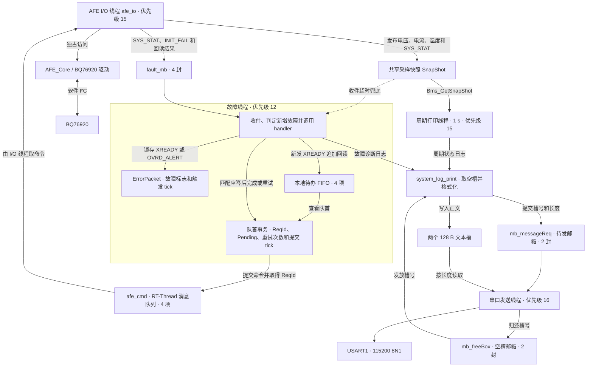

# 记录手册

用于持续记录本工程的配置、移植要点与调试结论。后续记录按日期追加。

## 2026-11-14｜STM32F1 时钟树与配置

适用范围：本工程 STM32F103C8T6、外部 8MHz 晶体。其他 F1 子系列的具体限制需查对应手册。

### 时钟树速记

```text
HSI 8MHz ───────────────────────┐
HSE 8MHz ───────────────────────┼─ SYSCLK 选择 → AHB 分频 → HCLK
HSI/2 或 HSE(/预分频) → PLL ────┘                         ├─ CPU、AHB、存储器
                                                        ├─ SysTick 时钟选择
                                                        ├─ APB1 分频 → PCLK1 → APB1 外设
                                                        └─ APB2 分频 → PCLK2 → APB2 外设
                                                                              └─ ADC 分频
PLL → USB 分频（/1 或 /1.5）→ USBCLK
LSE 32.768kHz / LSI 约40kHz / HSE÷128 → RTC 时钟选择
LSI → 独立看门狗 IWDG
```

| 时钟 | 本型号要点 |
|---|---|
| SYSCLK | 可选 HSI、HSE、PLL，最高 72MHz |
| HCLK | SYSCLK 经 AHB 分频，供 CPU、AHB 等使用 |
| PCLK1 | HCLK 经 APB1 分频，最高 36MHz；USART2/3、I2C、CAN、TIM2/3/4 等 |
| PCLK2 | HCLK 经 APB2 分频，最高 72MHz；GPIO、AFIO、USART1、SPI1、ADC、TIM1 等 |
| TIMxCLK | 所属 APB 分频为 1 时等于 PCLK，否则为 2×PCLK；不能把定时器倍频规则套到 USART/I2C 上 |
| ADCCLK | PCLK2 经 /2、/4、/6、/8，最高 14MHz；PCLK2=72MHz 时常选 /6=12MHz |
| USBCLK | USB 使用时需 48MHz；PLL=72MHz 时选择 /1.5 |
| SysTick | 可选 HCLK 或 HCLK/8；CMSIS SysTick_Config() 默认选择 HCLK |

### 本工程目标配置

```text
HSE 8MHz → /1 → PLL×9 → SYSCLK 72MHz
                           └─ AHB /1 → HCLK 72MHz
                                          ├─ APB1 /2 → PCLK1 36MHz → TIM2/3/4 72MHz
                                          └─ APB2 /1 → PCLK2 72MHz → TIM1 72MHz
```

- API：`User/Src/sys.c` 的 `SystemCoreClock_Set_72Mhz()`；已改为寄存器实现，不要求先调用 `HAL_Init()`，具体调用条件见下方新记录。
- Flash 配置 2 个等待周期并启用预取；72MHz 运行还须满足数据手册的供电条件。
- 切到 HSE+PLL 后关闭当前未使用的 HSI；LSE/LSI、RTC 备份域保持原状。
- 此 API 用于上电初始化，不用于任意运行时切频；未实现 CSS 时钟故障检测与恢复。
- `HSE_VALUE=8000000` 是软件对晶体频率的描述，必须与实物一致，不会改变实际晶体频率。
- 返回类型已改为本工程的 `SysClockStatus`，成功为 `SYS_CLOCK_OK`，其他返回值区分启动状态、计数器、Flash 及各阶段超时。

### 外设分频与门控

`HAL_RCCEx_PeriphCLKConfig()` 主要选择 ADC、USB、RTC 等的时钟源或分频；外设供钟通常通过 `__HAL_RCC_xxx_CLK_ENABLE()` / `DISABLE()` 控制。

- 当前不使用 ADC/USB/RTC，因此省略其特殊时钟配置，也不主动打开门控。
- 配置 ADC /6 不等于打开 ADC。未来使用时，应先设置合法 ADCCLK，再启用门控和 ADC。
- RTC 更换时钟源可能复位备份域，不应在通用系统时钟 API 中随意设置。
- `HAL_xxx_MODULE_ENABLED` 是编译开关，不等于对应硬件时钟已经打开。
- 未使用外设保持门控关闭可降低动态功耗；不要在通用 API 中批量关闭其他模块正在使用的外设。
- 停用外设时先结束 DMA/中断和事务，再做反初始化与门控关闭；GPIO 和外部器件耗电另行处理。

未来同时使用 ADC/USB 时的配置示例（当前未执行）：

```c
RCC_PeriphCLKInitTypeDef periph = {0};
periph.PeriphClockSelection = RCC_PERIPHCLK_ADC | RCC_PERIPHCLK_USB;
periph.AdcClockSelection = RCC_ADCPCLK2_DIV6;          /* 72/6 = 12MHz */
periph.UsbClockSelection = RCC_USBCLKSOURCE_PLL_DIV1_5; /* 72/1.5 = 48MHz */
/* 调用 HAL_RCCEx_PeriphCLKConfig(&periph)，并检查返回值。 */
/* 在具体外设初始化中按需打开对应门控。 */
```

### RT-Thread 与 HAL 时基

- 原 HAL 方案会通过 `HAL_RCC_ClockConfig()` 更新 `SystemCoreClock` 并重新初始化 HAL tick；新寄存器 API 只更新 `SystemCoreClock`，不会重新配置 SysTick，调用后需单独配置最终时基。
- HCLK=72MHz、SysTick 输入 HCLK、RT tick=1000Hz 时，重装载值是 `72000000/1000-1=71999`。
- 共用 1ms SysTick 时，每次中断分别推进 HAL 计数和 RT tick；RT tick 改频率后不能继续认为一次 tick 就是 1ms。
- 当前 `board.c` 已调用时钟 API，并在切频后重初始化串口；SysTick 尚未接入 RT tick，见最后的实现检查。
- 当前 RT-Thread 在进入 `rt_hw_board_init()` 前屏蔽可屏蔽中断。原 HAL RCC 方案依赖 `HAL_GetTick()`，失败路径可能一直等待；现已用 DWT 周期计数和次数上限替换，详见下方记录。

### 调试核对与来源

检查 `RCC->CR` 的 HSERDY/PLLRDY、`RCC->CFGR` 的 SWS/HPRE/PPRE、`FLASH->ACR` 的 LATENCY，及 `SystemCoreClock`、HAL 查询的 HCLK/PCLK1/PCLK2。软件变量正确不等于晶体频率已经实测；有条件时用 MCO 或定时器输出测量。

- [STM32F103x8/xB 数据手册](https://www.st.com/resource/en/datasheet/CD00161566.pdf)
- [RM0008 参考手册](https://www.st.com/resource/en/reference_manual/cd00171190.pdf)
- 工程 HAL 实现：`stm32f1xx_hal_rcc.c`、`stm32f1xx_hal_rcc_ex.c`。


## 2026-11-14｜关中断初始化的超时问题与寄存器实现

### 问题与结论

实际启动链为 `rtthread_startup()` → `rt_hw_interrupt_disable()` → `rt_hw_board_init()`。Cortex-M3 的 `CPSID I` 设置 PRIMASK，SysTick 异常被屏蔽；SysTick 硬件计数器仍可能运行，但默认依靠中断累加的 `uwTick` 不再增长。NMI、HardFault 不属于这里屏蔽的普通中断。

HAL RCC 内部轮询 HSERDY/PLLRDY/SWS，同时用 `HAL_GetTick()-start` 判断超时。正常就绪仍可退出；硬件不就绪时，时间差一直为零，超时分支无法触发。外围再包一层超时循环无效，因为控制权卡在 HAL 函数内部。

这不代表关中断时不能使用所有 HAL API；限制在于不能依赖停滞的中断时基或尚未运行的调度器。本次只替换时钟配置 API，不修改 HAL 库源码。

### 实现与频率换算

- API 保留名称 `SystemCoreClock_Set_72Mhz()`，返回类型改为 `SysClockStatus`；头文件只依赖 CMSIS 设备头 `stm32f1xx.h`。
- 计时使用 `DWT->CYCCNT`，每个 CPU 周期递增一次，不依赖 SysTick 中断。它不是 RT tick，也不是指令条数。
- 周期公式：`T=1/f`。72MHz 下约 **13.89ns/周期**，1us=72周期；8MHz 下为 **125ns/周期**，1us=8周期。
- 普通 C 循环包含寄存器访问、比较和跳转，还受 Flash 等待和优化影响，不能把一次循环当作一个周期。
- 每次等待记录起始 CYCCNT，用无符号差值与周期预算比较，可处理一次回绕。当前预算远小于 32 位计数器的回绕周期。
- 同时保留有限的轮询次数上限：若 DWT 后来停止计数，也不会无限轮询。该兜底只保证次数有限，不能保证精确毫秒数。
- 先有界探测 DWT 是否实际递增；不可用时返回错误，不依赖调试器预先开启 DWT。不清零 CYCCNT；现已抽取公共 DWT 模块，成功初始化后保持运行，初始化失败才恢复原有使能位状态。
- CPU 调试暂停、频率误差以及轮询粒度会影响实际墙钟时间；当前方案是初始化超时保护，不是精密延时 API。

| 阶段 | CPU 频率依据 | 周期预算 | 说明 |
|---|---|---|---|
| HSE 起振 | HSI 标称 8MHz | 800000 | 约 100ms，受 HSI 实际误差影响 |
| PLL 锁定 | 仍使用 HSI 标称 8MHz | 80000 | 约 10ms |
| SYSCLK 切换 | 8MHz→72MHz，按 72MHz 上限 | 720000 | 保守预算；全程若仍在 8MHz，约 90ms，不能宣称固定 10ms |
| HSI 关闭 | 已确认切到 72MHz | 720000 | 约 10ms |

### 调用条件与操作顺序

本 API 限于上电初始化：SYSCLK 已选且请求 HSI，AHB /1、HSI 就绪，HSE/PLL/CSS 关闭，外部实际为 8MHz 晶体。不满足时直接返回 `SYS_CLOCK_INVALID_STARTUP_STATE`，不尝试运行中切频。因此成功后再次调用不会作为重复初始化成功处理。

1. 校验初始状态，开启并探测 DWT 周期计数器。
2. **升频前**设置 Flash LATENCY=2，启用预取，并读回确认等待周期。
3. 设置 HSE 晶体模式，启动 HSE，有界等待 HSERDY。
4. PLL 关闭状态下配置 HSE /1、PLL×9，AHB /1、APB1 /2、APB2 /1。**先把 APB1 分频设好**，防止切频瞬间超过 36MHz。
5. 启动 PLL，有界等待 PLLRDY。
6. 写 SW 请求 PLL，有界等待 SWS 确认实际切换。SW 是请求，SWS 是结果，二者不可混淆。
7. 成功切换后关闭未使用的 HSI，有界等待 HSIRDY 清零。以后若需要 Flash 擦写，需按手册要求重新使能 HSI。
8. 调用不依赖 HAL 的 CMSIS `SystemCoreClockUpdate()`，保持公共 DWT 计数器运行，返回结果。

不修改 LSE/LSI、RTC 备份域、ADC/USB 分频或其他外设门控；不启动 CSS。也不替调用者配置 SysTick、HAL tick 或 RT tick。

### 关键寄存器

| 寄存器 | 地址 | 重要位／字段 | 本次作用 |
|---|---|---|---|
| RCC_CR | 0x40021000 | HSION/HSIRDY（0/1）、HSEON/HSERDY（16/17）、HSEBYP（18）、CSSON（19）、PLLON/PLLRDY（24/25） | 振荡器及 PLL 启停、就绪状态；关闭 HSE 时才能改变晶体/旁路模式 |
| RCC_CFGR | 0x40021004 | SW[1:0]、SWS[3:2] | 请求和确认 SYSCLK 来源；00=HSI、01=HSE、10=PLL |
| RCC_CFGR | 同上 | HPRE[7:4]、PPRE1[10:8]、PPRE2[13:11] | AHB、APB1、APB2 分频 |
| RCC_CFGR | 同上 | PLLSRC（16）、PLLXTPRE（17）、PLLMUL[21:18] | 选择 HSE、/1、×9；PLL 关闭时配置 |
| FLASH_ACR | 0x40022000 | LATENCY[2:0]、PRFTBE（4） | 升频前设 2 等待周期并启用预取 |
| CoreDebug_DEMCR | 0xE000EDFC | TRCENA（24） | 使能 DWT 等 Trace 功能访问 |
| DWT_CTRL | 0xE0001000 | CYCCNTENA（0）、NOCYCCNT（25） | 使能周期计数，检查计数器是否实现 |
| DWT_CYCCNT | 0xE0001004 | 32 位周期计数值 | 作为不依赖中断的超时依据 |
| PRIMASK | CPU 特殊寄存器，无普通外设地址 | PM（0） | CPSID I 置位，屏蔽包括 SysTick 在内的可屏蔽异常 |

地址和位定义针对当前 STM32F103C8/Cortex-M3。

### 失败路径与验证边界

- HSE 超时：关闭 HSE 请求，保留 HSI。
- PLL 超时：关闭 PLL 请求，SYSCLK 仍为 HSI；HSE 可能保持开启。
- 切换超时：保留 HSI/HSE/PLL，不在来源未确认时关闭时钟；可能存在未完成的切换请求，调用者应进入明确的故障处理或复位流程。
- HSI 关闭超时：SYSCLK 已为 PLL 72MHz，但仍返回错误，不能把非 OK 全部当作“还在 8MHz”。
- 非 OK 不保证寄存器完全回滚。不可忽略结果直接启动按 72MHz 假定配置的业务。
- 已进行 ARMCC 单文件编译验证；上板仍需验证正常启动、断开/移除 HSE 的超时路径、返回状态以及 HCLK/PCLK/SysTick 实际频率。

参考：[ARM DWT 寄存器](https://arm-software.github.io/CMSIS_6/main/Core/structDWT__Type.html)、[ST RM0008](https://www.st.com/resource/en/reference_manual/rm0008-stm32f101-stm32f102-stm32f103-stm32f105-and-stm32f107-advanced-armbased-32bit-mcus-stmicroelectronics.pdf)。


## 2026-11-14｜DWT 公共接口拆分

DWT 寄存器操作移入 `User/Src/dwt.c`，接口定义在 `User/Inc/dwt.h`，通过 `sys.h` 包含后对外暴露。时钟模块只调用公共接口，不再直接访问 DWT/DEMCR。

| API | 语义 |
|---|---|
| `DwtStatus DWT_Init(void)` | 启用并有界探测计数器；返回 `DWT_OK` / `DWT_UNAVAILABLE` |
| `uint32_t DWT_GetCount(void)` | 读取当前周期计数，前提是初始化成功 |
| `uint32_t DWT_Elapsed(uint32_t start)` | 返回从起点到当前的无符号周期差，单位是 CPU 周期 |

- 初始化成功后保持运行，RCC 配置结束也不会关闭。重复初始化不清零 CYCCNT，不破坏其他模块已保存的起点。
- 在启动阶段、并发使用前初始化；初始化失败恢复本次临时打开的使能位。GetCount/Elapsed 不会隐式初始化，也不会判断硬件是否后来被其他代码关闭。
- 不提供全局 Reset/Stop，避免其他模块的计时起点失效。调用者各自保存 start 即可。
- 单次测量跨度必须小于 `2^32` 个计数周期，不能检测多次回绕。72MHz 下约 59.65 秒，8MHz 下约 536.87 秒。
- 返回的是周期数，不是微秒；稳定 72MHz 时可用 cycles/72 换算微秒（整数除法会截断）。跨切频测量不能统一按一个频率换算。
- 调试暂停、睡眠和 Trace 配置变化可能影响计数；不作为跨低功耗的墙钟。

```c
#include "sys.h"

/* 启动阶段调用并检查 DWT_Init()；若时钟 API 已成功调用它，则无需再次初始化。 */
uint32_t start = DWT_GetCount();
/* 被测代码 */
uint32_t cycles = DWT_Elapsed(start);
/* HCLK 全程为 72MHz 时：uint32_t elapsed_us = cycles / 72U; */
```

Keil 工程已加入 `sys.c`、`dwt.c` 及对应头文件。当前 board.c 已调用 DWT 和时钟初始化；最终运行状态见最后的实现检查。


## 2026-11-14｜关闭 ARMCC 半主机与串口重初始化检查

半主机重定向接口集中放在 `User/Src/sys.c` 头部，针对当前 ARMCC 5 标准库，使用 `__use_no_semihosting`。按安装工具链 `rt_sys.h` 的声明提供 `_sys_open/close/write/read/istty/seek/ensure/flen/tmpnam/command_string/exit`、`_ttywrch`、标准流对象及输入桩。

- `fputc()` 保留 TODO，尚未实现硬件输出，返回 EOF；目前 printf 不会从串口发出信息。
- `_sys_write()` 经 fputc 转发，返回“未写出的字节数”，不是已发送字节数。输入和普通文件操作未实现，不虚报成功。
- `_sys_exit()` 按 ABI 不允许返回，采用停止循环，而不是调用调试器或返回已退出的运行库。
- 后续 fputc 不应递归调用 printf；早期关中断阶段不要使用依赖 uwTick 超时的 HAL_UART_Transmit。
- 已通过 ARMCC 编译和独立的“STM32 启动文件 + printf + 半主机桩”标准库链接验证，不代表整套工程已上板验证。

现有串口实现待修项：PA9 TX 配置复用推挽，PA10 RX 应单独配置为输入；HAL_UART_Init 失败应向上传播；切频前等待 TC 并暂停发送；DeInit 返回值也要检查。切频后 HAL_UART_Init 可以按当前 PCLK2 重算 BRR，但 DeInit 放在切频之后无法补救切频瞬间尚未发完的字符。DWT/时钟接口分别用 DwtStatus/SysClockStatus 接收结果，不要混用 HAL_StatusTypeDef。


## 2026-11-14｜早期串口、RT Console 与 Shell

### 8MHz 早期输出与切频

USART1 使用 APB2 时钟，PA9 为 TX（复用推挽），PA10 为 RX（输入，按需上拉）。配置依据是实际 PCLK2，不能总把 SystemCoreClock 直接当串口时钟。

| 阶段 | PCLK2 | 115200、8N1 下的 BRR | 说明 |
|---|---|---|---|
| HSI、AHB/APB2 均 /1 | 8MHz | 0x0045 | 实际约 115942，分频误差约 +0.64%，另有 HSI 误差 |
| HSE+PLL、AHB/APB2 均 /1 | 72MHz | 0x0271 | 理论 115200 |

- 16 倍过采样下，BRR 的编码值约等于 round(PCLK2/baud)。电脑串口助手保持同一波特率。
- HAL_UART_Init 可以用于这里的配置，它会按当前 PCLK2 重新计算 BRR。关中断不代表所有 HAL API 都不可用，要区分是否等待依赖中断的时基。
- 切频前停止提交输出、等待 TC=1，再暂停 USART，切频后重配并恢复。TXE 只表示数据寄存器空；TC 才表示移位寄存器也已发完最后停止位。
- DeInit/Init 能重配串口，但切频后的 DeInit 不能补救切频前没有发完的字符；热配置应有无通信窗口。
- 读 DR 用于部分接收状态清除序列，不应把“等待 TC 后读 DR”理解为通用清标志操作；清除条件须查 SR 对应位定义。
- 切频失败后，只有在时钟来源稳定且已确认时才能按实际 PCLK2 恢复串口。切换尚不确定时，不可只按返回码猜测 8MHz 或 72MHz。

### Console、debug 输出和 Shell 的层次

- UART 驱动：配置硬件，收发字节。
- RT Console：系统文字输入输出通道，负责输出去哪里、输入从哪里来；不等于命令解析器。
- Shell（FinSH/MSH）：读取字符、编辑和解析命令、执行注册函数；可以复用 Console 通道。
- Console 可以仅用于日志，暂不启用 Shell。USART1 可同时作为应用 debug 口和 RT Console，但正常运行时必须由统一输出层管理。

```text
printf → C运行库 → fputc ───────────────────┐
rt_kprintf → rt_hw_console_output ───────────┼→ 公共输出入口 → USART1
应用日志、Shell回显 ────────────────────────┘
```

当前 Nano 可用 rt_hw_console_output 直接适配 UART；启用完整设备框架时还可能经 console device/rt_device_write 路径，需按实际配置接入口。避免 printf 和 rt_kprintf 互相转调导致递归。早期已初始化 USART1 时，不再保留第二套自动初始化重复接管硬件。

## 2026-11-14｜统一 ConsoleTx 线程方案（设计，尚未实现）

采用多生产者提交消息、单线程串行发送。串行化的是 UART 输出，Shell 命令执行仍可在自己的线程中进行。

```text
应用日志 / printf适配 / RT Console / Shell输出
                    ↓
             格式化并复制消息
                    ↓
                 消息队列
                    ↓
             ConsoleTx线程
                    ↓
        UART轮询发送；后续可换DMA
```

初版使用固定长度消息，示意如下，长度和队列深度应结合 20KB SRAM 预算选择：

```c
typedef struct {
    uint16_t len;
    uint8_t source;
    char data[128];
} ConsoleMsg;
```

- 队列保存数据副本，不直接保存生命周期不明的局部字符串指针。
- 当前 rt_kprintf 内部使用共享 static rt_log_buf，且格式化处未加锁。仅在输出钩子入队不能解决入队前的缓冲区覆盖；后续利用弱定义替换为调用者私有缓冲区等方式，再提交消息，注意栈占用。
- 应用优先使用整条 Console_Printf/Log 接口，一次格式化、一条消息。不要让 fputc 每个字符都独立入队，否则开销大且不能保证整条 printf 不交叉。
- ConsoleTx 队列空时阻塞等待，收到消息后直接调用底层发送函数；线程内不能用 printf/rt_kprintf 再次发送这条日志，否则循环入队。
- 普通日志队列满可丢弃并累计计数；BMS 监控、保护线程不应被日志长期阻塞。Shell 输出可另定有限等待策略。不在队列满错误分支中继续递归打印。
- 115200、8N1 理论约 11520 字节/秒，1024 字节约 89ms；队列缓冲突发，不能解决持续输出量超过串口带宽。
- 两阶段输出：启动早期使用有界轮询直发；发送线程与队列就绪后，排空早期输出再切换为队列模式。不要过早使用调度器、队列或线程锁。
- DMA 是后续优化，先验证线程、消息队列和阻塞唤醒，再接入；不必为开始学习内核先完成整套日志系统。

## 2026-11-14｜当前实现检查与第一阶段练习入口

本次仅更新记录并检查/编译，按要求暂不补错误分支，不自动编写练习线程。

### 已有的正常路径

- board.c 已连接 HAL_Init → DWT_Init → 8MHz 串口初始化 → 72MHz 切频 → UART DeInit/Init → 组件初始化 → 堆初始化。
- PA9 TX 与 PA10 RX 已分别配置；HAL_UART_Init 失败已返回 HAL_ERROR。
- 切频前已等待 TC，但当前仍是无限轮询，后续可靠性完善时改成有界等待。
- DWT 公共接口和关闭半主机接口已提供；fputc 仍为 EOF 占位，当前不会真正从 printf 输出串口字符。

### 本次实际编译结果

对磁盘中的 Proj.uvprojx 执行 Keil build：C 编译通过，board.c 有两处枚举类型混用警告；链接失败：`L6236E: No section matches selector - no section to be FIRST/LAST`。当前项目未加入 STM32 启动文件，链接脚本要求的 RESET 段不存在。检查日志：Objects/review_build.log。修复后仍需再次完整链接，可能暴露后续问题；尚未上板验收。

### 开始线程实验前的正常路径必补项

1. 添加与 STM32F103C8 及 ARMCC 匹配的启动文件，让向量表、Reset_Handler、栈等进入工程。当前 C 文件和 RT 端口都定义了 HardFault_Handler，加入启动文件后仍需去掉 C 文件里的重复强定义；PendSV 的 C 空定义已经注释。
2. 最终 HCLK=72MHz 后重新配置 SysTick。当前 HAL_Init 在 8MHz 时配置的 LOAD 没有更新，切频后会约快 9 倍。RT_TICK_PER_SECOND=1000 时，HCLK 作输入应为 LOAD=71999。
3. SysTick_Handler 当前仅调用 HAL_IncTick；还需调用已有 rt_os_tick_callback（内部包含 enter/tick_increase/leave），或者在 ISR 中直接包含这三个调用。两条路径选其一，确保每次只增加一次 RT tick。
4. 用户 main 当前为空转循环。启用 RT_USING_USER_MAIN 后，它是优先级 10 的线程；若创建优先级 20/21 的练习线程，空转 main 会饿死它们。main 循环应阻塞/延时，而不是一直空转。

### 可以暂缓的功能

错误恢复、完整日志队列、Console/Shell、DMA 均不是第一个线程实验的前提。RT_USING_CONSOLE 当前未开启，钩子仍有 #error 占位；不要直接开启宏后期待能够编译。消息队列、互斥锁当前也未开启，练习到该模块时再按需配置。main 栈当前仅 256 字节，调用 printf/创建任务等前宜按实际需求扩大，并检查链接 RAM 占用；当前内核堆静态占 15KB。

### 推荐练习顺序与验收

1. 启动链和 tick：断点进入用户 main，观察 rt_tick_get 每秒约增加 1000。
2. 两个线程：不同延时递增两个可观察计数器或翻转 LED，main 自己延时。先用调试器观察，不依赖尚未完成的 fputc。
3. 信号量：一个线程发布事件，另一个线程阻塞等待后处理，观察线程挂起与唤醒。
4. 消息队列：生产者提交带序号的消息，消费者逐条处理，观察顺序和满队列行为。
5. 最后将消息队列练习演进成 ConsoleTx 线程，再接 RT Console 和 Shell。


## 2026-11-14｜启动补齐、头文件与 HardFault

### 本次完成

- 将已有 `Driver/startup_stm32f103xb.s` 加入 Keil 编译，提供 RESET 段、向量表、启动栈及复位入口。
- 用户已注释 C 文件中的 HardFault/PendSV 空实现，保留 RT 汇编的强定义；启动文件中的弱默认实现可以共存。
- 新增 `port/board.h` 声明 `rt_os_tick_callback()`，由 board.c 实现，SysTick_Handler 调用。HAL 头显式包含，避免隐式函数声明。
- 72MHz 切换后重新配置 SysTick，RT tick=1000Hz，LOAD=71999；每次中断先调用 HAL_IncTick，再通过板级回调执行 rt_interrupt_enter → rt_tick_increase → rt_interrupt_leave。
- main 增加 `g_main_heartbeat`，每次递增后 rt_thread_mdelay(1000)，可用调试器观察 main 线程是否反复唤醒。main 栈从 256 增至 1024 字节。
- board 中 DWT/时钟返回值分别使用 DwtStatus/SysClockStatus；内核堆放在板级组件钩子之前初始化。错误分支未扩展。
- 完整编译链接通过：0 Error、1 Warning；警告为 Console 关闭后 cpuport.c 中 context 变量未被使用，不修改第三方内核来消除该提示。
- 构建大小：Code=10450、RO=686、RW=220、ZI=17692 字节。RW+ZI=17912 字节，其中已经包含静态声明的 15KB RT 堆，不要重复计入。后续加模块仍需检查 RAM 与堆内可用空间。
- 构建日志：`Objects/rt_startup_build.log`，产物 `Objects/Proj.axf`。尚未烧录或验证实际板上频率、线程唤醒。

### 1. RT-Thread 头文件怎么包含

| 头文件 | 作用 |
|---|---|
| `<rtthread.h>` | 线程、延时、tick、IPC 等内核公共 API；具体功能还取决于 rtconfig.h 开关 |
| `<rthw.h>` | CPU/硬件适配接口，例如底层中断控制；普通业务代码通常无需包含 |
| `"board.h"` | 本工程板级适配函数声明 |
| `"sys.h"` | 本工程时钟、DWT、调试串口接口 |

`os_tick_callback()` 不是本工程提供的名称；已有函数准确名称为 `rt_os_tick_callback()`，它也不是 RT 内核 API，只是 board.c 包装出来的适配函数。因此包含 rtthread.h 不会得到这个声明，应包含 board.h。

```c
/* SysTick_Handler 中：当前 HAL 与 RT 均使用 1ms tick */
HAL_IncTick();
rt_os_tick_callback();
```

也可以不使用这个包装，在 ISR 中直接写 enter/tick_increase/leave；两者选其一，不要重复递增 RT tick。普通任务代码无需主动调用 tick 回调，直接使用 rt_thread_mdelay 等 API。

### 2. 两个汇编文件为什么都需要

| 文件 | 职责 |
|---|---|
| startup_stm32f103xb.s | 芯片启动：向量表、MSP 初值、Reset_Handler、SystemInit → __main、默认弱异常入口 |
| context_rvds.S | Cortex-M3 的 RT 端口：中断屏蔽、首次线程启动、PendSV 保存/恢复线程上下文、HardFault 汇编入口 |

前者解决“芯片从哪里启动”，后者解决“线程如何切换”。不是二选一，也不是按后缀判断谁负责启动。RVDS/ARM 汇编语法应与当前编译工具链匹配。

```text
向量表的 PendSV 项 → RT 端口 PendSV_Handler → 保存旧线程、恢复新线程
向量表的 HardFault 项 → RT 端口 HardFault_Handler → C 层故障诊断
```

弱默认定义可被强定义覆盖；两个同名强定义才会导致重复符号。不要为避免重复符号而删掉整个芯片启动文件。

### 3. HardFault 是什么，怎样使用

HardFault 是 Cortex-M3 硬件异常，不是 RT 发明的错误码。非法取指/访问、损坏的返回地址或栈、其他故障升级等情况可能触发。不是所有 C 错误都会 HardFault，例如普通数组越界可能先静默破坏内存。

RT 提供的是其处理程序：汇编根据 EXC_RETURN 判断故障现场使用 MSP 还是 PSP，补充保存寄存器，然后调用 cpuport.c 的 rt_hw_hard_fault_exception。它可输出 PC、LR、通用寄存器，以及故障发生在线程还是异常处理上下文，默认最终停止等待调试。

实际调试顺序：

1. 不主动调用 HardFault_Handler。在 HardFault_Handler 或 rt_hw_hard_fault_exception 下断点，等待真实异常触发。
2. 观察 exception_info 的保存现场，特别是 PC、LR、PSP/MSP 和线程栈范围，结合反汇编/源代码定位。
3. 检查 SCB 的 HFSR（0xE000ED2C）、CFSR（0xE000ED28）；MMFAR（0xE000ED34）/BFAR（0xE000ED38）只有对应有效标志置位时才可信。
4. 精确故障通常能结合堆栈 PC 定位；非精确总线错误等不能只凭 PC 断言具体出错指令。
5. 默认处理器只诊断并停止，不会修复野指针/栈破坏后自动安全恢复。

当前 RT_USING_CONSOLE 未开启，rt_kprintf 被宏消去，因此 HardFault 不会自动从串口打印现场。先用调试器检查；启用 Console 后，还要完成实际输出钩子。未来异步日志线程/队列不能作为故障处理唯一输出手段，因为调度器、堆或栈可能已损坏；故障直出路径后续单独设计。

参考：[ARM CMSIS 启动文件](https://arm-software.github.io/CMSIS_6/latest/Core/startup_c_pg.html)、工程 `libcpu/context_rvds.S` 和 `libcpu/cpuport.c`。


## RT-Thread手工移植与接管机制｜博客精简参考（2026-11-16更新）

适用范围：本工程STM32F103C8、Cortex-M3、ARMCC 5、RT-Thread Nano，启用RT_USING_USER_MAIN。不要把GCC/IAR分支混入这条启动链。

### 移植要点

1. 在可运行的裸机工程中加入同一版本的内核src/include、Cortex-M3的cpuport.c和匹配ARMCC的context_rvds.S；保留芯片启动文件。
2. 配置rtconfig.h：优先级数量、tick频率、main栈、堆及所需IPC；确保搜索路径只选中预期的配置文件。
3. 实现rt_hw_board_init：HAL/系统时钟、必要GPIO/串口、RT堆、最终SysTick配置。堆先于动态对象及会分配内存的组件初始化。
4. SysTick中配对enter/leave并调用rt_tick_increase；若共用1ms时基，也推进HAL_IncTick。通过板级回调包装时，不重复递增。当前72MHz、1000Hz tick对应LOAD=71999。
5. 删除C文件中与RT汇编重复的PendSV/HardFault强定义；保留芯片启动文件里的弱默认定义。先验证链接与周期线程，再接业务。
6. 当前RT启动时屏蔽可屏蔽中断；板级初始化不能依赖停滞的uwTick超时或线程阻塞。当前时钟API使用DWT有界等待。

### 接管发生在哪里

```text
上电/复位：硬件读取向量表，加载MSP及Reset_Handler
  → Reset_Handler
  → SystemInit()
  → __main：准备C运行环境（数据搬运、零初始化等）
  → 运行库准备调用main，链接器改接到$Sub$$main()
  → rtthread_startup()
      → 关中断、rt_hw_board_init()
      → 初始化内核，创建main/idle等线程
      → rt_system_scheduler_start()
  → 首次上下文恢复；main线程获调度
  → main_thread_entry() → rt_components_init()
  → $Super$$main() → 用户main()
```

RT接管的是**C运行库调用用户main的环节**，没有替换SystemInit，也没有跳过__main。ARM链接器将对main的调用转给$Sub$$main；$Super$$main用于调用原始main。当前Proj.map已验证这两个绑定。

components.c里的entry()属于GCC分支，本工程不使用；名字本身不会自动接入CPU。GCC还需启动/链接配置配合，ELF入口设置不等于改写Cortex-M复位向量。

### 两份汇编分别干什么

| 文件 | 具体职责 |
|---|---|
| startup_stm32f103xb.s | 声明MSP栈空间、运行库堆空间和向量表；复位入口调用SystemInit，再跳__main；提供默认弱异常/中断处理器。复位时初始MSP/PC由硬件从向量表加载，C数据初始化交给运行库，并非该汇编自己逐项完成 |
| context_rvds.S | 实现PRIMASK屏蔽/恢复、请求PendSV切换、首次线程启动、线程现场保存/恢复和HardFault汇编入口；不替代芯片向量表，也不负责业务外设初始化 |

context_rvds.S的内部关键过程：

- `rt_hw_interrupt_disable/enable`：读取并保存PRIMASK、CPSID I屏蔽可屏蔽异常，退出时恢复原PRIMASK；NMI/HardFault不受此屏蔽。
- `rt_hw_context_switch`及中断切换入口：记录from/to线程的sp字段地址，置切换标志、写ICSR.PENDSVSET。此函数只是请求切换，不在这里完成全部寄存器搬运。
- `PendSV_Handler`：短暂屏蔽中断，软件保存旧线程R4～R11至PSP栈并保存sp；读取新线程sp，恢复R4～R11并设置PSP；恢复屏蔽状态，异常返回到新线程。
- 硬件在异常进出时负责R0～R3、R12、LR、PC、xPSR的压栈/出栈；软件补齐R4～R11，合起来才是本端口的完整基本现场。
- `rt_hw_context_switch_to`：首次启动时没有旧线程要保存，设置from为空、目标sp、PendSV/SysTick最低优先级，恢复向量表指定的MSP，开放中断并触发首次PendSV。
- `HardFault_Handler`：检查EXC_RETURN，选择故障现场的MSP或PSP，补充保存R4～R11和EXC_RETURN，再调用C层rt_hw_hard_fault_exception诊断；默认停止等待调试。

新线程从未执行过，为什么也能“恢复”？因为cpuport.c的rt_hw_stack_init已按现场布局构造初始栈：R0=参数、PC=线程入口、LR=线程退出入口、xPSR设置Thumb位，并完成8字节对齐。首次异常返回便从这份人工现场开始执行。

### 栈与最小验证

- 启动阶段使用MSP；运行中的普通RT线程使用各自PSP栈；异常处理程序使用MSP。线程被异常打断时，硬件基本现场压到当时活动的栈，不能简单说所有异常现场都在MSP上。
- 芯片启动文件的栈大小主要约束启动/异常栈；rt_thread_create的stack_size决定各线程栈，单位字节，两者不是同一块。
- 用户main已经在线程上下文中，可调用rt_thread_mdelay；高优先级main不能空转阻止较低优先级业务线程运行。
- 最小验收：成功进入用户main，rt_tick_get按预期增长，两个线程可阻塞/唤醒，向量绑定正确；编译通过不代替上板验证。

源码参考：`Driver/startup_stm32f103xb.s`、`src/components.c`、`libcpu/context_rvds.S`、`libcpu/cpuport.c`、`port/board.c`。以上src/libcpu/port路径均相对本工程ThridParty/RT-Thread。


## 2026-11-17｜context_rvds.S 精读：全局开关中断与 switch 请求

对应文件：`ThridParty/RT-Thread/libcpu/context_rvds.S`（与 `cpuport.c`、`include/rthw.h`、`src/scheduler.c` 配合）。本节只梳理**全局开关中断**与 **`switch` 切换请求**，PendSV 内部保存/恢复现场流程后续单独记录。

### 1. 全局开关中断与启动期中断控制

```assembly
rt_hw_interrupt_disable    PROC
    EXPORT  rt_hw_interrupt_disable
    MRS     r0, PRIMASK
    CPSID   I
    BX      LR
    ENDP

rt_hw_interrupt_enable    PROC
    EXPORT  rt_hw_interrupt_enable
    MSR     PRIMASK, r0
    BX      LR
    ENDP
```

- **`rt_hw_interrupt_disable()`**：用 `MRS` 将当前 `PRIMASK` 读入 `r0` 作为返回值，再执行 `CPSID I` 屏蔽可屏蔽中断，然后 `BX LR` 返回。
- **`rt_hw_interrupt_enable(rt_base_t level)`**：通过 `r0` 接收先前的 `level`，用 `MSR` 写回 `PRIMASK`，恢复进入临界区前的中断屏蔽状态（支持嵌套保护，不是无条件开中断）。
- **启动期的关/开中断节点**：
  - 关中断：`rtthread_startup()`（`src/components.c`）入口第一行调用 `rt_hw_interrupt_disable()`，防止内核对象、调度器和线程栈尚未就绪前提前响应中断（如 SysTick）。
  - 首次开中断：`rt_system_scheduler_start()`（`src/scheduler.c`）选出首个最高优先级就绪线程并调用 `rt_hw_context_switch_to()`，在该汇编函数末尾恢复 `MSP` 后执行 `CPSIE F` / `CPSIE I`（接 `DSB` / `ISB`）打开处理器全局中断，随后触发首次线程切换并进入 `main_thread_entry()` → `rt_components_init()` → 用户 `main()`。

### 2. C 与汇编的符号衔接（`IMPORT` / `EXPORT` 与调用点）

1. **三个全局状态变量的定义位置**：
   - `rt_interrupt_from_thread`、`rt_interrupt_to_thread`、`rt_thread_switch_interrupt_flag` **不是在 `.S` 中定义的**，而是定义在 `libcpu/cpuport.c` 的 C 语言全局变量（`rt_uint32_t`）。
   - `context_rvds.S` 顶部使用 `IMPORT` 声明这三个符号，语义等价于 C 语言的 `extern`，供链接器在链接阶段解析地址。
2. **两个 switch 入口的导出与复用**：
   ```assembly
   rt_hw_context_switch_interrupt
       EXPORT rt_hw_context_switch_interrupt
   rt_hw_context_switch    PROC
       EXPORT rt_hw_context_switch
   ```
   - `EXPORT` 将标号暴露给链接器，对应 `include/rthw.h` 中的 C 声明。
   - 为兼容不支持延迟异常切换的芯片架构，RT-Thread 在 `rthw.h` 中区分了线程态 `rt_hw_context_switch(from, to)` 与中断态 `rt_hw_context_switch_interrupt(from, to)`。在 Cortex-M3 上两者最终都只是记录目标并悬起 PendSV，因此两个标号叠在一起共用同一段代码。
3. **链接到 `src/scheduler.c` 的位置（`rt_schedule()`）**：
   - 当 `rt_interrupt_nest == 0`（线程上下文触发调度，如 `rt_thread_mdelay`）：调用 `rt_hw_context_switch((rt_ubase_t)&from_thread->sp, (rt_ubase_t)&to_thread->sp)`。
   - 当 `rt_interrupt_nest != 0`（中断上下文触发调度，如 ISR 中唤醒高优先级线程）：调用 `rt_hw_context_switch_interrupt((rt_ubase_t)&from_thread->sp, (rt_ubase_t)&to_thread->sp)`。

### 3. `from` 与 `to` 参数的真实含义

- 按 ARM AAPCS 调用约定，32 位参数 `from` 通过 **`r0`** 传入，`to` 通过 **`r1`** 传入。
- **它们不是硬件 `PSP` 寄存器的值本身，也不是 `thread->sp` 的值，而是线程控制块 `struct rt_thread` 中 `void *sp` 字段的内存地址（即 `&from_thread->sp` 与 `&to_thread->sp`，等价于二级指针强转为 `rt_ubase_t`）**。
- **为什么要传 `&thread->sp`（地址）**：后续真正切换时，软件压栈后必须把更新后的新栈顶写回旧线程的 `from_thread->sp` 成员中，因此必须传入该成员在内存中的地址；`to` 传 `&to_thread->sp` 保持接口对称，读取时做两次解引用即可拿到目标线程栈顶。在 `rt_hw_context_switch` 函数本身内，尚未读写硬件 `PSP` 寄存器。

### 4. `rt_hw_context_switch` 源码与常用汇编语法

```assembly
    ; set rt_thread_switch_interrupt_flag to 1
    LDR     r2, =rt_thread_switch_interrupt_flag
    LDR     r3, [r2]
    CMP     r3, #1
    BEQ     _reswitch
    MOV     r3, #1
    STR     r3, [r2]

    LDR     r2, =rt_interrupt_from_thread   ; set rt_interrupt_from_thread
    STR     r0, [r2]

_reswitch
    LDR     r2, =rt_interrupt_to_thread     ; set rt_interrupt_to_thread
    STR     r1, [r2]

    LDR     r0, =NVIC_INT_CTRL              ; trigger the PendSV exception
    LDR     r1, =NVIC_PENDSVSET
    STR     r1, [r0]
    BX      LR
    ENDP
```

用到的 ARMASM（RVDS）语法速记：
- `PROC` / `ENDP`：过程（函数）起止边界；`EQU`：宏常量定义（如 `NVIC_INT_CTRL EQU 0xE000ED04`，类似 `#define`）。
- `LDR r2, =符号`（带 `=`）：伪指令，将符号的 **32 位地址或常量** 装入寄存器（等价于 `r2 = &符号` 或 `r2 = 常量`），**不是定义变量**。
- `LDR r3, [r2]`（带 `[]`）：从 `r2` 指向的地址读取 32 位数据（等价于 `r3 = *r2`）。
- `STR r0, [r2]`：将 `r0` 写入 `r2` 指向的地址（等价于 `*r2 = r0`）。
- `CMP` / `BEQ`：比较并在相等时跳转；`MRS` / `MSR`：读写特殊功能寄存器（如 `PRIMASK`、`PSP`）；`BX LR`：返回调用者。

### 5. `switch` 请求完整流程（不含 PendSV 内部执行）

1. **调度器选定线程**：`rt_schedule()` 在关中断保护下算出待切出的 `from_thread` 和最高优先级就绪线程 `to_thread`，并将 `rt_current_thread` 更新为 `to_thread`。
2. **进入汇编切换入口**：根据 `rt_interrupt_nest` 调用 `rt_hw_context_switch` 或 `rt_hw_context_switch_interrupt`（同一段指令），传入 `r0 = &from_thread->sp`、`r1 = &to_thread->sp`。
3. **检查切换标志 `rt_thread_switch_interrupt_flag`**：
   - 若为 `0`（常规首次请求）：将标志置 `1`，并把 `r0`（`&from_thread->sp`）存入 `rt_interrupt_from_thread`。
   - 若已为 `1`（上次切换请求尚未被响应前又触发了新调度）：**跳过更新 `rt_interrupt_from_thread`**，直接跳转到 `_reswitch`，确保真正还在运行态的最初旧线程不会被中间线程覆盖。
4. **更新切换目标**：在 `_reswitch` 将 `r1`（`&to_thread->sp`）存入 `rt_interrupt_to_thread`（若发生二次调度，这里更新为最新目标）。
5. **悬起 PendSV 并返回**：向 `NVIC_INT_CTRL`（`0xE000ED04`）写入 `NVIC_PENDSVSET`（`0x10000000`）置位 PendSV 悬起标志，随即 `BX LR` 返回 `rt_schedule()`。
6. **生效时机**：
   - **线程态调用**：`rt_schedule()` 返回前紧接着调用 `rt_hw_interrupt_enable(level)` 恢复开中断；一旦中断放开且无更高优先级异常在执行，CPU 立即响应悬起的切换请求。
   - **中断态调用**：由于 PendSV 优先级最低，当前及所有嵌套硬件 ISR 全部执行并退出后，CPU 在返回线程前响应切换请求。

# 附录 A｜RT-Thread 常用 API 速查

依据本工程 `ThridParty/RT-Thread/include/rtthread.h`、`rthw.h`、`rtdef.h` 和内核实现整理。其他版本接口与返回值可能不同，优先以当前工程头文件为准。本附录不自动开启配置，也不修改练习代码。

## A.1 使用前先记住

```c
#include <rtthread.h>  /* 普通线程、时间、IPC、内存等 */
#include <rthw.h>      /* 需要底层中断控制时 */
#include "board.h"    /* 本项目 rt_os_tick_callback，非内核公共API */
```

| 项目 | 本工程规则 |
|---|---|
| 优先级 | 数字越小越高；当前 0～31，31 留给 idle，不把普通业务放到 idle 优先级 |
| 栈大小 | 字节；区别于原生 FreeRTOS xTaskCreate 的 StackType_t 元素数 |
| 时间片 | tick；是同优先级轮转预算，不是线程周期 |
| 等待超时 | 通常是 tick；rt_thread_mdelay 的参数才是毫秒 |
| tick频率 | 当前 RT_TICK_PER_SECOND=1000，1tick=1ms；不要把等值关系写死到可移植业务中 |
| 毫秒转tick | rt_tick_from_millisecond(ms) |
| 普通错误码 | rt_err_t 接口通常成功为 RT_EOK（0），失败为负值，如 -RT_ETIMEOUT；不能按非零为成功判断 |
| 创建对象 | create 返回句柄，失败为 RT_NULL；init 通常返回错误码 |
| 不等待 | RT_WAITING_NO，即 0 |
| 一直等 | RT_WAITING_FOREVER，即 -1；只用于支持阻塞的线程上下文 |
| 对象名称 | 当前 RT_NAME_MAX=8，不宜使用很长的名字 |

当前功能开关（以阅读时的 rtconfig.h 为准）：

| 功能 | 配置宏 | 当前 |
|---|---|---|
| 动态内存/动态创建对象 | RT_USING_HEAP | 开启 |
| 信号量 | RT_USING_SEMAPHORE | 开启 |
| 邮箱 | RT_USING_MAILBOX | 开启 |
| 互斥锁 | RT_USING_MUTEX | 开启 |
| 事件集 | RT_USING_EVENT | 开启 |
| 消息队列 | RT_USING_MESSAGEQUEUE | 开启 |
| 软定时器线程 | RT_USING_TIMER_SOFT | 关闭（定义0后被undef，不算开启） |
| Console | RT_USING_CONSOLE | 关闭 |
| 设备框架 | RT_USING_DEVICE | 关闭 |

## A.2 线程：先练这一组

```c
rt_thread_t rt_thread_create(const char *name,
                            void (*entry)(void *parameter),
                            void *parameter,
                            rt_uint32_t stack_size,
                            rt_uint8_t priority,
                            rt_uint32_t tick);
rt_err_t rt_thread_startup(rt_thread_t thread);
```

| API | 用途/参数 | 返回与注意 |
|---|---|---|
| rt_thread_create(name, entry, arg, stack_bytes, priority, slice_ticks) | 动态创建，需堆已初始化 | 句柄或 RT_NULL；还要 startup |
| rt_thread_startup(thread) | 将已初始化线程放入就绪队列 | RT_EOK 表示启动成功；不等于立即运行 |
| rt_thread_init(thread, name, entry, arg, stack, stack_bytes, priority, slice_ticks) | 静态初始化，调用者提供控制块和栈 | 成功后也要 startup；控制块/栈必须长期有效且正确对齐 |
| rt_thread_self() | 当前线程句柄 | 中断不能把它当普通当前线程业务接口使用 |
| rt_thread_find(name) | 按名称查找线程 | 句柄或 RT_NULL；不保证对象之后不会被别的代码删除 |
| rt_thread_mdelay(ms) | 当前线程阻塞指定毫秒 | 释放CPU，唤醒后仍需等待调度 |
| rt_thread_delay(ticks) | 当前线程按tick阻塞 | 不要误传毫秒 |
| rt_thread_delay_until(&last, period_ticks) | 以累计目标tick实现周期等待 | last首次初始化为rt_tick_get；执行超期时不能保证周期 |
| rt_thread_yield() | 主动请求同优先级轮转 | 自己仍就绪，不是让低优先级线程运行的延时替代品 |
| rt_thread_delete(thread) | 删除create的动态线程 | 不要在仍持有互斥锁/资源时随意删除；部分资源由idle回收 |
| rt_thread_detach(thread) | 脱离init的静态线程 | 栈/控制块由调用者管理，确认线程不再使用后才可复用 |
| rt_thread_control(thread, cmd, arg) | 线程控制，例如RT_THREAD_CTRL_CHANGE_PRIORITY | 改优先级时arg指向rt_uint8_t变量；按命令核对参数 |
| rt_thread_suspend / rt_thread_resume | 手工挂起/恢复 | 属于进阶控制；普通同步优先用信号量/队列，不用它们替代事件同步 |

最小创建示例（调用位置是用户 main，已经处于 main 线程）：

```c
static volatile rt_uint32_t count_a;
static void thread_a_entry(void *parameter)
{
    (void)parameter;
    while (1) {
        ++count_a;
        rt_thread_mdelay(500);
    }
}

/* main中： */
rt_thread_t a = rt_thread_create("test_a", thread_a_entry, RT_NULL,
                                512, 20, 10);
if (a != RT_NULL) {
    rt_thread_startup(a); /* 实际工程还应检查返回值 */
}
/* main随后必须阻塞/延时；不能用优先级10的main空转饿死优先级20的线程。 */
```

512字节仅用于此简单计数例子，不代表带printf/复杂局部数组的线程也够用。线程入口返回后有内核退出处理，不要让其他代码继续使用已结束线程的资源。

## A.3 时间与周期执行

| API | 返回/用途 |
|---|---|
| rt_tick_get() | rt_tick_t，系统启动以来的tick计数，会回绕 |
| rt_tick_from_millisecond(ms) | rt_tick_t，将毫秒转换为tick |
| rt_tick_get_millisecond() | 当前实现的毫秒计数接口，不是RTC日期时间 |
| rt_tick_increase() | BSP在时钟中断中递增内核tick；业务线程不要调用 |

```c
rt_tick_t last = rt_tick_get();
while (1) {
    /* 周期业务 */
    rt_thread_delay_until(&last, rt_tick_from_millisecond(1000));
}
```

相对延时 `业务 → mdelay(1000)` 的循环间隔包含业务耗时和调度延迟；delay_until按累计目标时刻等待，适合减少周期漂移，但不能解决超载或高优先级线程长期占用CPU。

## A.4 信号量：通知发生了一次事件

需要 `RT_USING_SEMAPHORE`。

| API | 说明 |
|---|---|
| rt_sem_create(name, initial_count, flag) | 动态创建，返回rt_sem_t或RT_NULL；initial_count=0适合先等待事件 |
| rt_sem_init(sem, name, initial_count, flag) | 静态初始化，成功RT_EOK |
| rt_sem_take(sem, timeout_ticks) | 获取令牌；成功RT_EOK，超时-RT_ETIMEOUT |
| rt_sem_trytake(sem) | 等价于不等待获取 |
| rt_sem_release(sem) | 释放令牌，可能唤醒等待线程；需检查返回值 |
| rt_sem_delete / rt_sem_detach | 分别用于动态/静态对象 |

flag通常为 `RT_IPC_FLAG_FIFO`（等待先后）或 `RT_IPC_FLAG_PRIO`（等待线程优先级）。这是对象等待队列的排序规则，不改变全局优先级方向。

```c
/* 创建阶段 */
rt_sem_t sem = rt_sem_create("sample", 0, RT_IPC_FLAG_PRIO);
/* 生产者确认sem有效后 */
rt_sem_release(sem);
/* 消费者线程确认sem有效后 */
if (rt_sem_take(sem, RT_WAITING_FOREVER) == RT_EOK) {
    /* 处理一次事件 */
}
```

信号量本身不携带采样数据。需要数据内容时使用队列，或另行保护共享数据。不要把计数信号量误当具有所有权和优先级继承的互斥锁。

## A.5 互斥锁：保护共享资源

需先开启 `RT_USING_MUTEX`。

| API | 说明 |
|---|---|
| rt_mutex_create(name, flag) / rt_mutex_init(mutex, name, flag) | 动态/静态创建 |
| rt_mutex_take(mutex, timeout_ticks) | 成功RT_EOK；进入受保护区域 |
| rt_mutex_trytake(mutex) | 不等待尝试获取 |
| rt_mutex_release(mutex) | 必须由持有线程释放；递归获取须匹配释放次数 |
| rt_mutex_delete / rt_mutex_detach | 分别销毁动态/静态对象 |

用于串口共享状态、软件I2C总线等有所有权的资源访问。内核提供优先级继承支持；不代表自动消除死锁。不要在中断中使用，不要持锁做长时间延时或嵌套等待不明资源。

## A.6 消息队列：按值传递结构体

需先开启 `RT_USING_MESSAGEQUEUE`，动态创建还需堆。

```c
rt_mq_t rt_mq_create(const char *name, rt_size_t msg_size,
                     rt_size_t max_msgs, rt_uint8_t flag);
rt_err_t rt_mq_send(rt_mq_t mq, const void *buffer, rt_size_t size);
rt_err_t rt_mq_recv(rt_mq_t mq, void *buffer, rt_size_t size,
                    rt_int32_t timeout);
```

| API | 说明 |
|---|---|
| rt_mq_create(name, msg_bytes, max_msgs, flag) | 指定单条最大字节数和最大消息数量；返回句柄或RT_NULL |
| rt_mq_init(mq, name, pool, msg_bytes, pool_bytes, flag) | 静态初始化；pool_bytes是消息池字节数，内部还有管理开销，不能简单当作消息数量 |
| rt_mq_send(mq, &msg, sizeof(msg)) | 拷贝数据入队，不等待；成功RT_EOK，满通常返回-RT_EFULL |
| rt_mq_send_wait(mq, &msg, sizeof(msg), timeout_ticks) | 满队列时可阻塞等待，不能在ISR中阻塞 |
| rt_mq_recv(mq, &msg, sizeof(msg), timeout_ticks) | 本版本返回rt_err_t，成功为RT_EOK，不是收到的字节数 |
| rt_mq_urgent(mq, &msg, sizeof(msg)) | 插到消息队列前部；普通日志优先用普通发送保持顺序 |
| rt_mq_delete / rt_mq_detach | 动态/静态对象销毁 |

```c
typedef struct { rt_uint32_t seq; rt_uint16_t value; } SampleMsg;
rt_mq_t mq = rt_mq_create("sampleq", sizeof(SampleMsg), 8, RT_IPC_FLAG_PRIO);

/* 以下分别位于生产者/消费者线程，并已确认mq创建成功 */
SampleMsg tx = {1, 100};
rt_err_t sent = rt_mq_send(mq, &tx, sizeof(tx));
SampleMsg rx;
if (rt_mq_recv(mq, &rx, sizeof(rx), RT_WAITING_FOREVER) == RT_EOK) {
    /* 使用rx，不继续访问tx的局部地址 */
}
/* 必须根据sent决定如何处理发送失败；关键BMS线程不无限阻塞等日志空间。 */
```

队列只复制结构体本身。如果结构体里有指针，指针指向的数据不会被深拷贝。消费者缓冲区要足够容纳消息；避免接收size不够导致无法按预期取出完整内容。FIFO/PRIO是等待线程顺序，不是将已入队消息按优先级重排。

## A.7 邮箱与事件集

邮箱和消息队列是两个 IPC 对象。两者都保存消息并可唤醒等待接收的线程，每条消息的存储方式不同。

| 对象 | 动态创建 | 发送时保存的内容 |
|---|---|---|
| 邮箱 `rt_mailbox_t` | `rt_mb_create(name, 封数, flag)` | 一个 `rt_ubase_t`。本工程每封固定 4 B，可存槽号、打包后的整数或地址 |
| 消息队列 `rt_mq_t` | `rt_mq_create(name, 每项字节数, 项数, flag)` | 从发送方缓冲区复制指定字节数，例如 `sizeof(SampleMsg)` |

`rt_mb_create("mb", 2, flag)` 的邮件池是 `2 × sizeof(rt_ubase_t) = 8 B`。第二个参数由同时要保留的封数决定，`sizeof` 用于 `rt_mq_create()` 的每项字节数。消息队列的池还要计入每项对齐和内部链接节点。两种对象的控制块另计。参考 [RT-Thread IPC 实现](ThridParty/RT-Thread/src/ipc.c)。

| API | 说明 |
|---|---|
| rt_mb_create(name, capacity, flag) | capacity为消息槽数量，返回rt_mailbox_t或RT_NULL |
| rt_mb_send(mb, value) | 不等待发送一个rt_ubase_t |
| rt_mb_send_wait(mb, value, timeout_ticks) | 满时可等待 |
| rt_mb_recv(mb, &value, timeout_ticks) | 成功RT_EOK；value类型为rt_ubase_t |
| rt_mb_delete / rt_mb_detach | 动态/静态对象销毁 |

传采样结构体时，用 `rt_mq_send(mq, &msg, sizeof msg)` 得到一份队列内副本，成功后发送方就能复用原变量。用邮箱传结构体时，可以传预分配对象的槽号或地址，接收方用完才归还，期间发送方要保持该对象可用且不覆盖。带指针成员的结构体通过消息队列传递时，指针指向的内容也要按这个规则管理。只有几个小字段时，可以约定各自占用的位并打包到一封邮件里。

事件集需开启 `RT_USING_EVENT`：

| API | 说明 |
|---|---|
| rt_event_create(name, flag) | 创建事件集，返回rt_event_t或RT_NULL |
| rt_event_send(event, bits) | 设置事件位 |
| rt_event_recv(event, wanted, options, timeout_ticks, &received) | 等待指定事件组合，成功RT_EOK，通过received取得事件位 |
| rt_event_delete / rt_event_detach | 动态/静态销毁 |

options使用 `RT_EVENT_FLAG_OR`（任一位）或 `RT_EVENT_FLAG_AND`（全部位），可组合 `RT_EVENT_FLAG_CLEAR`（满足条件后清除）。重复置同一事件位不累计次数，不能替代计数信号量/消息队列记录每次事件。

## A.8 内核定时器

```c
rt_timer_t rt_timer_create(const char *name, void (*timeout)(void *parameter),
                           void *parameter, rt_tick_t time, rt_uint8_t flag);
```

| API/标志 | 说明 |
|---|---|
| rt_timer_create / rt_timer_init | 动态/静态创建，time单位tick；创建不等于启动 |
| rt_timer_start(timer) | 开始计时 |
| rt_timer_stop(timer) | 停止计时 |
| rt_timer_control(timer, RT_TIMER_CTRL_SET_TIME, &ticks) | 修改周期参数，ticks必须是rt_tick_t；按实际需求配合启动/重启 |
| rt_timer_delete / rt_timer_detach | 动态/静态销毁 |
| RT_TIMER_FLAG_ONE_SHOT | 单次触发 |
| RT_TIMER_FLAG_PERIODIC | 周期触发 |
| RT_TIMER_FLAG_HARD_TIMER | 回调运行在tick中断上下文，不是STM32 TIM外设 |
| RT_TIMER_FLAG_SOFT_TIMER | 回调运行在定时器线程，需真正开启RT_USING_TIMER_SOFT |

回调保持短小；耗时工作通知业务线程处理。硬定时器回调不得阻塞；软定时器也不宜阻塞，以免拖延其他定时器。当前软定时器线程关闭，不能只传SOFT_TIMER标志就认定运行在线程上下文。

## A.9 内存与输出

| API | 说明 |
|---|---|
| rt_malloc(bytes) | 动态分配，返回指针或RT_NULL |
| rt_calloc(count, size) | 分配并清零，失败RT_NULL |
| rt_realloc(ptr, bytes) | 调整分配；失败时不要直接覆盖原指针，避免丢失原内存 |
| rt_free(ptr) | 释放rt堆内存，与分配方式配对 |
| rt_memory_info(&total, &used, &max_used) | 参数为rt_size_t变量地址；查看内核堆总量、当前用量、历史峰值，不是整个芯片RAM统计 |
| rt_kprintf(fmt, ...) | RT格式化输出；当前Console关闭，调用会被宏消去，不会串口输出 |
| rt_snprintf(buf, size, fmt, ...) | 有界格式化，注意返回值可能是原本需要的长度，使用时处理截断 |
| rt_hw_console_output(str) | Console板级输出钩子，不是应用日志队列本身；当前尚未适配 |

优先在初始化阶段创建长期对象，避免在监控/保护高频路径不断malloc/free。malloc与rt_malloc除非明确配置同一后端，否则不要交叉free。字符串截断后不要用未裁剪的格式化返回值作为实际发送长度。

## A.10 中断、临界区与上下文约束

```c
rt_base_t level = rt_hw_interrupt_disable();
/* 非常短的、需要与ISR互斥的访问 */
rt_hw_interrupt_enable(level); /* 恢复原状态，而非无条件开中断 */
```

| API | 意义 |
|---|---|
| rt_hw_interrupt_disable / rt_hw_interrupt_enable | 底层中断屏蔽/恢复，声明在rthw.h；Cortex-M3当前端口使用PRIMASK |
| rt_enter_critical / rt_exit_critical | 配对锁定/解锁线程调度，不等于屏蔽硬件中断，不能保护线程与ISR之间的全部共享访问 |
| rt_interrupt_enter / rt_interrupt_leave | BSP在需纳入RT管理的ISR中配对维护中断嵌套与退出调度；SysTick已有适配，不重复嵌套包装 |
| rt_interrupt_get_nest() | 获取内核记录的中断嵌套层数，未正确包装的ISR不能靠它自动识别 |

| 操作 | 线程 | ISR |
|---|---|---|
| mdelay / delay / delay_until | 可用 | 不可用 |
| 信号量释放 | 可用 | 可用，注意完整ISR适配 |
| 消息队列不等待发送 | 可用 | 可用，检查队列满 |
| 带非零超时的阻塞等待 | 可用 | 不可用 |
| 互斥锁 | 可用 | 不可用 |
| 动态创建/删除对象、malloc/free | 初始化/线程按配置使用 | 初学阶段避免；不能假定线程API天然ISR安全 |

调度锁或关中断期间不要进行阻塞等待、长字符串输出、外设就绪无限等待。RT没有统一FromISR后缀，不代表任意函数都能放到ISR。

## A.11 FreeRTOS 对照与练习顺序

| 原生FreeRTOS | RT-Thread | 最关键区别 |
|---|---|---|
| xTaskCreate | rt_thread_create + rt_thread_startup | 栈单位、返回方式、优先级方向不同 |
| vTaskDelay(pdMS_TO_TICKS(ms)) | rt_thread_mdelay(ms) | 后者直接毫秒 |
| xTaskDelayUntil / vTaskDelayUntil（视版本） | rt_thread_delay_until | 目标tick推进，注意本工程签名 |
| xSemaphoreTake | rt_sem_take / rt_mutex_take | 按对象用途区分；成功RT_EOK=0 |
| xSemaphoreGive | rt_sem_release / rt_mutex_release | 互斥锁有所有权，不能随便从ISR释放 |
| xQueueSend / xQueueReceive | rt_mq_send / rt_mq_recv | 返回值不同，发送/接收都显式传字节数 |
| pvPortMalloc / vPortFree | rt_malloc / rt_free | 各自内存管理器需配对 |

建议先读A.1～A.3完成双线程计数；再练A.4信号量、A.6队列；最后补互斥锁、ConsoleTx、定时器。create与delete配对，init与detach配对。不要为了调用一个名字就打开所有组件，按实验需求逐项配置。


## 2026-11-15｜创建线程参数 tick：时间片，不是执行周期

`rt_thread_create(..., stack_size, priority, tick)` 最后一个参数是该线程的**时间片长度**，单位为系统 tick，用于同优先级就绪线程之间的轮转。

- 当前 `RT_TICK_PER_SECOND=1000`，20tick 约为20ms。A、B优先级都为18、时间片都为20且持续就绪时，大致轮流运行各20ms；实际受中断、抢占及tick边界影响，不是精确CPU计时。
- 时间片耗尽：当前线程仍就绪，轮到同级线程；不会自动阻塞或睡眠。没有同级竞争者时，也不意味着交给低优先级线程。
- 更高优先级线程就绪可立即抢占，不必等时间片用完；主动延时或等待IPC也可提前交出CPU。
- `rt_thread_mdelay(20)` 则是主动阻塞约20ms，到期后重新就绪；线程周期不能靠创建时的tick参数设定。
- 同级持续就绪线程可设置不同时间片，例如A=10、B=30时，无其他干扰下运行份额大致趋近1:3。
- 原生FreeRTOS也有同级时间片轮转：常见抢占配置中开启 `configUSE_TIME_SLICING=1` 后，每tick轮转同级就绪任务，不在xTaskCreate中逐任务指定时间片长度。

当前两个空转线程适合短期观察轮转，但会持续占用CPU，使idle无法运行。随后加入延时，对比“就绪轮转”和“阻塞唤醒”。


## 2026-11-15｜信号量实验：周期生产、事件驱动消费

用户已上板跑通：A每轮释放一次g_signal后延时100ms；B用RT_WAITING_FOREVER等待，获取后递增sem_count。A/B优先级均为18，main优先级为10。

### 关键概念

- 信号量初值为0，没有令牌时take使调用线程阻塞，不是在while中反复检查，也不是持续占CPU。B无需额外mdelay；再次take就是下一次等待。
- release产生一个令牌；有等待者时使等待者可运行，最终仍由调度器决定执行时机。唤醒不等于无条件立即抢占，同级也不必等满20tick才能在A主动延时后运行。
- 若A先release、B后来才take，令牌会被保留；计数信号量可在上限内累计未消费事件，不是只能记住一次的布尔标志。
- A的100ms是相对延时，实际产生周期还包含本轮处理与调度时间，不是精确10Hz采样时基。
- B每次成功take消费一个令牌；处理次数应随成功release次数增长。当前sem_count为静态volatile局部变量，适合调试器观察，但volatile不等于线程同步或原子保护。
- 信号量携带的是次数/通知，不携带电压等数据；若另用共享变量存数据，多次事件可能读到同一个最新值，不能自动保留每次采样内容。
- RT_IPC_FLAG_FIFO影响等待这个信号量的线程顺序，不改变全局调度优先级，也不规定生产者/消费者谁先运行；当前只有B一个等待者，FIFO/PRIO差别不明显。

### 当前实现检查

当前先创建并startup A/B，再创建g_signal。由于main优先级10高于A/B的18，且这几步之间没有主动阻塞，目前通常能先创建完信号量再运行A/B，因此本次可跑通。但它依赖初始化期间的优先级和阻塞条件，改动后可能暴露空句柄访问。后续应先创建共享IPC对象并确认有效，再启动使用它的线程。

B应仅在rt_sem_take返回RT_EOK时计数；即使等待时间为FOREVER，也不能从接口契约上认定永远不会因对象删除等原因返回错误。末尾continue在当前循环中没有必要。此次只记录建议，未修改用户main，也不扩展错误恢复。

### 下一步：消息队列传递每次采样内容

1. 开启RT_USING_MESSAGEQUEUE；先创建队列，再启动线程。
2. 消息示例：`{ rt_uint32_t seq; rt_tick_t timestamp; rt_uint16_t voltage_mv; }`，避免局部字符串指针。
3. A每100ms构造一条带递增序号、时间戳、模拟电压的消息，使用rt_mq_send按值复制入队。
4. B使用rt_mq_recv(..., RT_WAITING_FOREVER)阻塞接收，成功后记录序号、内容和接收次数，不需要另外再加一个通知信号量。
5. 先验收序号连续、内容对应；再让B处理后延时300ms，观察积压、队列满和发送返回值。非等待发送满队列会失败，若选择丢弃，后续接收序号出现跳号是预期结果，不能假定发送成功。
6. 最后将消息内容改成日志文本、让B负责UART发送，就演进为ConsoleTx。互斥锁、DMA与Shell在此之后继续学习。


## 2026-11-15｜消息队列实验检查：按值传递采样消息

### 当前实现与检查结果

- 已开启RT_USING_MESSAGEQUEUE，先创建g_mailQueue，再创建并启动A/B，初始化顺序正确。
- 队列单条容量为sizeof(Msg_t)，最多10条；发送和接收使用相同的sizeof(Msg_t)，参数匹配。
- A每轮更新seq、timestampe和voltage_mv，然后rt_mq_send，再延时100ms；B使用rt_mq_recv(..., RT_WAITING_FOREVER)接收，队列空时阻塞。
- 消息成员都是数值，没有悬空指针问题。A可以重复使用自己的message，因为成功send时队列已经复制数据，后续修改不改变已入队的副本。
- 本次Keil增量编译/链接通过：0 Error、0 Warning，日志Objects/queue_review_build.log；未代替用户做板上数据验证。未修改练习源码，错误恢复继续暂缓。

### 值得记住的语义

1. **消息队列=数据保存+阻塞唤醒。** 不需要额外再释放一个信号量；重复通知可能让计数与数据不同步。
2. rt_mq_send是非等待发送：成功返回RT_EOK，队列满则失败，不会自动覆盖旧消息或无限等空间。A当前先递增seq再尝试发送，因此发送失败后，下一条成功消息可能造成接收序号跳号。
3. 成功recv会取出并移除最早的普通消息。队列非空时RT_WAITING_FOREVER不会强制睡眠，B可连续取完积压，再在空队列上阻塞。
4. RT_IPC_FLAG_PRIO影响等待线程的唤醒顺序，不给消息本身加优先级；普通send的消息仍按队列顺序消费。
5. max_msgs=10表示最多10条待取消息，不是10字节，也不包括消费者已经取出、正在处理的那条。
6. 结构体大小包含对齐填充，不能把字段字节数直接相加当队列元素大小；本例通常sizeof(Msg_t)=12，以编译器结果为准。
7. 按值复制只覆盖结构体本体；若未来增加char*等成员，指向内容不会自动深拷贝。Console文本初版宜内嵌字符数组。
8. HAL_GetTick当前表示HAL毫秒；rt_tick_get表示RT tick。当前都是1ms步进不代表接口语义相同，后续改RT tick频率时需明确时间戳单位。

### 观察与后续练习

- 当前voltage_mv=HAL_GetTick()%100，而A约每100ms执行，取模结果容易长期相近，不能据此判断队列没更新。可用3300+(seq%100)模拟变化电压，更容易观察。
- B的recv_msg适合在接收调用后下断点查看。下一步加接收成功次数、最后序号、发送失败次数作为观察量；只有recv返回RT_EOK时才能把内容作为新消息处理。当前未检查recv返回值，先记录待完善，不扩展错误恢复。
- timestampe是拼写笔误，后续可统一为timestamp，不影响当前两端使用同一个结构体的通信。B末尾continue可以省略。
- 基础验收：每条成功发送的数据字段对应、无丢弃时序号连续，消费者无消息时阻塞。
- 满队列实验：让B每次成功处理后延时300ms，A保持100ms。观察积压至10条后send失败；先观察返回值，再选择丢弃/有限等待策略。避免在发送失败时递归提交同一日志。
- 做完满队列观察，再把Msg_t换成带len的日志文本消息，B调用串口发送，逐步实现ConsoleTx；不用一次接入Shell或DMA。


## 2026-11-15｜RT-Thread 中断与 FreeRTOS 对照

适用范围：当前单核 STM32F103/Cortex-M3 的 RT Nano 端口，与常见 FreeRTOS Cortex-M3 端口比较，不泛化到其他架构。

### rthw.h 的定位

`rthw.h` 声明 CPU/硬件适配接口，类似 FreeRTOS 的 portmacro.h 配合 port.c。实际实现位于 cpuport.c、context_rvds.S 或板级代码，不是全部实现在头文件中，也不是外设初始化库。

常见接口包括中断屏蔽/恢复、线程栈初始化、上下文切换、CPU复位和Console输出钩子。通用头中声明的中断安装、Cache等接口不一定由当前端口实现；F103外设IRQ仍通过向量表、NVIC和IRQHandler接入。

### 三层职责

| 层次 | 负责内容 |
|---|---|
| 外设寄存器/HAL | 开启外设内部中断源、读取数据、清除对应标志 |
| NVIC/CMSIS/HAL | 设置IRQ优先级、使能或屏蔽特定IRQ |
| RT内核中断适配 | 通过rt_interrupt_enter/leave维护中断嵌套，帮助内核选择正确调度路径 |

rt_interrupt_enter不是开中断，rt_interrupt_leave也不是关中断或硬件异常返回。本版本leave主要递减嵌套计数；真正退出ISR由处理器完成。包装放在实际IRQHandler外层，HAL回调中不重复enter/leave。

```c
void SomePeripheral_IRQHandler(void)
{
    rt_interrupt_enter();
    /* 检查并清除外设标志，保存必要数据。 */
    /* 确认对象已创建后，用rt_sem_release或非等待rt_mq_send通知线程。 */
    rt_interrupt_leave();
}
```

事件使等待线程就绪，内核按需挂起PendSV；待当前及其他更高优先级异常处理完毕，PendSV完成线程切换，不是在ISR中直接调用线程入口。

### 与 FreeRTOS 的关键差异

| 项目 | 当前RT端口 | 常见FreeRTOS Cortex-M3端口 |
|---|---|---|
| ISR通知接口 | rt_sem_release、rt_mq_send等部分接口与线程共用名称 | xSemaphoreGiveFromISR、xQueueSendFromISR等 |
| ISR上下文接入 | BSP配对调用rt_interrupt_enter/leave | 使用ISR专用API路径 |
| 切换请求 | 内核结合中断嵌套状态处理 | 常用task_woken配合portYIELD_FROM_ISR |
| 内核中断保护 | PRIMASK，CPSID I屏蔽可屏蔽异常 | BASEPRI按优先级阈值屏蔽，允许更高紧迫度中断进入 |
| 可调用内核的IRQ优先级 | 当前端口不是FreeRTOS的BASEPRI阈值机制，仍须遵守API上下文约束 | 受configMAX_SYSCALL_INTERRUPT_PRIORITY等约束，更高紧迫度IRQ不能调用任何FreeRTOS API，包括FromISR |

RT没有统一FromISR后缀不代表任意API都ISR安全。ISR不得延时、阻塞等信号量/队列、使用互斥锁；避免动态分配、复杂打印和长时间工作。收到硬件事件后尽快通知业务线程处理。

### 中断屏蔽与调度锁不要混淆

```c
rt_base_t level = rt_hw_interrupt_disable();
/* 极短的、需要与ISR互斥的操作。 */
rt_hw_interrupt_enable(level); /* 恢复原PRIMASK，不是无条件开中断。 */
```

level保存的是原屏蔽状态，不是IRQ优先级。PRIMASK不屏蔽NMI和HardFault。

`rt_enter_critical/rt_exit_critical`配对锁线程调度，不等于屏蔽硬件中断，不能单独保护线程和ISR共享数据。线程优先级与NVIC中断优先级是两套体系，数字不能直接相互比较。

下一轮练习：把“A线程释放事件”替换为“按键/定时器等外设ISR释放事件”，B继续阻塞等待；先创建IPC对象和消费者，再允许硬件中断产生。

参考：[RT中断管理](https://rt-thread.github.io/rt-thread/page_interrupt_management.html)、[FreeRTOS Cortex-M3端口](https://github.com/FreeRTOS/FreeRTOS-Kernel/blob/main/portable/GCC/ARM_CM3/port.c)。


## 2026-11-15｜Mutex实验现象排查与后续学习取舍

### 排查记录

用户反馈“A只运行几次、B一直运行”，后续调整后确认正常。当前磁盘源码A优先级17、B为18，A每轮释放锁后延时10ms；B尝试获取锁，成功后释放，再阻塞等待队列，没有在已示出的路径中持锁等消息。

- RT中数字越小优先级越高，但优先级只在就绪线程之间比较；A也可能在延时，并非一定挂在Mutex队列。
- A若确实等待B持有的同一把锁，B最终释放会移交/唤醒等待者并请求调度；本例高优先级A应优先获得执行机会。
- 已确认排查时源码与旧AXF不一致：源码A延时1ms，旧AXF反汇编是100ms。重新编译后核对到1ms；当前用户又调整为10ms。修改源码后要保存、编译、下载，不能把编辑器内容当作板上正在执行的程序。
- 频繁停在B的断点并反复继续，不等于连续运行；先禁用高频断点全速跑，再暂停观察状态。断点宜放在take之前，避免只观察获取成功分支。
- 观察对象：A的stat掩码、current_priority、线程定时器，以及mutex的owner/hold/value。区分延时、等锁、就绪和实际运行，不从“B跑得多”直接推断互斥锁失效。
- 用户已确认现象消失，但未逐项隔离验证原因，不把旧固件不一致等同于唯一根因。
- 当前磁盘SysTick仍保留“count>100不清零”和“先发再更新”的代码，属于独立待修逻辑，不能在记录中标成已解决；它会造成成段连续投递，而不是每100ms一次。

### RT与FreeRTOS的共性

线程/任务、优先级抢占、阻塞唤醒、IPC、定时器和内存管理属于通用RTOS概念。熟悉FreeRTOS后，RT基础API学习很快是正常现象；不能只用API数量或名字判断项目能力，也不必重新学一遍所有内核算法。

当前Nano工程重点补齐：周期执行/软定时器、优先级继承实验、栈堆与故障诊断、Console/Shell。自动组件初始化（INIT_xxx_EXPORT）、设备框架属于RT常见工程组织方式；完整版本的更多组件与软件包不代表本Nano工程已经带入或启用。

建议先完成ConsoleTx和RT Console，再开始BMS采集/保护的实际业务；使用到设备框架或分层初始化时再针对性深入。软件定时器与事件集可按需求补学，不必为背全API延后BMS学习。真正需要持续练习的是数据所有权、共享快照、超时、任务周期与优先级设计，以及可复现的调试验证。


## 2026-11-15｜软定时器与事件集

### 软定时器

- 时间到后执行短回调，不是每个定时器都创建一个线程；SOFT_TIMER回调由公共timer线程执行，HARD_TIMER回调在tick中断中执行，后者也不是STM32 TIM外设。
- 当前配置RT_USING_TIMER_SOFT=0后会被undef。使用软定时器需改为1，并在创建时指定RT_TIMER_FLAG_SOFT_TIMER。
- 当前timer线程优先级4、栈512字节，高于练习线程A/B；回调只发送事件/释放信号量等，复杂采样、打印或等待交给业务线程。阻塞回调会拖延其他软件定时器。
- 创建：rt_timer_create(name, callback, arg, period_ticks, flags)；检查非空后rt_timer_start。PERIODIC表示周期，ONE_SHOT表示单次。stop停止，delete销毁动态对象。
- 示例周期用rt_tick_from_millisecond(500)，不要把参数默认当毫秒。
- 场景：状态上报触发、通信超时管理、延时检查、周期维护。精确采样/PWM/快速保护不能依赖软件定时器的调度延迟保证。

### 事件集

- 开启RT_USING_EVENT，先rt_event_create再启动使用对象的线程。每个bit代表一种通知/条件，数据另行传递。
- rt_event_send(event, bits)置位；rt_event_recv(event, wanted, option, timeout_ticks, &received)等待，成功RT_EOK。
- RT_EVENT_FLAG_OR：所等位中任意一位满足即可返回；RT_EVENT_FLAG_AND：全部位满足后返回，不要求同时到来。AND/OR二选一。
- 可组合RT_EVENT_FLAG_CLEAR：成功接收后清除所接收条件对应的位。不清除时，循环recv可能不断立即成功而空转。
- 一次OR接收可能返回多位，处理时用多个独立if，不用else-if遗漏其他位。
- 重复发送同一位会合并，不累计次数、不保存数据和顺序。每次数据都必须保留时用消息队列；记录次数用计数信号量；独占资源用Mutex。
- 多个消费者同时清除相同事件位会互相影响，不直接把它当可靠广播机制。
- “电压READY AND 温度READY”不能自动保证数据来自同一轮采样；需要序号/时间戳及受保护快照保证数据一致性。
- 组合练习：500ms软定时器发送REPORT位，A每2秒发送另一通知位，B用OR|CLEAR等待并分类计数；另开一次AND练习验证条件积累。

## 2026-11-15｜BMS入手路线：供电确认到首个AFE读数

### 电源关系（已核对配套控制板原理图）

```text
电池组CELL5/VBAT+ → MP9486A降压 → +5V → AMS1117-3.3 → MCU 3.3V
电池组CELL5/VBAT+ → BQ76920供电网络 → AFE
```

这是两条并行供电分支，不是先唤醒AFE才能给MCU供电。BQ的REGOUT在此板用于其外围/指示部分，不是MCU主供电来源。S1切断主充放电回路，不切断CELL采样排线；关S1不能当整板完全断电。

### 第一阶段目标

先只采样、不接PACK外部负载/充电器、不启用充放电MOS或均衡。目标是新工程中读到一节真实电芯电压，并与万用表核对，不急着移植全部六大业务模块、SOC或充放电策略。

1. 接电池和控制板前按原教程核对极性与采样节点；测量供电链的5V、3.3V。若只外供MCU而未给AFE接电芯，MCU运行不代表AFE可通信。
2. 确认现有72MHz、RT tick和串口输出正常。fputc/Console输出若尚未接好，也可先用调试器检查寄存器和变量。
3. 配置AFE相关GPIO、软件I2C开漏释放/拉低及上拉，先检查总线空闲电平。原例程用软件I2C，不要按函数名I2C1误认为这些脚属于硬件I2C1。
4. 按BQ76920手册和本板唤醒电路给TS1产生BOOT信号，随后释放GPIO为输入，避免影响NTC测温。SHIP状态不应按正常运行态假定通信有效。
5. 验证地址ACK、寄存器读取及所需CRC，先读SYS_STAT和出厂校准寄存器；读值全0/全FF不直接认定成功。该芯片不要按常见传感器套路假设有WHO_AM_I可读。
6. 通信确认后清除充放电/均衡使能请求，按手册配置采样所需寄存器、开启ADC并等待有效采样；读VC1原始值，结合ADCGAIN/ADCOFFSET换算实际电压，与万用表比较。
7. 再扩展5节电压和总压，然后电流、温度，再处理ALERT、保护/恢复。SOC、均衡、充放电控制在采集链路可靠之后做。

### 本板接口映射

| 信号 | MCU引脚 | 首期用途 |
|---|---|---|
| AFE SDA | PB13 | 软件I2C数据 |
| AFE SCL | PB14 | 软件I2C时钟 |
| WAKEUP→TS1 | PA15 | 软件唤醒，经板上二极管/电阻网络到TS1 |
| ALERT | PB12 | 首期可先轮询状态，之后接中断通知采集/保护线程 |
| Debug TX/RX | PA9/PA10 | 输出原始值、换算值和通信状态 |

#### PA15为什么要释放JTAG、保留SWD（2026-11-18）

STM32F103复位后默认启用完整SWJ调试接口：PA15属于JTAG的JTDI，不能只配置GPIO输出就假定已经拿到该引脚控制权。JTAG与SWD都是调试接口；本板使用SWD下载/调试，因此关闭JTAG即可释放PA15，同时保留调试连接。

| 引脚 | 默认调试功能 | 禁用JTAG、保留SWD后的用途 |
|---|---|---|
| PA13、PA14 | JTMS/SWDIO、JTCK/SWCLK | 保留SWDIO、SWCLK，继续下载、断点和查看变量 |
| PA15 | JTDI | 可配置为本板WAKEUP输出 |
| PB3、PB4 | JTDO、NJTRST | 一并释放，可按其他功能配置 |

通过AFIO_MAPR.SWJ_CFG[2:0]=010选择“JTAG关闭、SWD开启”。使用HAL宏前先开启AFIO时钟：

```c
__HAL_RCC_AFIO_CLK_ENABLE();
__HAL_AFIO_REMAP_SWJ_NOJTAG();
```

不要误用关闭整个SWJ的配置，否则正常SWD调试连接会受影响。这里释放的是JTAG对引脚的占用，不是关闭CPU调试功能。

#### GPIO_Init之前为什么预置低电平（2026-11-18）

GPIO配置寄存器决定“引脚工作模式”，ODR锁存器决定“输出模式下驱动什么电平”。若先切为推挽输出，再写低电平，中间会先输出ODR里原有的值；重复初始化或其他代码曾写过ODR时，可能出现不希望的短暂高电平，影响TS1启动上升沿。

因此先开启GPIO时钟，预置ODR为低，再让引脚进入输出模式，使输出接管时就从已知的低电平开始。芯片刚复位时ODR通常已有复位值，但驱动不应只依赖“这是第一次初始化”的假设。

```c
GPIO_InitTypeDef initStructure = {0};

AFE_TS1_PORT_CLK_EN();
__HAL_RCC_AFIO_CLK_ENABLE();
AFE_TS1_PIN_PORT->BSRR = (uint32_t)AFE_TS1_PIN << 16u;
__HAL_AFIO_REMAP_SWJ_NOJTAG();

initStructure.Pin = AFE_TS1_PIN;
initStructure.Mode = GPIO_MODE_OUTPUT_PP;
initStructure.Pull = GPIO_NOPULL;
initStructure.Speed = GPIO_SPEED_FREQ_LOW;
HAL_GPIO_Init(AFE_TS1_PIN_PORT, &initStructure);
```

BSRR高16位写1清除对应ODR位，低16位写1置位；不必对整个ODR做读改写。预置只准备输出锁存值，在引脚仍属JTAG或浮空输入时，不代表引脚已主动输出低电平。输出模式接管后先保持低电平，再拉高形成唤醒脉冲，结束后切为无上下拉输入，释放TS1用于NTC测量。F1推挽输出的高低由ODR决定，GPIO_PULLDOWN不能代替输出低电平；HAL_GPIO_Init第二参数必须是结构体地址`&initStructure`。

本板实际路径为`PA15 → WAKEUP → R26(10kΩ) → D5 → TS1 → AFE第7脚`；WAKEUP与TS1是通过元件连接的不同网络，不能把两者当作同名网标直接短接。

参考：[ST RM0008，GPIO/AFIO的BSRR、AFIO_MAPR.SWJ_CFG及调试引脚映射](https://www.st.com/resource/en/reference_manual/rm0008-.pdf)，本工程`Driver/HAL/Src/stm32f1xx_hal_gpio.c`及控制板原理图。上述是初始化要点示意，不代表当前AFE_Init已完整实现或已上板验证。

#### AFE启动与初始化等待（2026-11-18）

AFE上电复位后进入SHIP，需要TS1上的BOOT上升沿进入NORMAL；此时不能依靠先发I2C命令来唤醒。MCU单独复位不等于AFE复位，AFE可能仍保持之前的运行状态，初期不必照搬例程“强制进入SHIP再唤醒”的流程。

| 启动条件/时间 | 含义与本工程选择 |
|---|---|
| TS1实际电压超过1V | 覆盖手册启动门限范围；需考虑R26、D5与NTC，不能直接把PA15的3.3V当作TS1电压 |
| BOOT判定时间最大2ms | 设计保持有效高电平超过该时间；当前PA15脉冲取5ms。2ms不是脉冲最长只能维持2ms |
| BOOT后I2C启动等待1ms | 不是所有初始化操作都只需等1ms，也不是每次写寄存器后都必须等1ms |
| 完整启动等待10ms | 当前脉冲结束、释放GPIO后再等20ms，留出余量 |

启动、配置、数据就绪分别判断：I2C能读到数据不代表配置正确；配置回读正确也不代表第一轮采样已经完成。初始化在RT用户main/线程中执行，可用rt_thread_mdelay等待；首轮电压留一个完整转换周期，初期可等300ms后读取，电流以CC_READY判断新结果。时间参数来源见[TI手册§7.5、§8.4](https://www.ti.com/lit/ds/symlink/bq76920.pdf)。

### 对照原例程的位置

- User/Drivers/drv_soft_i2c.c：底层软件I2C。
- User/Drivers/drv_softi2c_bq769x0.c：寄存器/CRC、TS1唤醒、采集换算。
- BQ769X0_Wakeup：本板唤醒高电平后返回输入的实现参考；例程使用较长等待，不把其等待值误当手册最小值。
- BQ769X0_GetADCGainOffset：出厂增益/偏置读取与组合。
- 原例程I2C七位地址为0x08，使用CRC；地址是否左移取决于自写接口约定，CRC要求以实际BQ完整型号和手册为准。
- 原例程BQ769X0_Initialize还包含进入SHIP、唤醒、保护阈值等完整过程，第一次调通不宜不加理解地整段复制。BQ延时宏用rt_thread_mdelay，适合调度已启动后的初始化线程/main，不直接搬到调度器启动前的board初始化。

第一轮可以只保留一个AFE调试线程：初始化GPIO/I2C → 唤醒 → 读状态/校准值 → 开ADC → 周期读VC1；其余模拟ISR发送消息练习先与真实AFE链路分开，避免干扰定位。

参考：配套BMS控制板原理图、原RT工程及[TI BQ76920数据手册](https://www.ti.com/lit/ds/symlink/bq76920.pdf)。


## 2026-11-16～17｜软件I2C：原语、时序与有界超时

对应代码：`Hardware/i2c_driver.c/.h`。本板SDA=PB13、SCL=PB14；STM32F103的硬件I2C1只能用PB6/PB7或重映射PB8/PB9，I2C2用PB10/PB11，不能把PB13/PB14任意映射为硬件I2C。

### 1．GPIO：开漏的“高”是释放，不是主动驱动

- 开漏输出写0拉低，写1释放，由板上的外部上拉电阻拉高。判断实际电平读IDR，不能只看ODR/BSRR写入值。
- F1普通开漏输出模式不靠`Pull=GPIO_PULLUP`启用内部上拉；本板配置`GPIO_NOPULL`并使用外部上拉。
- GPIO初始化结构体清零，必须填写Speed。`GPIO_SPEED_FREQ_LOW`是GPIO输出速度配置，不是把I2C设置成2MHz；总线时序由软件等待和实际边沿决定。
- 先开GPIO时钟，再预置ODR为1，最后切到开漏输出，避免复位ODR=0造成初始化低脉冲。

本板两根线同属GPIOB，初始化可精简理解为：

```c
GPIO_InitTypeDef init = {0};
I2C_SDA_PORT_CLK_EN();
SDA_UP();
SCL_UP();
init.Pin   = I2C_SDA_PIN | I2C_SCL_PIN;
init.Mode  = GPIO_MODE_OUTPUT_OD;
init.Pull  = GPIO_NOPULL;
init.Speed = GPIO_SPEED_FREQ_LOW;
HAL_GPIO_Init(GPIOB, &init);
```

BSRR高16位用于清零对应ODR位，建议写`(uint32_t)I2C_SDA_PIN << 16u`；原先`1u << 13 + 16`按C优先级确实等于`1u << (13 + 16)`，不是位移错误，但显式括号/引脚宏更清楚。

### 2．四类时序与原语出口

| 原语 | 关键规则 | 正常出口 |
|---|---|---|
| START | SCL高期间，SDA由高变低 | SCL低，准备发bit7 |
| 发8位 | MSB先发；SCL低时改SDA，高时保持 | SCL低；不重复产生ACK时钟 |
| 接收ACK | 发送者释放SDA，接收者在第9拍拉低表示ACK；高为NACK | ACK和NACK都先拉低SCL再返回 |
| STOP | SCL低时先拉低SDA，释放SCL并确认高，再释放SDA | 两线释放，并检查实际高电平 |

原语拆分时`i2c_send_a_byte()`只发8位，`i2c_wait_ack()`只处理第9拍；若两处都处理ACK，会多出时钟。

```c
send_bit = (byte >> (7u - i)) & 1u;  /* i=0..7，MSB先发 */

/* 接收ACK的核心：主机仍负责第九拍，但SDA由接收者控制。 */
SDA_UP();
/* 等待SDA建立，释放SCL并有界等待实际变高，再保持高电平。 */
ack = (uint8_t)SDA_READ();
SCL_LOW();                          /* ACK/NACK共用收尾 */
/* 保持低电平后再返回，禁止在NACK分支提前返回而留下SCL高。 */
return ack ? IIC_STATE_NORESPONSE : IIC_STATE_EOK;
```

主机发数据时，从机给ACK；以后主机读数据时，主机给ACK，最后一个接收字节给NACK再STOP。ACK是第9拍的电平采样，不是无限轮询等待SDA变低。NACK也可能是设备拒收，不只表示“器件不存在”。

### 3．首次START与重复START

- 首次START先释放两线，有界等待SCL、SDA都高，并满足总线空闲时间。
- 重复START发生在本机已经占用总线时：此时SCL通常由本机拉低，不能先等“总线空闲”，否则等的是自己。
- 重复起始准备：SCL低→释放SDA→建立时间→释放SCL并确认高→保持时间→拉低SDA→保持时间→拉低SCL。
- 实现用`i2c_started`表示本机当前事务是否已开始；发START后置1，STOP/错误释放后清0。它不是“上电后是否已经调用过一次”的永久标记。
- 成功`I2C_Start_Send()`之后再次调用它，产生重复START；先调用`I2C_Stop()`再调用，则是新事务，重新检查两线空闲。

### 4．每次释放SCL，都确认引脚真正为高

```c
static I2C_State_t i2c_scl_high(const I2C_Deadline *deadline)
{
    uint32_t guard = deadline->cycles;
    SCL_UP();
    while (SCL_READ() == 0u) {
        if (i2c_expired(deadline) || guard-- == 0u)
            return IIC_STATE_TIMEOUT;
    }
    return i2c_expired(deadline) ? IIC_STATE_TIMEOUT : IIC_STATE_EOK;
}
```

释放后可能仍受RC上升沿、从机时钟拉伸或故障影响。高电平保持时间应从实际读到高之后计算；发送数据、ACK、重复START和STOP均使用同一等待方法。首次总线忙不主动打时钟/STOP去干扰尚未取得的事务。

按标准模式，SCL低至少4.7us、高至少4us，STOP建立时间至少4us、STOP到新START的空闲时间至少4.7us。本实现关键阶段先用5us等待，不把原先混用2us/5us当作保证符合100kHz时序。函数开销、上升沿与RTOS抢占会影响实际速度，须上板测量。

#### STOP：确认电平与满足时间是两件事

`i2c_scl_high()`内部已执行`SCL_UP()`，随后只等待实际读到SCL高；没有固定延时。它后面的`wait_us(5, deadline)`才负责高电平保持时间。若从机额外拉低SCL 3us，正常顺序就是“释放→等3us确认高→再保持高5us”，不能把前3us算入有效高电平。

STOP正常路径可按下面理解（省略错误判断，实际代码仍须逐步检查返回值）：

```c
SCL_LOW();
SDA_LOW();
wait_us(5u, deadline);        /* 低电平准备 */

i2c_scl_high(deadline);      /* 确认SCL实际为高，此时SDA仍低 */
wait_us(5u, deadline);        /* tSU;STO：STOP建立时间 */

SDA_UP();                    /* SCL高期间SDA上升，形成STOP */
i2c_wait_idle(deadline);     /* 确认两线实际都已变高 */
wait_us(5u, deadline);        /* tBUF：STOP到下一次START的空闲时间 */
```

- **STOP之前**：从SCL变高到SDA上升的时间是`tSU;STO`，标准模式至少4us。
- **STOP之后**：到下一次START之前的总线空闲时间是`tBUF`，标准模式至少4.7us。
- `i2c_wait_idle()`只要某次采样看到SCL、SDA都高就返回，没有保证它们已经保持高5us；其后的延时用于补足空闲时间。因此“条件已成立”与“成立后维持足够时间”需要分别处理。
- 此处复用`I2C_HALF_PERIOD_US=5`只是数值相同；STOP不是额外发送一个时钟位，最后这5us的协议含义是`tBUF`。
- 当前STOP末尾和首次START内都保留5us空闲等待，连续STOP→START时会叠加，属于保守实现。后续可统一由一处负责`tBUF`，前提是所有新事务入口都能保证STOP之后的最小空闲间隔；不能把两处一起删掉。重复START不要求STOP后的`tBUF`，按其自身建立/保持时序处理。
- 将连续的“成功才执行下一步”判断改成嵌套`if`不改变这条时序；保持最终错误释放路径可达，不因提前返回遗漏收尾。

### 5．DWT、超时和错误收尾

- 每个公开API的START/位发送/ACK等步骤共用一个DWT时间预算，不给每个bit反复重置完整超时。参数单位统一为毫秒；`wait_us`内部单位为微秒。
- `timeout_ms=0`返回参数错误；毫秒换算后的周期数必须小于一个32位DWT区间。必须先转换为64位再乘；已经存进uint32_t后判断`>UINT32_MAX`没有意义。

```c
uint64_t cycles = ((uint64_t)SystemCoreClock * timeout_ms + 999u) / 1000u;
if (cycles == 0u || cycles >= UINT32_MAX)
    return IIC_STATE_EPARAM;
/* deadline保存start与cycles；无符号相减允许一次正常的计数回绕。 */
```

- 依赖先前成功的`DWT_Init()`和正确的SystemCoreClock，不依赖HAL_GetTick、SysTick中断。入口有限探测计数是否增长；不初始化/清零共享DWT，也不支持事务中切频。
- 所有等待另设有限循环次数兜底，避免DWT中途停计数造成无限等待；该兜底不是精确计时器，DWT异常时不承诺毫秒精度。
- 初始两线不空闲返回BUSY；传输等SCL/延时超时返回TIMEOUT；未初始化/入口DWT不运行返回NOT_READY；接收高电平应答返回NORESPONSE。
- 取得总线后的传输错误尝试STOP，清理使用新的1ms预算；清理失败优先返回收尾错误，最后释放两根引脚。失去DWT时只释放，不能保证产生规范STOP。
- “释放输出”不等于“外部总线已恢复”：从机仍拉低时不能宣称成功STOP，下次仍需检查实际空闲。暂未实现9脉冲总线恢复或多主机仲裁。
- 2026-11-17更新公开接口约定：事务进行中遇到错误（包括参数错误），由库内部尝试STOP并释放本机引脚，再返回状态；没有开始事务时直接返回错误，不操作总线。成功路径仍由调用者最终调用STOP。收尾失败可能覆盖最初错误，释放引脚也不保证从机已放开线路。

#### 为什么wait_us有返回值：延时、总超时与故障兜底

当前`wait_us(us, deadline)`承担“等待指定微秒数，同时检查整个API预算”的职责，所以返回`I2C_State_t`。调用一直等到函数返回，并不保证所请求的延时一定成功完成。

```c
while (DWT_Elapsed(start) < cycles) {
    if (i2c_expired(deadline) || guard-- == 0u)
        return IIC_STATE_TIMEOUT;
}
```

- `DWT_Elapsed(start)`：检查这一次局部延时是否足够，例如5us。
- `i2c_expired(deadline)`：检查整个公开API的时间预算；即使DWT正常，也可能因总预算耗尽而失败。例如总预算1ms，前序步骤已用998us，再等5us就会超时，交给上层收尾。
- `guard`：防止DWT在入口探测后意外停止，使等待仍能有限退出。它只是自旋次数兜底，不能替代准确计时，也不表示DWT故障后仍能完成精确5us延时。

普通微秒延时在保证计时源正常、由外层检查总超时的设计中，可以返回`void`。本实现把保护放进局部延时，因此需要返回状态；`wait_us`应理解为“带总超时检查的延时”。

这里的等待属于**忙等**：线程保持运行、占用CPU，仍可被中断或更高优先级线程抢占。`rt_thread_mdelay()`则会让线程进入定时阻塞，把CPU交给其他就绪线程；两者都要等一段时间，但调度行为不同。忙等函数返回错误表示等待未按要求完成，上层不能继续假定该段I2C时序有效。

### 6．当前可调用接口与最小验证

`HX_I2C_Init()`初始化GPIO；`I2C_Start_Send(addr7, rw, ms)`发首次/重复START、地址字节并收ACK；`I2C_Write_Byte(data, ms)`在写事务中发8位并收ACK；`I2C_Stop(ms)`结束事务。底层8位和ACK原语保持拆分。

沿用用户原枚举数值，`IIC_STATE_EOK`不是0，必须显式比较，不能用`if (!state)`判断成功。普通7位地址接口接受0x08～0x77，rw仅接受0/1；不传已经左移的地址。

```c
/* 在用户main/线程中，时钟和DWT已就绪；先完成AFE所需的唤醒。 */
HX_I2C_Init();
I2C_State_t state = I2C_Start_Send(BQ769200_ADDRESS_7, 0u, 5u);
if (state == IIC_STATE_EOK)
    state = I2C_Stop(5u);
/* 逻辑分析仪期望：START → 0x10 → ACK → STOP。 */
```

2026-11-17新增`I2C_Read_Byte(out, ms)`与`I2c_Send_ACK_NACK(ACK, ms)`，调用规则见下两节。尚未接入main、未增加BQ唤醒、寄存器CRC或电压采集；读地址字节为0x11，不能只发读地址就当作读到了寄存器。

当前仅限单调用者、线程上下文；不在ISR中忙等，不跨事务并发访问。以后多个线程共享时，Mutex应覆盖整段START到STOP，而不只是单个字节。没有为了位时序长时间关闭中断；调度抖动和实际波形仍需在板上验证。

### 7．读字节与主机发送ACK/NACK（2026-11-17）

读数据时，SDA的控制方向发生交换，但SCL的全部时钟仍由主机产生：

| 阶段 | SDA控制方 | 本工程原语 |
|---|---|---|
| 主机发8位，从机应答 | 前8位主机，第9位从机 | `i2c_send_a_byte` + `i2c_wait_ack` |
| 从机发8位，主机应答 | 前8位从机，第9位主机 | `i2c_read_a_byte` + `i2c_send_ack_nack` |

- 接收前把SCL拉低、SDA释放；前8拍主机始终释放SDA。SCL实际变高后保持高电平并采样，再拉低SCL，让从机准备下一位。开漏输出无需每个位切换GPIO输入/输出模式，释放后读IDR即可。
- MSB先到。用户原来的`byte |= (SDA_READ() << (7u - i))`正确；也可用“左移一位再或入新位”，两种拼接方法选一种即可。
- `i2c_read_a_byte`只产生8拍，正常出口SCL低；完整成功才写`*out`。中途错误不覆盖输出，变量保留旧值也不代表本次采集成功。
- 发送主机应答时，SCL低期间设置SDA：拉低为ACK，释放为NACK；等待建立时间，再产生第9拍。结束时先拉低SCL、保持片刻，再释放SDA。
- 读位或第9拍的高电平保持阶段超时，也要先拉低SCL再返回；发送应答原语还应释放SDA。内部原语不自行结束整笔事务，统一交由公开接口收尾。

以下是读取正常路径的局部代码；实际实现保留每一步错误判断及SCL拉低收尾：

```c
state = i2c_scl_high(deadline);          /* 等实际高，不能只写SCL_UP */
state = wait_us(I2C_HALF_PERIOD_US, deadline);
byte |= (SDA_READ() << (7u - i));        /* SCL高电平窗口内采样 */
SCL_LOW();
state = wait_us(I2C_HALF_PERIOD_US, deadline);
```

**内外两层的应答参数含义不同，不能混用：**

| 接口 | 发ACK（第9拍SDA低） | 发NACK（第9拍SDA释放） |
|---|---|---|
| 内部`i2c_send_ack_nack(nack, deadline)` | `nack=0` | `nack=1` |
| 公开`I2c_Send_ACK_NACK(ACK, ms)` | `ACK>=1`，推荐传1 | `ACK=0` |

公开封装保留用户的`if (ACK >= 1) nack=0; else nack=1;`转换逻辑。主动发送ACK或NACK，只要时序成功都返回`IIC_STATE_EOK`；读操作末尾的NACK是正常结束接收的信号，不表示通信失败。

连续读取通常对中间字节回复ACK，最后一个总线字节回复NACK，再STOP。BQ启用CRC时，最后一个字节可能是CRC字节，结束位置由具体寄存器协议决定。读取中途失败不再发送ACK/NACK：此时可能尚未收齐8位，直接让公开接口中止本次事务。

### 8．公开API：库内收尾，状态交给上层（2026-11-17）

| 层次 | 职责 |
|---|---|
| 内部static原语 | 完成局部波形、采样、超时检查，报告错误并保持约定的出口电平 |
| `.h`公开驱动接口 | 校验参数和事务状态；失败时在库内完成中止，再把状态返回调用者 |
| AFE/应用层 | 检查结果，决定有限重试、丢弃本次数据或报警，不调用static原语自行补波形 |

“内部abort”与“返回state”同时进行：前者负责本机资源收尾，后者让调用者知道操作是否成功。传输阶段的公开封装模式为：

```c
state = i2c_read_a_byte(&deadline, &recv);
if (state != IIC_STATE_EOK)
    return i2c_abort(state);  /* 库内先收尾，再返回错误 */
*out = recv;
return IIC_STATE_EOK;
```

入口错误统一由`i2c_entry_error`处理，当前约定包含参数错误；它与早期“参数错误保留事务”的策略不同，以现有源码为准：

```c
static I2C_State_t i2c_entry_error(I2C_State_t state)
{
    if (i2c_started)
        return i2c_abort(state);
    return state;
}
```

- `i2c_started=1`：本机已开始事务，入口/传输错误都在库内尝试STOP、释放两线、清事务标记。DWT不可用时无法完成定时STOP，只能释放。清理失败可以覆盖最初错误，最终仍返回失败。
- `i2c_started=0`：未开始事务的入口错误直接返回，不产生总线波形。公开读字节、发送应答和写字节都拦截“没有START就操作”的调用。
- `i2c_started`只记录本机事务状态，不等于总线实际空闲。`I2C_Stop()`有事务时发送规范STOP；无事务时最后两行只释放引脚并检查实际空闲，不执行9脉冲解锁等故障恢复。从机仍拉低线路时，释放本机输出不会使其自动恢复。
- 单字节成功也不代表整笔读取成功。应用应在全部字节、所需CRC和事务结束都成功后再采用数据；失败后从START、寄存器地址重新发起，不能接着读剩余位。
- 成功路径仍由调用者完成ACK/NACK和最终STOP；错误路径由库内部中止，上层收到失败后不再接续本次事务。

以下仅示意已成功发出读地址后的连续读取衔接；调用前应已检查缓冲区和非零长度，不是BQ完整寄存器读取程序：

```c
for (uint32_t i = 0; i < len; ++i) {
    state = I2C_Read_Byte(&buf[i], 5u);
    if (state != IIC_STATE_EOK) return state; /* 驱动已收尾 */

    uint8_t ACK = (i + 1u < len) ? 1u : 0u;
    state = I2c_Send_ACK_NACK(ACK, 5u);        /* 中间ACK，最后NACK */
    if (state != IIC_STATE_EOK) return state; /* 不继续发后续字节 */
}
return I2C_Stop(5u);
```

### 9．验证范围

`Tests/soft_i2c`直接使用实际驱动源码，通过寄存器模型验证位序、8+1拍、首次/重复START、ACK/NACK、STOP、两线卡低、SCL拉伸、共享预算和DWT异常/回绕。它不模拟真实电气特性，不证明BQ已唤醒或实物ACK正常；测试不加入Keil工程。

- 2026-11-16阶段：主机协议检查通过；Keil ARMCC 5完整重编译0 Error、2 Warning。警告为`sys.c`的`system_log_print`缺少返回值、Console关闭后`cpuport.c`的`context`未使用，I2C驱动无警告。日志：`Objects/soft_i2c_primitives_build.log`。
- 2026-11-17接收与公开封装阶段：新增读取位型、连续读ACK/NACK、读阶段SCL拉伸、失败输出不更新、未START拦截，以及公开参数错误/超时自动中止检查，主机仿真通过。Keil本次增量编译0 Error、0 Warning，日志：`Objects/soft_i2c_public_api_build.log`。
- 上述均未下载、未上板；main尚未调用驱动。主机仿真和编译结果不等于BQ实际通信、电气时序或采样精度已验证。

### 10．待办：I2C总线恢复（2026-11-17，尚未实现）

- [ ] 增加独立的`I2C_BusRecover`接口，单主机且无其他调用者操作总线时使用；两线已经空闲则直接返回，不额外打时钟。
- [ ] SDA持续低、SCL能够正常拉高：释放SDA，最多产生9个SCL脉冲，每次释放SCL都做有界实际电平等待；尝试STOP并检查两线空闲，不能只释放GPIO就报告恢复成功。
- [ ] SCL持续低：有界退出并报告故障，不强推高、不无限重试；检查GPIO、上拉、接线和供电，必要时按硬件方案复位/重新上电。
- [ ] 明确触发条件与次数：初始化发现总线忙，或中止事务后仍不空闲时再考虑恢复。普通NACK先检查唤醒、地址、CRC和时序，不自动当作死锁处理。
- [ ] 增加中途复位导致SDA卡低、可恢复/不可恢复、SCL卡低及恢复后重新读寄存器的验证；恢复失败交给上层处理，不持续阻塞采集线程。

BQ76920本身不驱动SCL、不进行时钟拉伸；现有`i2c_scl_high`仍保留，用于确认实际电平、检测线路异常和通用复用。SCL持续低不能解释成该芯片正常拉伸。[TI BQ769x0 FAQ §6.7](https://www.ti.com/lit/ug/sluub41a/sluub41a.pdf)。总线清除原则参考[NXP规范§3.1.16](https://www.nxp.com/docs/en/user-guide/UM10204.pdf)。以上仅列待办，不阻塞首轮AFE通信验证。

### 11．下一步：BQ76920芯片驱动层

```text
BMS应用层：周期采样、数据有效性、保护策略、上报
    ↓ 调用电压/温度/状态等接口
BQ76920驱动层：唤醒、寄存器读写、CRC、增益偏移及单位换算
    ↓ 调用现有公开I2C接口
软件I2C层：START、字节、ACK/NACK、STOP、超时及错误收尾
```

先增加BQ76920专用驱动，而不是把寄存器地址、CRC和I2C时序散落到应用线程。拟提供`BQ76920_Wakeup`、`ReadReg/ReadRegs`、`WriteReg`，再封装读取单体电压；芯片相关CRC不塞进通用I2C原语。

推进顺序：按本板电路唤醒→地址ACK→读SYS_STAT/出厂校准并验证CRC→开启ADC并等待有效数据→同一次连续读取VC1高低字节、换算并对比万用表→扩展5节。首期保持充放电MOS与均衡关闭，尚不展开SOC和完整保护策略。

参考：[NXP I2C规范UM10204，§3.1.3～3.1.7及表11](https://www.nxp.com/docs/en/user-guide/UM10204.pdf)、本工程F1 HAL GPIO实现及配套控制板原理图。

## 2026-11-17｜BQ76920 AFE驱动分层与CRC8

### AFE与MCU各自做什么

AFE是Analog Front End（模拟前端）。本项目使用带CRC的BQ76920，由其采集电芯电压、电流及温度相关模拟信号；STM32通过I2C配置和读取，完成校准值换算、周期采样和BMS策略。本阶段先读出真实电压，不展开SOC、均衡及充放电控制。

本板七位地址0x08，对应线上写地址字节0x10、读地址字节0x11。SDA=PB13、SCL=PB14，使用软件I2C；WAKEUP经PA15及板上电路连接TS1。唤醒、GPIO和电源关系沿用前面的BMS入手路线。BQ76920不进行时钟拉伸，但驱动仍保留实际电平确认和超时。

```text
BMS应用：周期采样、有效性判断、保护策略
    ↓ AFE_Init / AFE_GetCellVoltage / AFE_GetCurrent等功能接口
BMSCore/AFE_Core：唤醒、基础配置、校准缓存与物理量换算
    ↓ BQ76920_ReadReg / ReadRegs / WriteReg
Hardware/bq76920_driver：寄存器访问与芯片CRC协议
    ↓ 现有公开I2C接口
软件I2C：START、读写字节、ACK/NACK、STOP、超时收尾
```

CRC属于BQ通信协议，放在BQ驱动内部；通用I2C原语只搬运字节。应用层以后直接调用功能接口，不反复拼寄存器地址、I2C时序和CRC。

### AFE_Core接口与Init阶段进度（2026-11-18）

已建立`BMSCore/AFE_Core.c/.h`并加入Keil工程。AFEState_t是接口执行结果，不是SYS_STAT硬件状态，也不是芯片的SHIP/NORMAL模式；底层BqStatus要显式映射，不能直接强转。

| 接口 | 输出/约定 |
|---|---|
| AFE_Init | 唤醒、检查状态、校准缓存、基础配置及回读；全部完成后才能返回AFE_EOK |
| AFE_GetStatus | 原始SYS_STAT字节，不自动清状态 |
| AFE_GetCellVoltage | 电芯编号1～5，输出mV |
| AFE_GetCurrent | 输出有符号mA，需统一充放电符号约定 |
| AFE_GetTemperature | TS1外部NTC，输出0.1℃，例如253表示25.3℃ |

目前Init已写到唤醒、读取状态、CC_CFG写0x19及回读、三个出厂校准寄存器读取和缓存提交。采样配置及其回读、显式关闭MOS/均衡等步骤仍待补齐；Init末尾暂返回AFE_ENOTIMPL，采集接口仍为骨架。timeout_ms沿用底层单次I2C调用预算，不是整个Init的总时间上限；含RT延时的Init在线程上下文调用。

### 寄存器长度与接口约定

BQ寄存器按8位字节编址，一个功能值可能占多个寄存器。例如单体电压由HI、LO两个寄存器组成；不能把“一个功能值”都当成一个字节。

| 读取内容 | 有效数据长度data_len | 接收阶段数据+CRC字节数 |
|---|---:|---:|
| SYS_STAT | 1 | 2 |
| 一节电压HI、LO | 2 | 4 |
| 五节电压HI、LO | 10 | 20 |

上表不计前面的地址阶段。`data_len`始终表示有效寄存器数据字节数，不包含CRC；调用者只接收有效数据。HI、LO应在同一次连续读取中获取，避免跨越内部更新边界后拼出错误数值；只对手册允许的连续寄存器范围做块访问。

以下是寄存器层接口；初建时为骨架，2026-11-18源码已包含读写及CRC处理，实际硬件通信仍待验证：

```c
BqStatus BQ76920_ReadRegs(uint8_t first_reg, uint8_t *data,
                        uint8_t data_len, uint32_t timeout_ms);
BqStatus BQ76920_ReadReg(uint8_t reg, uint8_t *value,
                       uint32_t timeout_ms);
BqStatus BQ76920_WriteReg(uint8_t reg, uint8_t value,
                        uint32_t timeout_ms);
```

`ReadReg`已复用长度为1的`ReadRegs`；后续电压接口调用`ReadRegs(..., 2, ...)`，通过CRC后组合HI/LO、应用出厂增益偏移并输出mV。

`BqStatus`区分`BQ_EOK`、`BQ_EPARAM`、`BQ_EI2C`和`BQ_ECRC`。必须显式比较各层自己的成功值：BQ_EOK=0，而现有IIC_STATE_EOK不是0，不能直接强转两个枚举或按相同真假含义使用。整笔读写失败时，本次缓冲区不供应用采用。

### 常用寄存器的访问与响应关系（2026-11-18）

地址宏已按表格形式放在`Hardware/bq76920_driver.h`，统一前缀`BQ76920_REG_`，`BMSCore/AFE_Core.c`通过包含该头文件使用。这些是AFE内部的字节地址，通过I2C寄存器层访问；不是STM32内存映射地址。

| 寄存器 | 地址 | MCU读写规则及AFE响应 |
|---|---|---|
| SYS_STAT | 0x00 | 读状态；有效位写1清除(W1C)，写0不影响，不可用来设置故障/就绪状态 |
| CELLBAL1 | 0x01 | bit0～4对应电芯1～5的均衡使能；初期写0关闭均衡 |
| SYS_CTRL1 | 0x04 | 配置ADC_EN、TEMP_SEL；SHUT_A/B按特定序列进入SHIP；bit7 LOAD_PRESENT只读 |
| SYS_CTRL2 | 0x05 | 配置CC连续/单次转换与CHG/DSG驱动；CC_ONESHOT为完成后自清除的命令位 |
| PROTECT1 | 0x06 | 配置RSNS量程、放电短路SCD阈值及延时 |
| PROTECT2 | 0x07 | 配置放电过流OCD阈值及延时 |
| PROTECT3 | 0x08 | 配置过压OV、欠压UV保护延时 |
| OV_TRIP、UV_TRIP | 0x09、0x0A | 配置单体过压/欠压阈值编码，不能直接写入mV |
| CC_CFG | 0x0B | 启动时按手册写0x19，再回读确认配置 |
| VC1～VC5_HI/LO | 0x0C～0x15 | 只读；AFE更新14位无符号单体电压ADC结果 |
| BAT_HI/LO | 0x2A～0x2B | 只读；16位总压结果，量化步长不同于单体电压 |
| TS1_HI/LO | 0x2C～0x2D | 只读；14位温度ADC结果，含义由TEMP_SEL选择 |
| CC_HI/LO | 0x32～0x33 | 只读；16位有符号电流转换结果 |
| ADCGAIN1、ADCOFFSET、ADCGAIN2 | 0x50、0x51、0x59 | 只读；出厂电压校准参数，初始化读取并缓存 |

本型号没有CELLBAL2/3、VC6～VC15、TS2/3；不能因为地址在同系列表中就访问。含R/W位的寄存器也可能夹有只读或保留位，配置时保留位按手册处理，回读只比较目标配置位；例如SYS_CTRL1不能无条件整字节比较为0x18。

#### 控制、结果、状态是三种不同角色

```text
SYS_CTRL1.ADC_EN=1 → 电压ADC转换 → VC1～VC5、BAT结果更新
SYS_CTRL1.TEMP_SEL → 选择外部NTC/内部温度 → TS1结果按所选模式更新
SYS_CTRL2.CC_EN=1  → 连续CC转换 → CC结果更新 → CC_READY=1 → ALERT拉高
```

写控制位成功仅表示通信操作成功，不等于采样已完成；读回使能位也不是数据就绪检查。HI/LO应在同一连续事务中读取以保证单个数的一致性；这一保证不等于电压、电流同步采样。单次CC模式需CC_EN=0且CC_READY=0再写CC_ONESHOT=1；转换完成后该命令位自清零，并置CC_READY，不能要求它始终回读为1。

#### 状态位W1C：清事件不等于写普通变量

```c
/* 只清CC_READY(bit7)，不会清除同一字节中的其他故障位。 */
BQ76920_WriteReg(BQ76920_REG_SYS_STAT, 0x80u, timeout_ms);
```

这表示清除bit7，不是把bit7设置为1；清除结果还可能被下一次转换重新置位。写0不能清状态；读SYS_STAT本身也不会清除锁存事件。不要将读取的整字节状态原样写回，否则会清除其中所有已为1的有效状态位。清除故障记录不代表故障物理条件已消失，也不等于可以立即恢复MOS。

CC_READY是新电流结果指示，会锁存至主机清除；DEVICE_XREADY则是内部故障指示，不是“启动完成”。ALERT汇总SYS_STAT状态，因此ALERT为高也可能只是电流数据就绪，必须读状态分辨原因。

#### SYS_STAT掩码与初始化时的处理（2026-11-18）

先检查ReadReg的BqStatus，再解释读出的字节：`state`是通信/CRC结果，`rcv`才是硬件状态。以下名称统一带`BQ76920_SYS_STAT_`前缀，已定义在驱动头文件中。

| 位 | 掩码 | 名称 | 置1表示 |
|---|---|---|---|
| bit7 | 0x80 | CC_READY | 新电流转换结果就绪，不是故障 |
| bit6 | 0x40 | 保留 | 不使用、不写1 |
| bit5 | 0x20 | DEVICE_XREADY | 芯片内部异常，不是“已准备好” |
| bit4 | 0x10 | OVRD_ALERT | 检测到ALERT被外部拉高覆盖，检查引脚配置与外部电路 |
| bit3 | 0x08 | UV | 单体欠压 |
| bit2 | 0x04 | OV | 单体过压 |
| bit1 | 0x02 | SCD | 放电短路 |
| bit0 | 0x01 | OCD | 放电过流 |

```c
uint8_t fault = rcv & BQ76920_SYS_STAT_FAULT_MASK; /* 0x3F，不含CC_READY */
/* BQ76920_SYS_STAT_VALID_MASK为0xBF：含全部有效位，排除保留bit6。 */

if (rcv & BQ76920_SYS_STAT_DEVICE_XREADY) {
    return AFE_ENOTREADY; /* 正常初始化暂不能继续；恢复策略另行实现。 */
}
if (rcv & BQ76920_SYS_STAT_OVRD_ALERT) {
    return AFE_ENOTREADY;
}
```

不能用`rcv != 0`直接判故障：0x80只是电流就绪；0x84同时表示CC_READY与OV。需要处理所有事件时用独立if逐项检查；若检测到首个致命异常就立即return，则现有if/else if也可表达该退出策略。

初始化阶段保留OV/UV/SCD/OCD记录，结合真实条件、阈值配置和后续采样判断；不读取后立即全清，也不把这些锁存位直接当作当前电压/电流数值。FAULT_MASK、VALID_MASK用于筛选和分类，不代表应把聚合掩码无条件写回清除。故障恢复策略尚未实现。

#### 保护配置与硬件动作

```text
PROTECT1/2 → 短路/过流阈值及延时 → 内部保护比较器
PROTECT3、OV_TRIP、UV_TRIP → 电压保护阈值及延时 → 电压检测
                                    ↓ 故障满足触发条件
                      SYS_STAT置位、ALERT拉高
                      按故障类型控制充放电驱动
```

硬件保护不依赖MCU轮询GetCurrent/GetCellVoltage后才触发；OCD/SCD保护比较器与用于读电流的CC转换是不同路径。CHG_ON/DSG_ON是驱动控制请求，还受保护逻辑约束，写使能不能替代对实际故障和通路状态的判断。均衡CELLBAL1初期保持0，不因采样已开启就顺带开启。

初期初始化可采用：唤醒 → 读SYS_STAT并检查CRC/故障 → 关闭MOS与均衡 → 读取GAIN/OFFSET → CC_CFG=0x19 → SYS_CTRL1=0x18 → SYS_CTRL2=0x40 → 按配置位回读验证，再等待有效测量。每次都检查BqStatus，不把地址ACK、完整事务成功、配置正确和测量就绪混为一件事。

参考：[TI BQ76920数据手册Rev. I，§8.3.1.1～8.3.1.3、§8.4及§8.5](https://www.ti.com/lit/ds/symlink/bq76920.pdf)。本节是访问规则与响应关系记录，不代表AFE_Init或采集功能已经完成。

### 带CRC的帧：每个数据字节都有自己的CRC

连续读取的接收阶段为：

```text
D0 → C0 → D1 → C1 → D2 → C2 → ……
```

不是在整块数据末尾仅追加一个CRC。每个C都重新从初值0计算，不把前一个CRC的余数直接延续到后一个数据字节。

| 事务 | 首个数据字节CRC的输入 | 后续各数据字节CRC的输入 |
|---|---|---|
| 读寄存器 | `[读地址字节0x11, D0]` | 单独的`[Di]` |
| 写寄存器 | `[写地址字节0x10, 寄存器地址, D0]` | 单独的`[Di]` |

单字节访问使用首字节规则。读操作的首个CRC以第二次START后的读地址字节为起点，不把前面的寄存器指针写入阶段一起算进去。

#### 为什么首组要带地址：这是芯片协议规定的计算范围

需要分清两层约定：CRC算法规定“如何计算”（多项式、初值、移位方向等）；BQ76920通信协议规定“哪些字节参与这一次计算”。单看CRC数学算法，推导不出应当包含器件地址还是寄存器地址，必须按芯片手册组织输入。

手册要求使用实际在线上传输的**地址字节，包含R/W位**。它不是只把某个C表达式或0x11固定塞进所有CRC；本板七位地址为0x08，因此地址字节为：

```c
uint8_t addr_r = (uint8_t)((BQ769200_ADDRESS_7 << 1u) | 1u); /* 0x11，读 */
uint8_t addr_w = (uint8_t)(BQ769200_ADDRESS_7 << 1u);        /* 0x10，写 */

/* 读取首个数据：包含读地址字节，不包含Reg。 */
uint8_t read_input[2] = {addr_r, received_data};
uint8_t read_crc = bq76920_crc8(read_input, 2u);

/* 写入首个数据：包含写地址字节、Reg、Value，三者按顺序一起算。 */
uint8_t write_input[3] = {addr_w, reg, value};
uint8_t write_crc = bq76920_crc8(write_input, 3u);
```

上述是局部示意，变量由所在读写函数提供。读写复用同一个CRC8函数，只是输入数组不同；不要把七位地址0x08直接当作参与CRC的地址字节，也不要在写CRC中误用读地址0x11。

“首组”是**每次读/写事务的第一个数据字节**，不是芯片编号为0的寄存器。从VC3或其他寄存器开始读取时，首组仍要包含读地址字节；连续事务中后续每组则按表中规则，仅对该数据字节从初值0重新计算。

单字节写的完整顺序（省略ACK标记）是`START → 0x10 → Reg → Value → CRC → STOP`。CRC也需通过`I2C_Write_Byte`发送并检查从机ACK；Value被ACK只说明该字节已被接收，不能替代整个CRC校验过程。错误CRC可能被从机NACK，带CRC型号不能省略该字节后就把写入当作成功。

读到D后，主机先回ACK才能继续接收C；收到C后先校验：正确且还有下一组就ACK，最后一组或CRC错误就NACK，再STOP。CRC错误发生在字节已完整收到之后，可以对这个CRC字节发NACK；位读取中途超时则直接走I2C错误收尾，不能假定已经来到第九拍。

公开接口`I2c_Send_ACK_NACK`的参数是1发ACK、0发NACK（任意非零均按ACK处理）；内部`i2c_send_ack_nack`的nack参数相反。主动发送NACK成功仍返回EOK。

### CRC8为什么是移位和异或

CRC是循环冗余校验。发送方用约定算法从数据计算校验余数，接收方对收到的数据重新计算并比较。它用于检错，不能修复错误数据，也不能保证发现所有错误。

数学上，把数据位看成多项式系数：数据后补8个0，再用生成多项式做模2长除法，留下8位余数。模2运算没有进位和借位，加减都用异或；同位相同为0，不同为1。

```text
G(x) = x^8 + x^2 + x + 1
幂次：8 7 6 5 4 3 2 1 0
系数：1 0 0 0 0 0 1 1 1  → 完整除数0x107
```

8位移位算法把最高的x^8项隐含处理，只存低8位，所以代码多项式常量为`0x07`。本器件算法参数是初值0、MSB先处理、不反射、不做最终异或；“CRC8”只说明结果宽度，不能随意替换成其他器件的CRC8算法。

`Hardware/bq76920_driver.c`中的核心实现：

```c
uint8_t crc = 0u;
for (i = 0u; i < data_len; ++i) {
    crc ^= data[i];
    for (bit = 0u; bit < 8u; ++bit) {
        if (crc & 0x80u)
            crc = (uint8_t)((crc << 1u) ^ 0x07u);
        else
            crc = (uint8_t)(crc << 1u);
    }
}
```

- `crc ^= data[i]`把下一个字节并入当前余数；多字节输入时沿用上一字节的crc，不在每个字节开头清零。
- 每个字节处理8轮；先检查移位前最高位。如果为1，左移后异或0x07完成消项；为0则只左移。
- 转成uint8_t只保留低8位，与8位余数寄存器对应。这个移位实现等价于上述模2长除法，不是普通整数取模。

### 逐步例子：0x80算出0x89

初值0，先做`crc ^= 0x80`得到0x80，然后计算8轮：

| 轮次 | 计算前CRC | 操作（左移后保留低8位） | 结果 |
|---|---|---|---|
| 1 | 80 | 左移得00，再异或07 | 07 |
| 2 | 07 | 左移 | 0E |
| 3 | 0E | 左移 | 1C |
| 4 | 1C | 左移 | 38 |
| 5 | 38 | 左移 | 70 |
| 6 | 70 | 左移 | E0 |
| 7 | E0 | 左移得C0，再异或07 | C7 |
| 8 | C7 | 左移得8E，再异或07 | 89 |

所以`CRC8({0x80})=0x89`。这只是纯数学例子；真实BQ读取第一个数据0x80时，计算输入还要带读地址字节，即`{0x11, 0x80}`，不能直接拿0x89当作其首字节CRC。

### CRC模块建立时的记录（历史进度）

- `bq76920_crc8(data, data_len)`是.c内部static函数，不在.h暴露；它只计算传入字节，不自动添加地址、寄存器，也不操作I2C。
- 每次调用从crc=0开始。指针必须对应可读缓冲区；仅长度为0时允许NULL。未来寄存器层负责选择正确的CRC输入并校验收到的C。
- 初建时新建`Hardware/bq76920_driver.c/.h`并加入Keil Hardware组，仅实现CRC算法；读写接口当时为骨架。后续寄存器读写已补齐，2026-11-18进度见本章前面的接口与Init记录。
- 创建CRC模块时，主机验证通过：空输入、`123456789 -> 0xF4`、`0x80 -> 0x89`，并与独立模2长除法比较全部单字节、首个读数据CRC输入及写地址0x10下全部寄存器/数据组合。测试在`Tests/bq76920_crc8`，只验证计算，不验证实际CRC帧或AFE通信。
- 该阶段Keil构建0 Error、1条CRC暂未被调用的警告，日志`Objects/bq76920_crc8_build.log`；后续用户空函数体的实现仍待完成。未烧录、未上板。

参考：[TI BQ76920数据手册§8.3.1.4（CRC帧与多项式）](https://www.ti.com/lit/ds/symlink/bq76920.pdf)、[TI FAQ §6.3（连续读取多字节值）及§6.7（无时钟拉伸）](https://www.ti.com/lit/ug/sluub41a/sluub41a.pdf)，以及本工程驱动源码。

## 2026-11-17｜BQ76920物理量换算与采样时间对齐

### 1．ADC码、LSB与单位

读到的寄存器值是ADC数字码；LSB表示数字码每增加1对应多少输入量。BQ内部电压/温度ADC与电流CC的换算系数不同，不能套用STM32的参考电压/满量程公式，也不能把单体电压的GAIN/OFFSET套到电流、温度上。

| 测量内容 | 原始值解释 | 换算路径 |
|---|---|---|
| 单体电压VCn | 14位无符号数 | ADC码 → 出厂GAIN/OFFSET → mV |
| 电流CC | 16位有符号补码 | ADC码 → 分流电阻压差 → A或mA |
| 外部NTC温度TS1 | 14位无符号数，TEMP_SEL=1 | ADC码 → TS电压 → NTC阻值 → ℃ |
| 芯片内部温度 | 14位无符号数，TEMP_SEL=0 | ADC码 → 内部温敏电压 → 芯片温度 |

每个测量值的HI、LO应在同一次ReadRegs事务中连续读取，CRC全部通过才使用结果。HI/LO原子读取保证一个数不被拆成新旧两半，不表示不同通道同时采样。

### 2．单体电压：出厂增益与偏移

#### 从电芯抽头到首个 ADC 读数

第一节电芯的两端是 CELL1、CELL0。两条采样线分别串联 R12、R15（各 1kΩ），接到 U2 的 VC1、VC0。C29（220nF）跨在两个 VC 输入之间，滤掉两线之间的快速差分扰动。稳态时输入电流很小，串联电阻压降很小，VC1−VC0 约等于第 1 节电芯电压。

```text
CELL1 ── R12 1kΩ ──●── VC1
                   │
                C29 220nF
                   │
CELL0 ── R15 1kΩ ──●── VC0

电芯两端 → RC 滤波 → AFE 差分 ADC → VCx_HI/LO → I²C → STM32 换算 mV
```

五节电芯各自测相邻抽头的压差。假设每节都是 3.9V，CELL5、CELL4 对 CELL0 分别约为 19.5V、15.6V，第 5 节的输入为 VC5−VC4，约 3.9V。

AFE 在 NORMAL 模式、`SYS_CTRL1.ADC_EN=1` 时自行轮流测量五节电芯。均衡关闭时每节的测量窗口约 50ms，五节一轮约 250ms。CELLBAL1 有均衡位打开时，每节窗口缩短为约 12.5ms，整组更新周期仍约 250ms。AFE 会暂停均衡并留出输入恢复时间再测量。STM32 读取寄存器时拿的是已有的转换结果。连续读完五节也不能把这些结果视为同一时刻采样。

BQ76920 从 SHIP 进入 NORMAL 后，TI 建议等待 250ms 再读首轮电压。第 1 节的 `VC1_HI=0x0C`、`VC1_LO=0x0D` 应在同一笔自动递增读事务中取得，并由驱动检查 CRC。一节电芯的 14 位原始码由 HI 的低 6 位与 LO 的 8 位拼成，再按下面公式用出厂 GAIN/OFFSET 换算。举例，HI=0x27、LO=0x10 得到 10000 码，假设 GAIN=390µV/码、OFFSET=−5mV，结果为 3895mV。

本工程的 [AFE_Core.c](BMSCore/AFE_Core.c) 中，`AFE_Init()` 开启电压 ADC 并缓存校准参数，`AFE_GetCellVoltage()` 读取同一节的 HI/LO 并输出整数 mV。当前读取接口检查校准缓存，但首轮等待由调用方安排。上板核对时记录 HI/LO、GAIN、OFFSET 和换算结果，再与万用表测得的 CELL1−CELL0 比较。

参考：[控制板原理图](<../BMS项目资料/4.硬件原理图/BMS控制板-原理图.pdf>)、[TI BQ76920 数据手册 §8.3.1.1.2、§8.5](https://www.ti.com/lit/ds/symlink/bq76920.pdf)。

#### ADC 码与出厂参数换算

手册§8.3.1.1.2、§8.5：

```text
Vcell(mV) = ADCcell × GAIN(µV/LSB) / 1000 + OFFSET(mV)
GAIN = 365 + ADCGAIN[4:0]，范围365～396 µV/LSB
OFFSET为8位有符号补码，单位mV
```

初始化时读取ADCGAIN1(0x50)、ADCGAIN2(0x59)、ADCOFFSET(0x51)，缓存本颗芯片的出厂校准参数。GAIN各位不是连续存放的：

```c
/* 示意：下面三个寄存器值均已成功读取。 */
uint8_t gain_code = (uint8_t)(((adc_gain1 & 0x0Cu) << 1u)
                           | ((adc_gain2 & 0xE0u) >> 5u));
uint16_t gain_uv = (uint16_t)(365u + gain_code);
int8_t offset_mv = (int8_t)adc_offset;

uint16_t adc_cell = (uint16_t)(((uint16_t)(hi & 0x3Fu) << 8u) | lo);
int32_t cell_mv = ((int32_t)adc_cell * gain_uv) / 1000 + offset_mv;
```

例：ADC=10000、GAIN=380µV/LSB、OFFSET=-2mV，得到3798mV。先乘后除，保留中间精度；偏移可能为负，计算和输出类型需考虑有符号数。上面整数代码会舍弃不足1mV的部分。不要把GAIN固定写成典型值382来替代出厂校准。

#### 出厂参数缓存、位拼接与Calib软件标志（2026-11-18）

电压换算只需缓存解码后的公共GAIN与有符号OFFSET，五节电压共用这组对外提供的参数；不必保存五份数组。三个寄存器原始字节可用局部变量接收。当前.c内部结构体为：

```c
typedef struct {
    uint16_t adc_gain_uv;       /* 365～396 µV/LSB，实际增益 */
    int8_t adc_offset_mv;       /* -128～127 mV，有符号偏移 */
    uint8_t calibration_valid; /* 软件缓存有效标志，没有对应寄存器 */
} AFE_Param;
static AFE_Param AFEParamPack;
```

| 参数类别 | 来源 | 是否需要从芯片读取并缓存 |
|---|---|---|
| 电压GAIN | ADCGAIN1(0x50)、ADCGAIN2(0x59) | 需要；拼5位编码后加365 |
| 电压OFFSET | ADCOFFSET(0x51) | 需要；按int8_t解释 |
| calibration_valid / Calib | 软件维护 | 不读取，由程序置0/1，不是出厂参数 |
| 采样电阻、NTC的R25/B | 板级元件参数 | 不从上述寄存器读取 |
| 8.44µV/LSB、382µV/LSB | 手册换算系数 | 作为相应换算常量，不套用电压校准参数 |
| OV/UV/OCD等阈值 | 应用配置 | 不是出厂电压校准参数 |

位提取必须先掩码，再把原寄存器位置搬到目标编码位置：

| 来源 | 原位置 | 目标位置 | 表达式 |
|---|---|---|---|
| ADCGAIN2 | bit7:5 | gain_code[2:0] | `(gain2 & 0xE0u) >> 5u` |
| ADCGAIN1 | bit3:2 | gain_code[4:3] | `(gain1 & 0x0Cu) << 1u` |

原错误是提取ADCGAIN2后未右移归位，以及ADCGAIN1误取3位、左移量不对。拼接后gain_code为0～31，还不是实际增益；必须`365 + gain_code`。例如gain1=0x04、gain2=0xE0，拼出0x0F即15，最终GAIN=380µV/LSB。

ADCOFFSET直接按补码转换：`int8_t offset = (int8_t)offset_raw;`，例如0xFF=-1mV、0x80=-128mV。不能用uint8_t缓存负偏移。零偏移、零增益编码都是合法值，不能仅因读到0就认定参数无效。

```c
/* Init入口先使旧缓存失效；中途失败时不会继续认可上一轮参数。 */
AFEParamPack.calibration_valid = 0u;

/* 局部示意：gain1、gain2、offset_raw均已由ReadReg成功读出，CRC通过。 */
AFE_Param param = {0};
uint8_t gain_code = (uint8_t)(((gain2 & 0xE0u) >> 5u)
                          | ((gain1 & 0x0Cu) << 1u));
param.adc_gain_uv = (uint16_t)(365u + gain_code);
param.adc_offset_mv = (int8_t)offset_raw;
param.calibration_valid = 1u;
AFEParamPack = param;
```

实际代码保留原先“读GAIN2 → 读GAIN1 → 读OFFSET”的顺序，每次检查BQ_EOK，由底层校验CRC；全部成功后才提交局部param。没有额外的CALIB寄存器需要读取。软件valid表示本次读取与解码已完成，不代表测量精度已验证、故障已恢复或整个Init成功。

目前缓存提交后Init仍返回AFE_ENOTIMPL，等待剩余采样配置/回读完成再返回AFE_EOK。缓存应在后续Get接口使用前检查有效性；此处依赖初始化期间无并发读者，结构体赋值本身不是通用的跨线程原子发布保证。

最近一次局部修改编译0 Error、1 Warning（AFEParamPack已赋值但采集接口尚未使用）；日志`Objects/afe_calibration_cache_build.log`。未上板验证。校准位定义来源：[TI手册ADCGAIN1/2、ADCOFFSET](https://www.ti.com/lit/ds/symlink/bq76920.pdf#page=36)。

### 3．电流：先算压差，再除采样电阻

#### 从检流电阻到 CC 读数（2026-11-20）

五节电芯串联，主充放电电流流过低端回路中的 R18（5mΩ）。按欧姆定律，1A 对应 5mV 压差，2A 对应 10mV。R18 的两端各引出一条采样支路，经 R16、R17（各 100Ω）分别接到 BQ76920 的 SRP（18 脚）和 SRN（19 脚）。

```text
主回路 ──────●───── R18 5mΩ ─────●────── Q6 / Q1 ── 主回路
             │                   │
          R16 100Ω            R17 100Ω
             │                   │
            SRP ─── C31 100nF ── SRN
```

R18 承载主电流。R16、R17 与 C30～C32 对采样信号滤波，C31 跨在两根采样线上，D18 用于限制两线之间的瞬态压差。主电流反向时，采样压差也反向。TI 典型接法和参考例程约定 CC 读数充电为正、放电为负。实物的符号可用已知方向的电流核对。

AFE 的 **16 位积分 ADC（CC）**在约 250ms 的窗口内测量检流压差，换算值可视为该窗口的平均电流。例如半个窗口为 2A、半个窗口为 0A，理想结果约为 1A。

| 配置或事件 | 行为 |
|---|---|
| `CC_EN=1` | 连续转换，约每 250ms 更新一次 `CC_HI/LO` |
| `CC_EN=0`，触发 `CC_ONESHOT` | 完成一次约 250ms 的转换 |
| `SYS_STAT.CC_READY=1` | 有一个 CC 结果就绪，可轮询状态或由 ALERT 通知采集线程检查状态 |

同一组 SRP/SRN 信号也送到独立的放电过流（OCD）和短路（SCD）比较器。硬件保护按配置阈值和延时动作，250ms 是 CC 测量窗口。

#### 补码与本工程的整数换算

同一笔 I²C 连续读事务取得 `CC_HI=0x32`、`CC_LO=0x33` 并通过 CRC 检查。保留两个字节的全部 16 位，拼接后按有符号补码解释。例：HI=0xFC、LO=0x18，得到 0xFC18，即 −1000 码。按 8.44µV/码和本板 5mΩ 换算，得到 −1688mA，按例程约定为 1.688A 放电。

[AFE_Core.c](BMSCore/AFE_Core.c) 的 `AFE_Init()` 开启连续 CC，`AFE_GetCurrent()` 以 `((int32_t)current_raw * 1688) / 1000` 输出整数 mA。读取成功说明本次寄存器读取及换算成功。采集层用 CC_READY 判断新一轮结果，处理后的就绪位按写 1 清除。安时积分使用窗口电流乘对应的时间间隔，避免把同一结果重复计为多个新窗口。

参考：[控制板原理图](<../BMS项目资料/4.硬件原理图/BMS控制板-原理图.pdf>)、[TI BQ76920 数据手册 §8.3.1.1.3、§8.3.1.2](https://www.ti.com/lit/ds/symlink/bq76920.pdf)、[TI BQ769x0 FAQ §5](https://www.ti.com/lit/ug/sluub41a/sluub41a.pdf)。

#### CC 码与物理量公式

手册§8.3.1.1.3：

```text
Vsense(µV) = ADCcc × 8.44
I(A) = ADCcc × 8.44e-6 / Rsense(Ω)
```

CC_HI/CC_LO拼接后按int16_t解释，避免负电流被当作很大的正数。本板采样电阻为5mΩ，因而I(mA)=ADCcc×1.688；例如ADCcc=1000时为1.688A，-1000时为-1.688A。正负对应充/放电需结合SRP/SRN接线确认，并在应用层统一符号约定。

```c
uint16_t raw_cc = (uint16_t)(((uint16_t)hi << 8u) | lo);
int16_t adc_cc = (int16_t)raw_cc;
float current_a = (float)adc_cc * 8.44e-6f / 0.005f;
```

公式中的8.44µV/LSB是CC换算系数，精度还受AFE误差、采样电阻容差、温漂和PCB影响；后续再考虑板级零点/增益校准。

### 4．外部温度：TS电压、NTC阻值与阻温关系

#### 从 P6 认出 NTC 分压电路（2026-11-24）

控制板原理图中，U2 的 **6 脚 TS1** 与右下角 **P6 的 1 脚**使用同一个 `TS1` 网名，两处在电气上相连。**P6 的 2 脚接 CELL0**。原理图用两针接口符号画 P6，旁边标注了所接的热敏电阻型号 **MF52A103F3950 (A1)**。实物上已看到 NTC 本体接在 P6 两脚之间。

```text
BQ 内部约 3.3V
    │
内部 10kΩ 上拉                         芯片内
    │
    ●── TS1（U2 第 6 脚）── AFE ADC
    │
  P6.1
    │
外部 NTC（R25 = 10kΩ，B = 3950）         芯片外
    │
  P6.2
    │
CELL0 / VSS
```

分压上半段的 10kΩ 在 BQ 内部，图上能看到的是分压下半段的 P6 接口。C35（4.7nF）从 TS1 接向 CELL0，对测量输入滤波。R24（10kΩ）与 KEY1、R26（10kΩ）与 D5/WAKEUP 分别是按键和 MCU 唤醒支路。正常测温时，TS1 分压由芯片内部上拉和 NTC 的阻值决定。25°C 附近上下阻值各约 10kΩ，TS1 约为 1.65V。升温后 NTC 阻值降低，TS1 电压随之降低。

#### 当前软件测什么、多久读一次

| `SYS_CTRL1.TEMP_SEL` | 测量对象 | 寄存器与换算 |
|---|---|---|
| 0 | BQ76920 内部硅片温度，受芯片发热与板上环境影响 | 同一组 TS1 寄存器，用内部温敏电压公式换算，见下一节 |
| 1（当前） | P6 上外接 NTC 的本体温度 | 同一组 TS1 寄存器，按分压算 NTC 阻值，再按阻温关系换算 |

本工程 [AFE_Init()](BMSCore/AFE_Core.c) 向 `SYS_CTRL1` 写入 `0x18`，即 `ADC_EN=1`、`TEMP_SEL=1`，并回读核对。BQ 约每 2s 更新一次温度。[采样线程](BMSCore/bms_app.c) 按当前配置每 3s 调用一次 `AFE_GetTemperature()`，读的是已有的 ADC 结果。切换测温来源后需等待新一轮转换，并切换对应换算公式。

`AFE_GetTemperature()` 在一笔事务中连续读 `TS1_HI=0x2C`、`TS1_LO=0x2D`，拼成 14 位无符号码。按 **382µV/码 → TS1 电压 → NTC 阻值 → B 参数模型**换算。输出单位为 **0.1°C**，例如 `temperature_decic=250` 表示 25.0°C。当前实现拒绝换算电压落在分压端点之外或端点上的情况。实际判断探头断线、短路，还需要结合测量误差和允许温区设置判据。

#### CELL0 与实际测温位置

CELL0 是电池串最底端的负极，也是第 1 节电芯的负端。第 1 节电芯在 CELL0 和 CELL1 之间。CELL0 在测温分压里是电气参考和回流节点，热量如何到达热敏电阻则取决于探头本体的安装位置、热接触以及周围空气和器件。

| NTC 本体的安装 | 当前读数的物理意义 |
|---|---|
| 直接装在 P6 附近、未贴电芯 | 控制板附近的局部温度，受周围空气和板上器件发热影响 |
| 与选定电芯表面绝缘贴合 | 该电芯贴合位置的表面温度，可作为包内的一个温度测点 |

台架上加热 P6 探头，可以验证从 NTC、AFE 到软件温度读数及保护逻辑的链路。用于包内电芯温度保护时，需要验证探头是否贴在能反映风险的位置、会不会漏掉热点，以及升温后探头多久能跟上。当前 BQ76920 提供一个外部测点。一个测点只代表其位置，包内有明显温差时，要结合关键位置的多个测点评估最高和最低温度。

参考：[控制板原理图（U2、P6、C35、KEY1）](<../BMS项目资料/4.硬件原理图/BMS控制板-原理图.pdf>)、[TI BQ76920 数据手册 §8.3.1.1.4～§8.3.1.1.5](https://www.ti.com/lit/ds/symlink/bq76920.pdf)。

#### TS1 分压与温度公式

手册§8.3.1.1.4先给出电压、阻值换算：

```text
Vts(V) = ADCts × 0.000382
Rntc(Ω) = 10000 × Vts / (3.3 - Vts)
```

其中10kΩ与3.3V对应AFE内部温度测量的上拉/偏置，不是随意代入MCU供电。手册要求再按NTC厂家资料把阻值转换为温度，可查阻温表或使用B参数近似：

```text
T(℃) = 1 / [1/298.15 + ln(Rntc/R25)/B] - 273.15
```

R25为25℃标称阻值；B取实际NTC型号的参数；ln为自然对数。原参考例程使用R25=10kΩ、B=3950，不代表所有10kΩ NTC都可用3950。Rntc=R25时，结果为25℃。注意检查异常输入，避免分母接近0或对非正阻值求对数；断线、短路不能当作正常温度发布。

### 5．芯片内部温度与外部NTC不能混算

TEMP_SEL=0时TS结果对应内部芯片温度；TEMP_SEL=1时对应外部热敏电阻。手册§8.3.1.1.5的内部温度公式为：

```text
Vts(V) = ADCts × 0.000382
Tdie(℃) = 25 - (Vts - 1.200) / 0.0042
```

芯片温度不能直接当作电芯温度。切换模式后需等待新温度转换，不能立即把旧TS值按新模式解释。

### 6．同时读取不等于同时采样

电压ADC和电流CC在AFE内部按各自时序工作。普通GetCellVoltage/GetCurrent接口读取已完成的寄存器结果，不因调用就重新采样。两函数顺序调用是合理的软件读取方式，但不能据此承诺电压、电流同时采样。

未开启均衡时，每节电压使用约50ms测量窗口，五节依次测量，完整更新约250ms；电流CC是约250ms的积分转换。温度约2s更新。它们不是同一瞬间的理想点采样；同为250ms更新也不等于各测量窗口完全重合。均衡会改变电压测量窗口，不能把上述50ms套用于所有模式。

- 一次连续读HI/LO：保证单个数的字节一致性。
- 紧接着读取电压与电流：缩短通信间隔，不能消除芯片内部测量时间差。
- mutex或关中断：只能约束MCU侧访问，不能冻结AFE内部转换，也不能制造硬件同步。
- 一次块读取多通道：不能由HI/LO原子保证推导出整块寄存器全局冻结或同时采样。

### 7．当前工程的采集方案（设计建议，尚未实现）

由一个AFE采集线程统一访问芯片。轮询SYS_STAT.CC_READY，或由ALERT中断通知线程检查状态；线程发现新CC结果后，连续读电流和五节电压，成功换算后发布一个数据快照。ISR只做通知，不在ISR里跑软件I2C。

CC_READY只表示新电流结果，不表示全部电压/温度刚好同一时刻更新。该位锁存，需按写1清除；仅清此位时写SYS_STAT=0x80，不要把读取的整份状态原样写回而误清故障位。采集与清除应及时完成，避免拖过下一次CC更新；该标志不是采样计数器，遗漏后不能靠它恢复每一次结果。

用局部结构体暂存本轮电压/电流，记录采集起止tick、有效标志，全部必要读取成功才通过队列或受保护的缓存发布；其他线程不应读到半更新的结构体。温度按其更新周期单独标记新鲜度。MCU时间戳表示读取/收集时间，不是精确ADC采样时间；局部快照也不代表硬件同步采样。

常规监测可先采用上述方式。负载快速变化时，错配的电压/电流可能影响功率、内阻、SOC模型；严格同步需要支持相应测量同步能力的硬件，不能靠调换Get接口调用顺序实现。用BQ76920时应结合其窗口与负载稳定区间评估数据，不能拿异步突变附近的V/I直接做精确瞬态内阻计算。

### 8．本次阶段结论与下次起点

当前先采用单个AFE线程统一收集电压、电流并发布完整数据，不承诺严格同步采样。顺序调用Get接口缩短的是读取间隔，无法消除AFE内部测量窗口差异；CC_READY也不是全通道同步完成标志。

下次先实现并验证最小单体电压链路：读取出厂GAIN/OFFSET → 同一事务读取一节电压HI/LO → CRC校验 → 换算mV → 与万用表比较。通过后再扩展五节电压、电流、温度及统一采集线程。

参考：[TI BQ76920数据手册Rev. I，§8.3.1.1.2～8.3.1.1.7及§8.5](https://www.ti.com/lit/ds/symlink/bq76920.pdf)。本节只整理换算与采集设计，没有新增测量API、修改驱动或上板验证。

## 2026-11-15｜EVENT静态检查与切换到BMS基础工程

### 删除前的EVENT实现检查（未上板）

- 已开启RT_USING_EVENT；事件集在A/B启动前创建，初始化顺序正确。
- EVENT_FAULT/OV/UV使用不同bit，B用OR|CLEAR等待任意事件，成功后分别用独立if处理各bit，语义正确。bit宏可写成1UL<<n以明确无符号类型。
- B先rt_mq_recv(...FOREVER)，后rt_event_recv(...FOREVER)。这不是“等队列或事件”：它必须先拿到一条队列消息才能检查事件。没有队列消息时，FAULT即使已置位也无法唤醒停在队列上的B；反过来等事件时也不会消费新队列消息。设计统一消费者时宜将通知归一为一个消息队列，或让独立线程各自等待，不简单串联两个无限阻塞。
- A每100ms发送OV，count超过100后未清零，FAULT会在后续多轮持续发送，直至uint8_t回绕；不是每10秒一次，也不是只触发一次。若要周期发送应到阈值后清零，若只发一次应单独记录已发送状态。
- 同一事件位多次发送会合并，不能由接收次数推出发送次数。当前没有UV生产者，因此未覆盖UV分支；启用了软定时器配置，但没有创建软定时器实验对象。
- 本轮按用户要求只做静态检查，不上板，不补实验错误分支。

### 工程清理结果

- 删除main中的A/B入口、创建封装、线程句柄/参数、心跳、共享计数及消息队列/Mutex/EVENT实例和模拟业务。
- 删除SysTick中的模拟计数、消息类型副本、extern队列句柄和消息投递，保留HAL_IncTick + rt_os_tick_callback正常时基。
- 保留STM32启动文件、RT内核/CPU移植层、main线程接入、72MHz时钟、DWT、调试串口初始化、半主机桩和堆配置。
- main仅保留BMS初始化TODO，返回后只结束RT的main线程，调度器和idle仍运行；以后在此接入AFE/BMS初始化及业务线程创建。
- 暂关闭未使用的软定时器线程，减少静态栈占用；Mutex/EVENT/消息队列等内核能力仍可按后续BMS需要调用，不在启动时创建实验对象。
- RT Console和fputc发送后端仍未完成；目前不是完整BMS，也尚未读AFE。

首个BMS目标保持为：供电确认 → GPIO/软件I2C → BQ76920唤醒 → 寄存器/CRC → 首节电压核对。

清理后完整编译链接通过：0 Error、1 Warning（Console关闭后cpuport.c的context未使用，保留第三方实现）。已核对链接映射不再包含A/B及实验队列、心跳符号；未烧录。构建日志：Objects/bms_base_build.log。


## 2026-11-15｜控制板读图总览与MP9486A降压电路

### 控制板先沿三条路径读

1. 供电：CELL5/VBAT+ → MP9486A → 5V → AMS1117-3.3 → MCU及控制电路。AFE另从电池获得供电，不依赖MCU先运行。
2. 采样：CELL0～CELL5 → 输入滤波 → BQ76920 VC输入 → I2C → MCU；SRP/SRN检测5mΩ采样电阻压差，TS1用于NTC测温兼启动唤醒。
3. 控制：MCU读数/策略 → I2C配置BQ → CHG/DSG及其驱动网络 → 主功率MOS；均衡支路以电阻消耗高电芯能量。

U=芯片，Q=晶体管，R/C/L=电阻/电容/电感，D=二极管，P/CN/J=端子。相同网络名通常表示相连；红点标连接，线条交叉不自动表示连接。供电、信号、主电流路径分开追；网名有疑点时与实物丝印/导通关系复核，不能只猜BAT/PACK文字。

### 第一个电路的核心

MP9486A内部集成高侧MOS，通过开关向电感输送能量，外部肖特基二极管在MOS关闭后提供续流回路。电感与输出电容使负载得到较平滑的电流和电压，反馈网络决定平均输出目标5V。这是非同步Buck，不是电阻分压或用电感直接“吃掉”输入电压。

```text
VIN → 内部开关 → SW → L3 → +5V → 负载 → GND
                      ↑          │
GND → D8（正向）───────┘      输出电容并到GND
```

连续电流工作时：

- 开关导通：SW接近VIN，D8反偏；电感电压约VIN-VOUT，电流上升。输入经开关和L3供给输出。
- 开关关断：电感电流不能瞬间变零，SW可降到略低于地，使D8导通；GND→D8→SW→L3→负载→GND形成续流。电感继续向输出供能，电流下降。
- 轻载下电感电流可以降到零，不能把连续导通的两阶段模型当作所有工况的精确波形。
- 理想连续导通近似VOUT≈D×VIN，只用于理解开关时间比例；此芯片是滞环控制，不应据此假定固定频率PWM或由STM32产生PWM。

### 电感与电容为何这样接

- 电感串在主输出路径：`vL=L·di/dt`，限制电流变化速度；能量为`L·I²/2`。没有续流路径，强行中断电感电流会产生高电压。
- 输出电容并在VOUT和GND间：`iC=C·dv/dt`，通过充放电缓冲输出电压；其电流`iC=iL-iLOAD`。电感电流大于负载时充电，小于负载时补差。不能简单说“开关关断后只有电容给负载供电”，电感此时仍可能在供能。
- 电容两端分别接输出/地，不代表用导线短接输出；理想稳态直流电压不变时电容电流为零，电压变化时才发生充放电电流。
- 大小电容并联可兼顾储能与快速瞬态，但实际效果还取决于ESR、ESL、封装、偏压下有效容量和PCB走线，并非单凭标称容量划分频率。

### 对照本图元件

| 元件 | 连接位置/功能 |
|---|---|
| U3 MP9486A | 内部高侧开关和闭环控制；无需MCU程序产生降压开关信号 |
| L3 33uH | SW至5V之间的储能/平滑电流电感；选型还看饱和电流、温升、直流电阻，不能任意短接或换值 |
| D8 SS310 | 肖特基续流二极管，阳极接GND、阴极接SW；关断时为电感电流提供回路 |
| C43/C16，各2.2uF | VIN对地的输入去耦，提供开关脉冲电流，减小输入电压尖峰与纹波 |
| C46 100uF | 输出对地的有极性大容量电容，储能、承担纹波电流和负载瞬态；具体介质、耐压、ESR需核对BOM/实物 |
| C15/C2，各2.2uF | 输出对地的较小电容，与C46配合改善高频/瞬态特性，效果依赖实际器件与布局 |
| R3 240k、R6 10k | 输出电压采样分压，FB平均约0.2V，对应VOUT≈0.2×(1+240/10)=5V |
| C12 100nF | **并联在R3两端，即VOUT到FB，不是VOUT到GND**；为前馈电容，将输出变化较快地耦合到FB，配合滞环控制影响纹波和开关频率 |
| C11 100nF | BST与SW之间的自举电容，为浮动高侧MOS驱动提供相对SW的供电，不是5V输出滤波电容 |
| EN与DM/DIM | 图中相连；手册建议普通Buck应用把DIM与EN连接，EN悬空可使能；不要误认为该节点直连VBAT+ |

### C46的理解与器件选择

C46可理解为输出端的局部储能缓冲：负载突然增大，电感电流来不及突变，电容先补差；负载减小时吸收短时多余电流。举例：暂缺100mA、持续100us，100uF电容仅按电荷关系估算下降`ΔV≈IΔt/C=0.1V`，实际还存在ESR引起的阶跃与控制响应。

该芯片手册特别说明输出电容ESR与滞环工作有关，并给出电解/钽加小陶瓷电容、前馈电容配合的建议。因此不应把C46随意换为任意超低ESR电容，也不能认为越大越好。图中“3.5A”是典型开关峰值限流，不是3.5A连续输出保证。

### 为什么这么画

原理图按能量与信号关系排列，而不是按PCB实际位置：输入在左、输出在右，电感串联，滤波电容向下并到地，反馈分压从输出引回FB，自举电容跨BST/SW。实际PCB中输入电容、续流二极管与开关芯片的高频回路应紧凑，反馈走线远离SW等噪声节点，不能照原理图的纸面距离摆器件。

本次放大图纠正上一轮口头说明：C12不属于普通输出对地电容组。作用由其两端接到哪里决定，不能只看它画在输出区域。

参考：[MPS MP9486A数据手册，尤其引脚、工作原理、输出电容及布局章节](https://www.monolithicpower.com/en/documentview/productdocument/index/version/2/document_type/Datasheet/lang/EN/sku/MP9486A)，及本项目控制板原理图。

## 2026-11-19｜BQ7692003PWR 接线：供电、采样与保护

对应参考控制板原理图的 U2（BQ7692003PWR，20 引脚），搭配五串电池板。引脚和元件编号按这版参考板记录，电压示例为按原理图推算。

### 电池组电压与 AFE 的供电

电池板 P2 把五串电芯的六个节点 `CELL0～CELL5` 引到控制板 CN2。每节电芯为 3.9V 时，以 CELL0 为参考，六个节点依次为 0、3.9、7.8、11.7、15.6、19.5V。AFE 的 VSS 直接接 CELL0，VBAT+ 网来自 CELL5，所以 `VBAT+ − VSS = 19.5V`。BAT 引脚在输入滤波支路后面，正常供电时会有二极管和电阻压降，实测值取决于负载。

电池板 P1（BAT−）和 P3（BAT+）承载主充放电电流。S1 串在 CELL5 与 P3 之间，采样排线的 CELL5 从 S1 前面引出。因此只要电芯和采样排线接着，S1 置 O 后 AFE 和控制板电源仍可从 CELL5、CELL0 取电。

```text
VBAT+ / CELL5 → (D17 ∥ R55 10kΩ) → R28 100Ω → 同一供电节点
                                               ├─ BAT（10 脚）
                                               ├─ REGSRC（9 脚）
                                               └─ C37 2.2µF → CELL0

芯片内部 REGSRC → LDO → REGOUT（8 脚，标称 3.3V）
                         ├─ C38 4.7µF → CELL0
                         └─ R25 1kΩ → LED1 → CELL0

独立 MCU 电源支路：VBAT+ → U3 MP9486A（5V）→ U7 AMS1117-3.3（+3.3V）
```

- **BAT** 给 AFE 主电路供电。**REGSRC** 给内部 LDO、CHG/DSG 驱动等电路供电。BQ76920 的 BAT−VSS 和 REGSRC−VSS 推荐范围均为 6～25V，本板的五串电池可让两脚共用一个滤波节点。
- **R28/C37** 用于输入滤波。电池端电压突降时，D17 反偏，限制 C37 经二极管向电池侧快速放电。与 D17 并联的 R55 留下一条电流较小的通路。
- **REGOUT** 驱动 AFE 指示灯 LED1，C38 是其输出电容。STM32 和 I²C 上拉由 U7 的 +3.3V 供电，两路 3.3V 在图上分别走线。**CAP1** 另接 C36 1µF 到 CELL0，作为芯片内部电源的旁路。

### U2 全部引脚对照

| 引脚 | 原理图接线 | 用途 |
|---|---|---|
| 1 DSG | 接 Q6 的栅极回路 | 驱动低端放电 MOS |
| 2 CHG | 经 Q3、R21、D3 等接 Q1 的栅极回路 | 驱动低端充电 MOS，Q3 用于隔离外部负端低于 VSS 时对 CHG 脚的影响 |
| 3 VSS | 直连 CELL0，CELL0 经 R29 0Ω、GND_DC、R42 0Ω 连到 MCU 的 GND | AFE 参考地。沿图追踪时留意 CELL0 和 PACK− 的各自连接 |
| 4 SDA、5 SCL | 分别接 STM32 PB13、PB14，由 R32、R31 各 10kΩ 上拉到板载 +3.3V | 软件 I²C，料号 BQ7692003PWR 的 7 位地址为 `0x08`，启用 CRC |
| 6 TS1 | 接 P6 热敏电阻及 C35 4.7nF，同时接 KEY1 和 PA15 的唤醒支路 | 正常工作时测温，从 SHIP 模式启动时接收唤醒信号 |
| 7 CAP1 | C36 1µF 到 CELL0 | 内部电源旁路 |
| 8 REGOUT | C38 4.7µF 到 CELL0，另一路经 R25 和 LED1 到 CELL0 | 芯片内部 LDO 的 3.3V 输出 |
| 9 REGSRC、10 BAT | 两脚共接 R28 后、C37 上端的节点 | 分别给稳压和驱动电路、AFE 主电路供电 |
| 11 NC | 悬空 | 无连接 |
| 12 VC5、13 VC4、14 VC3、15 VC2、16 VC1、17 VC0 | 分别经 1kΩ 串联电阻接 CELL5～CELL0，相邻 VC 输入间有 220nF 电容 | 测量五节电芯电压，并配合外部被动均衡支路 |
| 18 SRP、19 SRN | 各经 R16、R17 100Ω 接 R18 5mΩ 的两端，配有滤波电容和 D18 钳位 | 测量检流电阻的压差，供电流采样及放电过流、短路保护使用 |
| 20 ALERT | 接 STM32 PB12，R27 1MΩ 下拉、C14 470pF 对 CELL0 | AFE 通知 MCU 有故障或 CC 转换完成。MCU 读 `SYS_STAT` 确认原因 |

### 沿着三条信号路径读图

- **单体电压与均衡**。第 n 节电压是 `VCn − VC(n−1)`，例如第五节读 VC5−VC4。VC0 经 R15 1kΩ 接 CELL0，VSS 则直连 CELL0。以第 1 节为例，开启均衡后 AFE 内部开关改变 VC0 电位，通过 R30 控制 Q11，电芯的均衡电流走 R7（39Ω）与 Q11。
- **TS1 测温和唤醒**。按下 KEY1，CELL1 经 R24（10kΩ）把 TS1 拉高。STM32 也可通过 PA15、R26（10kΩ）、D5 产生唤醒信号。参考例程的 `BQ769X0_Wakeup()` 在发出脉冲后把 PA15 切回输入，避免持续驱动 TS1 影响 NTC 测温。
- **电流检测到保护事件**。2A 流过 5mΩ 时，SRP/SRN 之间的压差幅值为 10mV。发生放电过流时，AFE 可关断 DSG 并拉高 ALERT。参考例程读 `SYS_STAT` 后调用 `BMS_ProtectHwOCD()`，把 OCD 故障记入 `BMS_Protect.alert`。前面“BQ76920 物理量换算与采样时间对齐”一节有电流寄存器的换算方法。

参考：[控制板原理图](<../BMS项目资料/4.硬件原理图/BMS控制板-原理图.pdf>)、[电池板原理图](<../BMS项目资料/4.硬件原理图/BMS电池板.pdf>)、[TI BQ76920 数据手册 §5、§6.2、§7.3、§8.3](https://www.ti.com/lit/ds/symlink/bq76920.pdf)、[TI BQ769x0 十大设计要点 §9](https://www.ti.com/lit/an/slua749a/slua749a.pdf)。

## 2026-11-19｜BQ76920 电气特性与 I²C 时序

适用硬件为参考板的 BQ7692003PWR、五串电芯、R18 = 5mΩ。本地数据手册 ZHCSCE2F 的 §6.5、§6.6，对应英文 Rev. I 的 §7.5、§7.6。比较数值时要同时看测试条件和 MIN/TYP/MAX。

### 电气特性速查

| 类别 | 关键规格 | 在本板上的用法 |
|---|---|---|
| TS1 唤醒 | VBOOT 门槛上界 1.0V，唤醒脉宽要求上界 2ms。tI2CSTARTUP 典型 1ms，tBOOTREADY 最大 10ms | 电平和脉宽看 TS1 脚实测值。通信能应答、启动完成、首个采样结果就绪各有自己的时间条件 |
| 采样更新 | 单体电压和总压约 250ms，CC 单次转换约 250ms，温度约 2s | 频繁读寄存器可能读到同一轮数据。CC_READY 表示新电流结果，电压与电流仍由各自的测量窗口产生 |
| 单体电压 | 14 位 ADC，典型 382µV/LSB。3.6～4.3V 条件下典型误差 ±10mV，表中界限 ±40mV | 换算用出厂 GAIN/OFFSET。LSB 是码值步进，精度另看误差规格 |
| 电流 CC | 16 位有符号码，8.44µV/LSB，输入测量范围 ±200mV。CCOFFSET 最大 ±3 LSB | 5mΩ 时约 1.688mA/LSB，仅 CC 零点偏移一项约为 ±5.1mA。板级允许电流需按电芯、MOS、采样电阻和走线核对 |
| TS1 外部 NTC | 上拉电阻标称 10kΩ，25°C 时 9.85～10.15kΩ。ADCTS 在表列条件下为 ±35mV | 先算 TS1 电压与 NTC 电阻，再按实际 NTC 的阻温曲线算温度 |
| OV / UV | 阈值步进 16 个 ADC 码，按典型 GAIN 约 6.1mV/档。OV 的 2s 档对应 1.6～2.75s | 阈值编码用实际 GAIN/OFFSET，验收延时按档位对应的范围 |
| OCD / SCD | 通过 RSNS 和档位选检流压差阈值。比较器偏移 ±2.5mV、比例误差 ±10%。SCD 的 100µs 档对应 50～150µs | 5mΩ 时 2A 对应 10mV，偏移一项就相当于 ±0.5A。AFE 硬件执行保护，MCU 经 ALERT 和 SYS_STAT 记录原因 |
| REGOUT / MOS 驱动 | 3.3V 版本空载 3.20～3.40V。REGSRC ≥12V 且为手册规定轻载时，CHG/DSG 导通输出典型 12V | 检查 REGOUT 与驱动脚时以 VSS 为参考。判断功率 MOS 是否导通时量 MOS 自己的 VGS |
| 均衡与功耗 | 均衡占空比典型 70%。ADC 和 CC 都开时 AFE 本体典型 130µA，SHIP 模式典型 0.6µA | 均衡支路的导通电流与平均电流分开算。整板功耗另计 MCU、稳压器和指示灯 |

物理量公式见前面的“BQ76920物理量换算与采样时间对齐”。

### I²C 时序按边沿读

正常传数据时，发送方在 SCL 低电平期间布置 SDA，接收方在 SCL 高电平期间读稳定的 SDA。SCL 高时，SDA 的下降沿表示 START，上升沿表示 STOP。重复 START 和首次 START 的边沿相同，区别是前者处在同一笔事务里。

| 参数 | BQ76920 要求 | 在波形上量哪里 |
|---|---:|---|
| tSU;STA | ≥4.7µs | 重复 START 前，SCL 升高到 SDA 下降。先在 SCL 低期间释放 SDA，再升高 SCL |
| tHD;STA | ≥4.0µs | START 或重复 START 的 SDA 下降之后，到 SCL 第一次下降 |
| tLOW / tHIGH | ≥4.7µs / ≥4.0µs | 数据时钟 SCL 实际维持低、高的宽度。fSCL 同时不得高于 100kHz |
| tSU;DAT | ≥250ns | SDA 成为有效数据到 SCL 上升。发送端先布好位，接收端再读 |
| tHD;DAT | ≥0µs | SCL 下降到 SDA 可以改变旧值。最小为 0 仍须按边沿顺序，在 SCL 高期间保持数据稳定 |
| tVD;DAT | ≤900ns | BQ 作为发送方时，从 SCL 下降到 SDA 的新输出有效。这是从机输出延时的上限 |
| tSU;STO | ≥4.0µs | STOP 前 SDA 保持低，先让 SCL 升高，等够时间再释放 SDA |
| tBUF | ≥4.7µs | STOP 的 SDA 上升到下一次 START 的 SDA 下降。重复 START 中间没有 STOP，按 tSU;STA 和 tHD;STA 执行 |

典型寄存器读事务是 START → 写地址 → 寄存器地址 → 重复 START → 读地址 → 读数据 → STOP。重复 START 之前留的是建立时间 tSU;STA。确实发过 STOP 后才计 tBUF。数据拍和第九个 ACK/NACK 时钟都要满足 SCL 脉宽要求。

3.3V REGOUT 时，表中 VIL 上限约 0.825V、VIH 下限约 2.475V。VOL 是低电平输出规格，VOH 标为 N/A 对应开漏输出靠外部上拉。截图中 t_f 一行描述的是下降时间，单位印成了 V，不能按电压解读。分析边沿时看实际引脚波形，本板的 10kΩ 上拉与总线电容会影响上升速度。

本工程 `Hardware/i2c_driver.c` 中 `I2C_HALF_PERIOD_US` 为 5µs。首次 START、重复 START 和 STOP 中的 5µs 分别承担对应的协议间隔。拉高 SCL 时先释放开漏输出，再在 `i2c_scl_high()` 中读回引脚。用逻辑分析仪核对实际脉宽及边沿间距，代码中的延时常量只表示请求的等待时长。

参考：[本地 BQ769x0 数据手册 §6.5、§6.6 及图 6-1](<../BMS项目资料/3.数据手册/BQ76930_中文datasheet.pdf>)、[TI 英文数据手册 §7.5、§7.6](https://www.ti.com/lit/ds/symlink/bq76920.pdf)。

## 2026-11-20｜首次 AFE 上板、Cell5 低读数排查与整组充电

### Cell5 低读数与万用表误判

1. 用配套例程上板，`Cell5` 报 **1.089 V**，`Cell4` 报 **3.797 V**，最大单体压差 **2.833 V**，总压 **16.636 V**，SOC 显示 **0.0%**。单独在第五节电芯两端用万用表量到约 **3.9 V**。五节串口读数的和也是 16.636 V。例程的总压来自 AFE 的 `BAT` 寄存器，该寄存器由芯片内部汇总单体读数，两项吻合只能说明二者一致，无法独立证明电池组的实际总压。参考 [TI BQ76920 数据手册 §8.3.1.1.6](https://www.ti.com/lit/ds/symlink/bq76920.pdf#page=21)。
2. 断开控制板后，最初在电池板上量第五节对应采样点时读到 **0 V**，其余四节约 **3.93 V**。输出端一度在 S1 两个位置都读到 0 V。随后记录 `P2-1` 对 `P2-6` 为 **0 V**，`P2-2` 对 `P2-6` 为 **15.71 V**。若节点电位在这些测量之间保持稳定，这两笔相减应得到约 **15.71 V** 的压差幅值，和先前直接量 `P2-1` 对 `P2-2` 的 0 V 不一致。此时怀疑短路为时过早，应先统一参考点、确认针号和表笔接触。
3. 红表笔固定在电池座 `CELL5` 正端，黑表笔依次接第五节负端、第四节负端和电池座 `CELL0`，测得约 **3.93 V、7.8 V、19 V**。再固定黑表笔到实际电池座 `CELL0`，依次复测 `P2-6`、`P2-2`、`P2-1` 和 S1 闭合时的 `P3`，四处都正常。这一轮确认电池组总压已到达采样座和 S1 后的输出正端，未观察到固定短路。
4. 配套例程随后恢复，五节为 **3.910、3.915、3.921、3.914、3.923 V**，最大单体压差 **13 mV**，总压 **19.586 V**，SOC 显示 **77.2%**。五节读数和为 **19.583 V**。当日后续测试未再出现该低读数，根因尚未定位。可能涉及表笔接触、线束或电池座的间歇接触，或 AFE 与例程的暂态采样异常。

### 同类异常复现时的定位顺序

| 测点 | 看什么 |
|---|---|
| 第五节电池座两端 | 确认实际电芯电压和电池座取样点 |
| 电池板 `P2-1 (CELL5)` 对 `P2-2 (CELL4)` | 确认第五节电压是否到达电池板排针。若结果矛盾，固定黑表笔在实际电池座 `CELL0`，分别测两节点对它的电压再相减 |
| 控制板 `CN2-6 (CELL5)` 对 `CN2-5 (CELL4)` | 与电池板端比对。电池板端正常而这里偏低，优先检查线束、压接和插座 |
| 控制板 `C10` 两端，即 `VC5 − VC4` | `CN2` 正常而这里偏低，沿 `R54/R53` 及 `C10` 周边查看输入电路 |
| `VC5_HI/LO`，`0x14/0x15` | AFE 输入压差正常而串口值异常时，连续读两字节并核对 CRC、原始码和换算，同时检查例程有无 `Update Cell Voltage Fail` |

两端按网络名认针号。电池板 `P2-1` 对应控制板 `CN2-6`，`P2-2` 对应 `CN2-5`，电池板 `P2-6` 则是 `CELL0`。S1 位于 `CELL5` 到电池板输出正端 `P3` 之间，采样排针从 S1 前取点。S1 处于 OFF 时，采样针仍可能带电。下次若低读数复现，先保留串口现场，趁异常仍在分别测两端，再考虑复位或重插。

电池仍装在座内且难以取出时，保持充电器和外部负载断开，用万用表直流电压档测量，红表笔插 `VΩ` 孔，避开容易跨接相邻针脚的测点。通断或电阻测量要等电池全部取出、板子完全断电后进行。若板子或电芯出现发热、异味或变形，停止测试。参考 [电池板原理图](<../BMS项目资料/4.硬件原理图/BMS电池板.pdf>)、[控制板原理图](<../BMS项目资料/4.硬件原理图/BMS控制板-原理图.pdf>)、[万用表通断测量说明](https://www.fluke.com/en-us/learn/blog/digital-multimeters/how-to-test-for-continuity)。

### 自写固件首次上板结果

`AFE_Test` 冒烟测试完成五轮，终结日志为 `[AFE TEST] end: result=0 pass=54 fail=0 faults=0x00`。它验证了 `AFE_Init`、I²C/CRC 通信、状态读取，以及五节电压、电流和外部 NTC 温度的读取链路。日志末两轮如下。

| 轮次 | VC1～VC5（mV） | 单体求和 | 电流 | 温度 | SYS_STAT |
|---|---|---:|---:|---:|---|
| 4 | 3908 / 3913 / 3920 / 3913 / 3922 | 19576 mV | −6 mA | 20.4℃ | `0x80` |
| 5 | 3909 / 3913 / 3920 / 3913 / 3922 | 19577 mV | +1 mA | 20.4℃ | `0x80` |

两轮各节最多变化 1 mV，和配套例程恢复后的正常数值逐节相差约 1～2 mV。第五节均为 3.922 V。本次是无外部负载的接口验证，电流与温度的实际精度仍待用独立仪表核对。`0x80` 是锁存的 `CC_READY`，测试首轮检查它，本轮测试不会逐次清除，后面的 `0x80` 无法证明每轮都采到了新的电流结果。测试入口见 [AFE_Test](Tests/afe_board/README.md)。

### 电池留在座内的整组充电方式

- 电池板到控制板保留六芯采样排线，以及 `BAT+ / BAT−` 主回路线。充电器接**控制板 `PACK+ / PACK−`**，正对正、负对负，`S1` 闭合后主回路才接通。直接接电池板 `BAT+ / BAT−` 会绕过 BMS 保护通路。配套材料要求充电与电子负载放电分开验证。参考 [配套课件 §11](<../课件-3.1.BMS电池管理系统原理与实战.txt>)。
- 充电器负责恒流、恒压和充电终止。BMS 管理逻辑根据各节电压、温度和故障状态决定是否放行，BQ76920 驱动外部充电 MOS 并执行相应硬件保护。`CHG_ON` 表示通路放行，实际是否有充电电流还取决于充电器和回路。参考 [TI BQ76920 数据手册 §8.3.1.3.1](https://www.ti.com/lit/ds/symlink/bq76920.pdf#page=23)。
- 自写固件的采样版 `SYS_CTRL2 = 0x40` 仅启用连续 CC，`CHG_ON` 和 `DSG_ON` 都保持为 0。当前仍处于采样验证阶段。实际充电前应确认 Cell5 间歇异常已排查、充电保护和切断已验证，并核对电芯规格和充电器 `OUTPUT` 铭牌。只有电芯规格写明每节上限 4.20 V，五串的恒压目标才是 21.0 V。充电电流应符合电芯与板子的允许范围。

## 2026-11-22｜常驻采样线程与快照

### 快照的值、读取结果和有效期

`BatteryPackInfo_t` 保存五节电压（mV）、电流（mA）、温度（0.1℃）和原始 `SYS_STAT`。五节电压各有独立的成功 tick 和读取结果，`voltage_valid_mask` 的 bit0～4 对应第 1～5 节。电流、温度和 `SYS_STAT` 各有自己的有效标志、tick 和读取结果。来源见 [bms_app.h](BMSCore/bms_app.h)。

- **初始化**。有效位全清，各项 `result` 设为 `AFE_ENOTREADY`。`AFE_EOK` 的值是 0，单靠结构体清零会把尚未尝试的读取标成成功。
- **成功读取**。更新对应的值、`result`、最后成功 tick 和有效位。`SYS_STAT` 读到 `0x00` 也保存。tick 表示 MCU 成功读取的时刻。`CC_READY` 是锁存位，连续读到 1 无法确认每轮都有新的硬件转换。
- **读取失败**。只更新该项 `result`，保留上次成功的值、tick 和内部有效位。未安排读取的项保持原样。比如 VC3 CRC 失败，这次记录 `AFE_ECRC`，其余电芯照常更新。
- **取快照时检查过期**。`Bms_GetSnapShot()` 以无符号差值 `(rt_tick_t)(now - last_ok_tick) >= max_age` 判断，实际时间间隔小于 tick 的完整回绕周期即可处理回绕。只在输出副本里清除过期项的有效位，保留旧值和最后一次读取的错误码。采样线程停顿时，上层继续取快照也能识别过期。

`afe_sys_stat_result` 表示读 `SYS_STAT` 的通信结果，`afe_sys_stat` 里的位表示 AFE 的硬件状态。上层先看有效位和读取结果，再按掩码解释原始字节。`Bms_GetSnapShot()` 返回 `HAL_OK` 只表示输出快照已写回。

### Init 结果与 250 ms 节拍（2026-11-23 更新）

`Bms_AfeIoThreadCreate()` 创建命令队列和 AFE I/O 线程。该线程独占 AFE 的 I²C 访问并负责周期采样。线程调用 `AFE_Init()` 后把原始返回码写入 `stat.afe_init_result`。初始化失败后发布错误、保留无效快照，进入只处理诊断命令的待机状态。正常业务等待初始化和首轮必需数据有效。若 Init 在写关闭 MOS 的配置前失败，硬件状态需另行确认。

```c
rt_tick_t last_wakeup = rt_tick_get();
const rt_tick_t base_ticks = rt_tick_from_millisecond(BMS_SAMPLE_BASE_PERIOD_MS);

for (;;) {
    rt_thread_delay_until(&last_wakeup, base_ticks);
    /* 计数达到该通道的采样节拍数，再执行读取。 */
}
```

`last_wakeup` 在循环外初始化，由 RT-Thread 推进。本轮处理耗时从节拍内扣除，避免每轮工作之后再固定睡 250 ms 导致持续漂移。当前内核版本错过目标时会把基准重设为当前 tick，采样计数随实际循环推进。线程创建时的 `tick = 10` 是同优先级线程轮转时间片。参考 [本地 RT-Thread 实现](ThridParty/RT-Thread/src/thread.c) 和 [采样线程](BMSCore/bms_app.c)。

| 读取项 | 250 ms 节拍数 | 读取周期 | 快照有效期 |
|---|---:|---:|---:|
| 五节电压 | 1 | 250 ms | 750 ms |
| `SYS_STAT` | 1 | 250 ms | 750 ms |
| 电流 | 8 | 2 s | 6 s |
| 温度 | 12 | 3 s | 9 s |

BQ76920 每 250 ms 完成一轮五节电压更新，连续电流转换也是每 250 ms 一次。MCU 每 2 s 读取电流用于状态监测，`SYS_STAT` 单独保持 250 ms，便于及时发现 AFE 故障。芯片温度通道每 2 s 更新，MCU 每 3 s 读取。快照有效期按各项读取周期的三倍分别计算。参考 [采样配置](BMSCore/bms_app.h) 和 [TI BQ76920 数据手册 §8.3.1.1](https://www.ti.com/lit/ds/symlink/bq76920.pdf#page=21)。

### 电流监测与 SOC 积分的节拍（2026-11-26）

- AFE 在连续 CC 模式下每 250 ms 产出一个积分窗口的电流结果。当前 MCU 每 2 s 才读一次，约八个结果中只能取到一个。把这一笔当作整段 2 s 的平均值，仅适合电流变化小的场景。串口每 1 s 输出状态，可以两次显示同一笔电流。参考 [TI 连续 CC 模式](https://www.ti.com/lit/ds/symlink/bq76920.pdf#page=20)。
- 做库仑积分时，目标是每个转换结果取一次、积一次。MCU 和 AFE 的时基各自运行，固定 250 ms 直接读结果可能重复或漏读。可用 `ALERT` 唤醒 AFE I/O 线程后读取 `SYS_STAT`，也可先用短于转换周期的轮询。确认 `CC_READY` 置位后，在一次 I²C 事务中读取 `CC_HI/CC_LO`，成功后只对 `CC_READY` 写 1 清除，保留其他故障位。`CC_READY` 会锁存，积压的转换次数无法从这个位推算。参考 [当前读取实现](BMSCore/AFE_Core.c#L244) 和 [TI `SYS_STAT` 定义](https://www.ti.com/lit/ds/symlink/bq76920.pdf#page=30)。
- 每个连续取得的完整 250 ms 窗口，带符号的电量增量约为 `I_mA × 250 / 3600000` mAh。用整数累计时可先累加 `mA·ms`，再换算 mAh，保留每轮低于 1 mAh 的部分。漏样或清除就绪位失败时应记录采样异常，避免重复积分。积分按新样本推进，串口继续按 1 s 显示。

### 两次短临界区与输出对象的所有权

采样线程独占 AFE，在局部结构体里完成 I²C 读取，再用短调度锁整份写入内部 `SnapShot`。获取快照时，先在锁内复制 `SnapShot`，在锁外检查局部副本的过期状态，再加锁整份写回调用者缓冲区。原来的写法先写出原始快照再逐项清有效位，调用者若共享输出对象，另一线程可能在中途看到旧数据仍标为有效。

每个调用者优先使用自己的局部结构体。需要共享同一个输出时，调用方要统一同步读写，读者也应在共同的保护下复制整份数据，以保证多个字段来自同一版本。当前使用单核 `rt_enter_critical()` 调度锁，只限制线程切换。ISR 访问需要另行设计。

采样模块已加入 Keil，主机模拟覆盖初始化失败、周期计数、过期与 tick 回绕、输出只在检查结束后更新。当前 `main()` 调用 `Bms_AfeIoThreadCreate()` 进入常驻采样。

## 2026-11-22｜串口日志的 RAM 预算与双槽发送

STM32F103C8T6 有 20 KiB SRAM。此前板测构建的 `RW + ZI` 为 18,264 B，其中 15,360 B 是 `board.c` 预留的 RT-Thread 堆，链接区域还余 2,216 B。后续接入采样、串口和协议线程后，用 `rt_memory_info()` 查看堆的 `used`、`max_used`，同时查看各线程栈余量。链接余量和运行时堆余量分别统计。参考 [ST 数据手册](https://www.st.com/resource/en/datasheet/stm32f103c8.pdf)、[堆配置](ThridParty/RT-Thread/port/board.c)。

| 方案 | 数据区预算 | 适用情况 |
|---|---:|---|
| 256 B 单槽 | 256 B 加长度字段 | 两个信号量管理空槽和就绪状态，低频日志最简单。发送期间生产者等空槽或按超时策略放弃 |
| 两个 128 B 短槽 + 双邮箱 | 272 B，含两个独立邮件池 | 一条在发时另一槽可准备下一条，邮箱负责交接槽号和长度 |
| 四项定长队列 | 4 × 256 B = 1,024 B，仅消息数据 | 现成 FIFO，池空间按最大消息长度分配，另计队列管理开销 |
| 按字节计的环形缓冲 | 例如 512 B，记录按实际字节数占用 | 短消息多、长度差异大时更合适，需处理长度、回绕、缓冲满和发送时的读指针推进 |
| 只排事件和参数 | 取决于事件结构大小与条数 | 适合固定格式的保护和诊断事件，记录事件 ID、通道、tick、错误码等，由发送线程格式化 |

### 双槽的长度与行尾

当前采用 `TxBuff_1`、`TxBuff_2` 两个 `uint8_t[128]` 槽。最初的 258 B 草案包含两个独立长度字节。改为邮箱后，**长度随待发送邮件传递**，槽位只保存文本。串口终端根据 `\r\n` 显示换行，发送线程按邮件里的长度发送。20 字节文本追加行尾后发送 22 字节，未使用的槽尾可以保留原内容。发送长度包含 `\r\n`，到 `\0` 前为止。

每槽预留 `\r\n` 的 2 字节和 `\0` 的 1 字节，前缀和正文合计最多 **125 字节**。`snprintf` 先在 126 B 的容量内写前缀，`vsnprintf` 再用剩余容量写正文。两处都在调用时把 `buffer` 转成 `char *`。返回值为负时归还槽位，非负时用 `min(返回值, 本次容量 - 1)` 计算实际写入的文本长度，再追加 `\r\n` 和 `\0`。最长一封发送 127 字节。源码见 [system_log_print](User/Src/sys.c#L192)。

`LOG_INFO()` 传空的 `file`，前缀只有 `[INFO] `，适合周期状态行。`LOG_DEBUG()`、`LOG_WARN()`、`LOG_ERROR()` 仍传 `__FILE__` 和 `__LINE__`，文件路径也占前缀空间。参考 [日志宏](User/Inc/sys.h#L45)。

### 两个邮箱如何交接槽位

| 邮箱 | 谁读取 | 谁写入 | 一封邮件的内容 |
|---|---|---|---|
| 空槽邮箱 `mb_freeBox` | `system_log_print()` 的调用线程 | 初始化放入 1、2。提交失败由调用方归还，发送结束由发送线程归还 | 空槽编号 |
| 待发送邮箱 `mb_messageReq` | 串口发送线程 | 调用线程完成格式化后提交 | 槽号和实际发送长度 |

待发邮件用 `(slot_id << 16u) | len` 打包，高 16 位是槽号，低 16 位是发送长度。例如槽 1 有 22 字节，邮件值是 `0x00010016`。发送线程用 `mail >> 16u` 取槽号，用 `mail & 0xFFFFu` 取长度。打包发生在待发送邮箱的一封邮件里，空槽和待发仍分别有一个邮箱，各有一组接收者。两个邮箱各有两项的独立池，各占 8 B。正文槽位 256 B 加池合计 272 B，邮箱对象、堆管理开销和线程栈另计。参考 [RT-Thread 邮箱接口](ThridParty/RT-Thread/include/rtthread.h)。

槽位按「空闲 → 调用方写入 → 待发送 → 发送线程持有 → 空闲」交接。取出空槽号就获得该槽的独占使用权，两个生产者可以各写各的槽。`system_log_print()` 返回 `HAL_OK` 表示已入队，物理发送由发送线程完成。发送顺序按提交的 FIFO 顺序，`RT_IPC_FLAG_PRIO` 管的是有多个线程等待 IPC 时的唤醒顺序。

### 邮箱与发送线程的启动顺序（2026-11-23）

- `SystemDebugUart_Init()` 只配置硬件。板级初始化在 8 MHz 和 72 MHz 各调用一次，均早于 `rt_system_heap_init()`。动态创建邮箱和线程需要 RT-Thread 堆，由 `main()` 在堆就绪后先调 `SystemConsoleMailboxInit()`，再调 `SystemConsoleThreadStart()`，最后创建周期打印线程。`AFE_Test_Run()` 直接使用 USART1，保留作独立板测入口。参考 [main.c](User/Src/main.c)、[板级初始化](ThridParty/RT-Thread/port/board.c)。
- 两个邮箱创建并放入空槽号后才发布邮箱句柄，发送线程启动成功后才发布线程句柄。创建过程中失败会清理已创建的资源。日志初始化失败只影响调试输出，`main()` 继续运行。`system_log_print()` 在发送线程未就绪时立即返回 `HAL_ERROR`，避免邮件入队后无人消费。参考 [SystemConsoleThreadStart](User/Src/sys.c#L167)。
- 发送线程优先级为 16，低于采样线程的 15，当前栈设为 256 B。平时用 `rt_mb_recv(..., RT_WAITING_FOREVER)` 阻塞等待，收件成功后才解包。非法槽号直接丢弃。槽号合法时，只在长度为 1～127 B 时发送，无论发送成功、发送超时还是长度非法都归还槽位。接收和发送错误由 `log_thread_err_cnt` 记录，可在调试器里查看。参考 [sys_log_thread](User/Src/sys.c#L135)。
- 提交前若格式化失败，或 `rt_mb_send()` 未能提交，由调用方统一归还。`mailbox_release()` 用 `index != 1u && index != 2u` 拒绝非法槽号。`system_log_print()` 用 `rt_tick_from_millisecond(50)` 换算等空槽的时限，到期返回 `HAL_TIMEOUT`。串口发送另有 50 ms 的轮询等待预算。

### USART1 寄存器发送与半主机清理

异步日志由发送线程独占 USART1 TX。每个字节等待 `SR.TXE` 后写 `DR`，最后一字节写完后等 `SR.TC`，以 `TC` 表示最后一帧在发送线上结束。各次等待共享一条消息的超时预算。发送范围由邮件长度决定，归还槽位前无需清零。115200、8N1 下发送满槽约 11 ms，轮询时保持中断和调度可用，采样线程可以抢占。以后若改用 TXE 中断或 DMA，可以沿用邮箱和槽位交接。参考 [STM32 RM0008 USART 状态寄存器](https://www.st.com/resource/en/reference_manual/rm0008-stm32f103xx-advanced-armbased-32bit-mcus-stmicroelectronics.pdf)。

`sys.c` 已删除旧的标准流重定向、`fputc`、`fgetc` 和直接输出的 `printf`。时钟初始化错误继续由返回码报告。ARMCC 5 的 C 运行库仍引用 `_sys_exit`，因此保留最小的本地停机桩。`__use_no_semihosting` 继续作为链接检查，以便发现后续误引入的调试器调用。板测代码的 `vsnprintf` 仍负责内存格式化，板测串口仍走现有 UART 发送路径。

发送线程已接入 `ConsoleSend()`。此前 Keil 编译及主机模拟已覆盖启动失败回滚、接收异常、非法邮件、发送超时与槽位循环复用。周期打印线程通过 `LOG_INFO()` 提交日志，由发送线程写 USART1。源码见 [sys.c](User/Src/sys.c)。

## 2026-11-23｜BMS 周期状态输出

- `Bms_Console_Thread()` 每 1 s 取一次局部 `BatteryPackInfo_t` 快照。每轮先发 `afe_init_result`、十六进制 `SYS_STAT` 和最近一次 `stat_rc`，再发 `CELL1`～`CELL5`、电流及温度。显示编号用 `i + 1`，数组下标仍是 0～4。温度每 3 s 更新，所以连续几轮打印同一个有效温度是正常的。参考 [调试线程](BMSCore/bms_app.c#L262)、[采样快照接口](BMSCore/bms_app.h)。
- 快照复制成功后，各字段仍按有效位决定能否显示。有效且最近一次读取成功时只打印数值。有效但最近读取失败时，打印上次成功的值，加 `cached`、错误码和 `(rt_tick_t)(now - 上次成功 tick)`。每轮共用同一个 `now`，无符号差值支持 tick 回绕。当前 1 tick 为 1 ms。无效字段显示 `--`，包括尚未完成首次采样的字段。
- 两个槽限制的是同时占用数。115200、8N1 下，发完一个最长 127 B 的槽约需 11 ms，50 ms 等空槽时限按单次提交计算。周期内任一 `LOG_INFO()` 失败就 `goto next_round`，跳过剩余输出，下一周期重新取快照。
- `last_wake` 是 `rt_thread_delay_until()` 的周期起点。当前在线程启动时取一次，启动提示的入队结果不改变节拍。`LOG_INFO()` 可能等空槽后成功，也可能超时。若希望第一次报告在启动提示返回后等满 1 s，可以统一在调用返回后取初值。周期内的日志失败沿用原节拍。
- `main()` 已接入常驻采样和周期输出。`Bms_AfeIoThreadCreate()` 启动 AFE I/O 线程，`AFE_Init()` 在线程入口执行。总压可以在五节都有效后求和，SOC 等估算项随算法接入。

### 定点温度格式化与空间开销

`temperature_decic` 以 0.1°C 存储，`-5` 就是 `-0.5°C`。C 的有符号整数除法向零截断，`-5 / 10` 得到 `0`，`-5 % 10` 得到 `-5`。先保留原值的符号，再拆绝对值，才能正确拼出 `-0.5`。电流现在直接按整数 mA 用 `%ld` 输出，格式化函数会处理负号。若把电流拆成 `-0.006 A`，也要先保留符号。这个区别来自显示单位和拆分方式，与 `int16_t`、`int32_t` 的位宽无关。

```c
const int decic = bmsinfo.temperature_decic; /* 本工程的 int 为 32 位 */
const char *sign = decic < 0 ? "-" : "";
const unsigned magnitude = (unsigned)(decic < 0 ? -decic : decic);
LOG_INFO("Temp: %s%u.%u C", sign, magnitude / 10u, magnitude % 10u);
```

用本工程 ARMCC 5、Cortex-M3、`-O0`、标准 C 库做对照链接。两次都保留采样和调试线程的代码，只替换温度输出，浮点版用 `temperature_decic / 10.0f` 和 `%.1f`。

| 温度输出 | 链接 Flash（Code + RO + RW） | 静态 RAM（RW + ZI） |
|---|---:|---:|
| 整数拆分 | 30,412 B | 18,584 B |
| `%.1f` | 30,468 B | 18,584 B |

这次整数版少 56 B Flash。本工程通用 `vsnprintf()` 已经链接浮点格式化支持，单个调用改为整数后，库代码仍在。整数版省掉这条路径上的浮点运算、可变参数的 `float` 到 `double` 提升，以及浮点转十进制的执行开销。表里的静态 RAM 不反映线程运行时的栈峰值。格式化在调用 `LOG_INFO()` 的线程里执行，栈余量要看 BMS 调试线程这边，本次只比较了链接大小。

## 2026-11-23｜故障邮箱与状态分发

### 故障邮箱与 32 位邮件

故障线程优先级为 12，采样线程为 15，故障邮箱深度为 4。`main()` 先创建故障邮箱和线程，再启动采样线程，随后初始化串口发送和周期打印。`rt_mb_send(mb, word)` 按值复制一个 `rt_ubase_t`，在本工程中为 32 位。`rt_mb_recv(mb, &word, timeout)` 用指针写回该值，只有返回 `RT_EOK` 才解包。完整的 `BatteryPackInfo_t` 仍由 `Bms_GetSnapShot()` 提供。参考 [main.c](User/Src/main.c)、[RT-Thread 邮箱实现](ThridParty/RT-Thread/src/ipc.c) 和 [快照接口](BMSCore/bms_app.h)。

| 位范围 | 用途 |
|---|---|
| `31:28` | 事件类型。`1` 为 `BMS_FAULT_EVENT_GENERIC_UPLOAD`，`2` 为 `BMS_FAULT_EVENT_INIT_FAIL`，`3` 为 `BMS_FAULT_EVENT_VERIFY_OUTPUTS_RESULT` |
| `27:24` | 保留，发送时置 0 |
| `23:0` | 事件数据。常规上报用 `7:0` 保存原始 `SYS_STAT`，初始化失败保存 `AFE_Init()` 返回码，回读结果按下文的格式编码 |

- 本轮成功读取 `SYS_STAT` 时组装邮件。采样线程在短临界区内发布完整快照，退出后再投递。读取失败时只在快照中更新 `afe_sys_stat_result`。`SYS_STAT=0x00` 是合法状态，在邮件里编码为 `0x10000000`。
- `AFE_Init()` 失败时，先发布 `afe_init_result`，再发送 `BMS_FAULT_EVENT_INIT_FAIL`，然后采样线程进入故障待机。失败码同时保存在快照里。`AFE_Init()` 当前对 `DEVICE_XREADY` 和 `OVRD_ALERT` 均返回 `AFE_ENOTREADY`，以后要区分这两种上电故障，需要保存初始化阶段读到的原始 `SYS_STAT`。
- 邮件携带的是投递时的值，`Bms_GetSnapShot()` 返回的是当前最新快照。故障线程可用邮件记录当时的 `STAT`，再按需查看最新电压、温度和有效位。恢复判定使用最新有效数据。
- 当前使用不等待的 `rt_mb_send()`，接收等待为 750 ms。接收超时已接入快照检查，发送失败后的故障锁存和线程启动失败时的邮箱清理待完善。初始化结果保存在快照里。

### 判定与处理

1. `bms_evaluate(uint8_t sys_stat)` 映射六个故障位。硬件 bit4 是 `OVRD_ALERT`、bit5 是 `DEVICE_XREADY`，软件掩码中这两个位号互换，因此显式映射。`CC_READY` 和保留位不进入故障掩码。
2. 故障线程用 `fault_mask & ~previous_faults` 找出本次新增的位，再通过静态函数表逐位调用。多个故障同时置位时会分别分发，同一位持续置位只触发一次。`INIT_FAIL` 已能解包并打印 `AFE_Init()` 的返回码。XREADY handler 记录触发并追加回读待办，`OVRD_ALERT` handler 记录触发标志和 tick，其余四个 handler 保留占位。主机模拟验证了 256 种 `SYS_STAT` 映射、同时置位、重复上报、清零后再次置位和收件失败。参考 [故障判定](BMSCore/bms_app.c#L387)。
3. 故障 handler 适合更新故障记录和软件许可，AFE 寄存器操作交给独占 I²C 的线程。温度和数据过期可从快照判断。接入恢复后，可把人工或上位机的恢复请求加到命令队列，由 AFE I/O 线程回报执行结果。
4. BQ76920 的硬件关断与线程通知独立。`OV` 撤销充电输出，`UV`、`SCD`、`OCD` 撤销放电输出，`DEVICE_XREADY` 和 `OVRD_ALERT` 撤销双向输出。软件恢复需按故障分别确认条件，再清对应的状态位，由控制逻辑决定是否放行。提高故障线程优先级可以缩短发布后的调度延迟。若以后要更快获知 AFE 故障，可以用 `ALERT` 提醒 AFE 访问线程优先读取 `SYS_STAT`。参考 [TI BQ76920 数据手册表 8-1](https://www.ti.com/lit/ds/symlink/bq76920.pdf#page=23)。

#### 持续置位为什么只触发一次 handler

`previous_faults` 定义在循环外，保存上次处理的故障位。先算 `new_faults = fault_mask & ~previous_faults`，再执行 `previous_faults = fault_mask`。按位取反把上次已经置位的故障过滤掉，留下本轮由 `0` 变为 `1` 的位。若先更新 `previous_faults`，表达式就变成 `fault_mask & ~fault_mask`，结果恒为 0。参考 [故障分发](BMSCore/bms_app.c#L525)。

以 XREADY 为例，原始 `SYS_STAT` 依次为 `0x20 → 0x20 → 0x00 → 0x20` 时，handler 在第一轮和第四轮触发。各位独立判断，XREADY 持续期间新增 OCD，只有 OCD 会触发。`previous_faults` 用于上报去重，`ErrorPacket` 保存软件锁存和触发时间。一次读到故障位清零后，恢复逻辑仍须完成验证。首次回读请求如果入队失败，持续置位也不会自动再调用 handler，后续需要由恢复逻辑安排有界重试。

### 收件超时与快照兜底（2026-11-26）

- `rt_mb_recv()` 返回 `-RT_ETIMEOUT` 才调用 `Bms_GetSnapShot()`。有效的 `SYS_STAT` 用完整赋值组装本地状态字，再走原有 `switch` 和新增位判定。`|=` 会先读取左值，收件失败后应直接赋值，完整覆盖事件类型和状态位。
- AFE 初始化成功后，快照的 `SYS_STAT` 变得不可用时，只在首次进入该异常时报告 `batterySnap.stat.afe_sys_stat_result`。这个字段是最后一次状态寄存器读取结果。保留此前判定的故障位，再回到邮箱等待。后续收到正常状态邮件，或从快照取得有效且最近读取成功的状态时，清掉报告标记。有效期内的缓存可以参与判定，最新读取失败时保留该标记。
- 其他接收错误单独打印错误码并延时 100 ms 重试，为低优先级任务留出运行时间。普通超时直接回到阻塞接收。`INIT_FAIL` 的 `case` 用 `{}` 定义局部变量的作用域，`Bms_GetSnapShot()` 的输出结构体需要可写。
- 超时兜底这次改动的 Keil 增量编译为 0 错误、0 警告。主机模拟覆盖了接收错误和超时的分流、快照兜底、过期日志去重、重新收到有效数据后再次报错。参考 [超时分支](BMSCore/bms_app.c#L497)。

### DEVICE_XREADY 的硬件动作与软件恢复（2026-11-26）

- `SYS_STAT.DEVICE_XREADY` 为 bit5（`0x20`），表示 AFE 检测到内部异常。系统瞬态可能触发该位，BQ76920 上持续置位且清不掉时需要排查器件。故障置位后 AFE 自动清掉 `CHG_ON`、`DSG_ON` 和 `CELLBAL1` 的均衡控制位。电压读数在故障期间应排除出业务判断，诊断仍可继续读取 `SYS_STAT`。参考 [TI 数据手册表 8-1 与均衡说明](https://www.ti.com/lit/ds/symlink/bq76920.pdf#page=24)、[TI AFE FAQ §§1.12–1.13](https://www.ti.com/lit/ug/sluub41/sluub41.pdf#page=5)。
- 当前 handler 写入 `ErrorPacket` 的 XREADY 标志和触发 tick，投递一次只读回读请求。后续由功率控制逻辑使用锁存状态撤销充电、放电和均衡许可。回读确认的是寄存器控制位。重复向 `SYS_CTRL2` 整字节写 `0x00` 会连同 `CC_EN` 一起清零。参考 [XREADY handler](BMSCore/bms_app.c#L464)、[TI `SYS_CTRL2` 定义](https://www.ti.com/lit/ds/symlink/bq76920.pdf#page=32)。
- 恢复仍待接入。TI 建议等几秒后尝试清位，由 AFE I/O 线程向 `SYS_STAT` 写 `0x20`，只清 `DEVICE_XREADY`，再读回状态。回读失败、故障持续或重现时保留闭锁。清位成功后核对配置、其他故障位和新采样有效性，由上层另行决定是否放行。上电就命中 XREADY 会走 `INIT_FAIL`，以后需保留初始化时的原始 `SYS_STAT` 才能区分 XREADY 与 `OVRD_ALERT`。参考 [TI W1C 定义](https://www.ti.com/lit/ds/symlink/bq76920.pdf#page=30)、[AFE 初始化](BMSCore/AFE_Core.c#L93)。

### AFE I/O 命令队列与 VERIFY_OUTPUTS（2026-11-26）

- `Bms_AfeIoThreadCreate()` 先创建深度 4 的 `afe_cmd` 消息队列，再创建并启动 `afe_io`。线程创建或启动失败时回收队列。`afe_io` 继续独占 I²C 并负责采样。正常模式每轮采样发布后最多取一条命令，`rt_thread_delay_until()` 的等待按原节拍推进。初始化失败后线程阻塞等待诊断命令。
- 命令结构 `BmsAfeCommand_t` 只在 `bms_app.c` 定义，包括 `type`、`request_id` 和 `union args`。上层调用 `Bms_AfeRequestVerifyOutputs(timeout_ms, &id)`。模块检查服务状态和单次读取超时（1～20 ms），在短调度锁内分配请求号并用 `rt_mq_send()` 按值提交。`HAL_OK` 表示已入队并写回请求号，`HAL_BUSY` 表示队列满，`HAL_ERROR` 表示参数或服务错误。请求号按入队顺序在 8 位范围内回绕。调用方可以用局部变量接收，再把它存进待应答状态。参考 [公开接口](BMSCore/bms_app.h)、[命令提交与队列创建](BMSCore/bms_app.c)。
- `VERIFY_OUTPUTS` 由 AFE I/O 线程调用 `AFE_ReadOutputState()` 读 `SYS_CTRL2` 与 `CELLBAL1`。两个读取都成功后，函数才交付两个输出。回复复用 `fault_mailbox`，故障线程按请求号打印关断、仍有输出或读取失败。回复投递失败时记录日志。参考 [回读 API](BMSCore/AFE_Core.c#L204)、[故障线程的回复分支](BMSCore/bms_app.c#L540)。

| 回复位范围 | `VERIFY_OUTPUTS` 邮件字段 |
|---|---|
| `31:28` | 类型 `3` |
| `27:24` | 保留 |
| `23:16` | 8 位请求号 |
| `15:8` | `AFEState_t` 返回码 |
| `7:0` | 成功时 bit0/1 对应 `CHG_ON`/`DSG_ON`，bit2～6 对应五节均衡位，bit7 保留 |

- 后续恢复、清指定故障位、充放电和均衡控制、`SHIP` 模式切换、重初始化及只读诊断都可复用命令队列，各命令参数放进 `union`。未来有多个发起者或支持超时重试时，用请求号匹配结果。接入 SOC 时，由 AFE I/O 线程跟随 `CC_READY` 读取电流，SOC 接收新样本或累计增量，减少按周期重复投递命令。保护许可在执行开通命令前检查。
- 上一次 Keil 验证为 0 错误、1 警告，`ErrorPacket` 目前只有写入。主机模拟覆盖了队列启动回滚、参数检查、满队列、FIFO、回复编码和第二次 I²C 读取失败。命令路径待上板验证。

#### 故障线程的本地待办 FIFO（2026-11-26）

- 故障线程内的 handler 和主循环运行在同一个线程，待办用 4 项静态数组。读下标指向队首，写下标指向下一次插入的位置，下标满 4 后回绕。计数区分读写下标相等时的空和满。这里无需调度锁或额外的线程唤醒。跨线程交接继续用 `afe_cmd` 消息队列和 `fault_mailbox`。
- 每项待办保存操作类型和参数。共用一份 `BmsFaultTransaction_t`，保存请求号、重试次数、是否待应答和提交 tick。队首占用一项，直到该事务结束。XREADY handler 先锁存故障和触发 tick，再追加 `VERIFY_OUTPUTS`。本地队列满时报错并保留故障锁存。
- 故障主循环每轮先服务队首。`afe_cmd` 满时保留队首等待下轮，入队成功才写回 `ReqId` 并转为待应答。匹配的读取失败应答最多安排五次复查，复查仍用同一队首，每次实际入队分配新号。成功或达到重试上限后弹出队首。到了 2 s 应答期限，下次检查时报告超时并推进，以免丢一封回复就堵住后续事务。迟到或编号不匹配的回复不会推进队首。
- 当前首条命令是 `VERIFY_OUTPUTS`。后续关断和清位可共用这份待办与在途状态。其它线程有请求时，应走 IPC 把消息交给故障线程，由它统一追加待办。参考 [FIFO 和提交逻辑](BMSCore/bms_app.c#L406)。

#### 回读重试如何接回主循环

1. `bms_fault_service_requests()` 取队首并提交。成功时 API 写回 `request_id`，服务函数再记录提交 tick，置 `pending`。`retry_count` 初始为 0。
2. 收到 `VERIFY_OUTPUTS_RESULT`，先核对 `pending`、请求号和队首命令类型。读失败且还有重试额度时，清 `pending`、递增 `retry_count`，用 `break` 退出当前 `switch`。此时队首仍在，读下标与计数都保留。
3. 下一轮主循环先调用 `bms_fault_service_requests()`，再阻塞收邮件。队首存在且 `pending` 为假，于是同一条请求走原有提交路径。成功入队后得到新号，再等新回复。`afe_cmd` 若满，保留队首到下一轮。
4. 事务结束时，`bms_fault_finish_request()` 用 `(read + 1u) % 4` 把读下标推进一格，最后一格之后回到 0。随后计数减一，事务结构体用 `{0}` 清零。队首应答超时而被摘除时，服务函数要在读取新队首之前重新判空。主机模拟已验证最后一项超时后停止、有剩余项时继续提交。

参考 [队首完成与提交](BMSCore/bms_app.c#L415)、[主循环](BMSCore/bms_app.c#L495)、[重试分支](BMSCore/bms_app.c#L549)。

#### 通用批量寄存器操作（设计）

故障线程决定目标和允许修改的位，AFE I/O 线程独占 I²C，按顺序执行操作清单。第二条命令计划使用 `WRITE_REGS`，复用现有的本地待办 FIFO、`afe_cmd` 和按 `ReqId` 匹配回复的机制。后续清故障位、修改均衡使能和其他寄存器配置都可以用这条命令路径。现有低层接口一次写一组 8 位地址和 8 位值。参考 [BQ76920 寄存器接口](Hardware/bq76920_driver.h#L92)。

批量参数直接加进 `BmsAfeCommandArgs_t`，由外层命令类型选择对应成员。第一版用内嵌的 `ops[4]`，提交前检查 `count` 为 1～4。

```c
typedef union {
    struct {
        uint32_t timeout_ms;
    } verify_outputs;

    struct {
        uint32_t timeout_ms;
        uint8_t count;
        struct {
            uint8_t reg;
            uint8_t op;
            uint8_t mask;
            uint8_t value;
        } ops[4];
    } write_regs;
} BmsAfeCommandArgs_t;
```

- 每项把地址、操作类型、掩码和值放在一起。上层可以传类型明确的数组或业务参数，提交接口立即复制内容。本地 FIFO 和 `rt_mq` 都按值保存完整参数。把两个 `void *` 放进消息只会复制地址，异步执行时还要额外保证原缓冲区的生命周期。扩展 `union` 后，按新的 `sizeof` 核算两个队列的内存。参考 [RT-Thread 消息复制](ThridParty/RT-Thread/src/ipc.c#L2864)。
- `op` 区分直接写、按掩码更新和 W1C 清位。直接写使用 `value`。按掩码更新用于 `SYS_CTRL2` 这类普通读写寄存器，例如只清 `CHG_ON`、`DSG_ON`，保留 `CC_EN`。`SYS_STAT` 的 W1C 操作直接写目标清除位，避免把同时已置位的其他状态按原值写回。I/O 线程校验寄存器和操作类型后再执行。参考 [TI `SYS_STAT`](https://www.ti.com/lit/ds/symlink/bq76920.pdf#page=30)、[TI `SYS_CTRL2`](https://www.ti.com/lit/ds/symlink/bq76920.pdf#page=32)。
- 执行结果至少返回 `ReqId`、结果码以及失败项下标。前几项可能已经生效，后续判断要考虑部分写入。关键输出控制位写完要回读确认，写入返回成功只表示操作完成。

#### XREADY 回读后的恢复顺序（设计）

故障线程用共用的事务状态跟踪 XREADY 回读及其复查。关断后的恢复阶段仍待接入，由故障线程推进，AFE I/O 线程执行寄存器操作。

| 回读应答 | 建议动作 |
|---|---|
| `result != AFE_EOK` | 记为关断状态未确认，保持锁存。按退避和次数上限安排复查 |
| 回读成功，`fet_enable` 或 `balance_enable` 非零 | 当回复匹配闭锁中的故障事务时，把当前队首推进为 `WRITE_REGS`，清充放电与均衡使能，保留 `CC_EN`。写后再次回读，确认关断前保持锁存 |
| 回读成功，两类使能位均为 0 | 记录关断已确认，继续等待清故障的条件 |

同一条本地待办可依次经历初次回读、批量写入和写后核验。阶段推进时保留队首，清 `pending` 并重置该阶段的重试次数，下轮成功提交时分配新 `ReqId`。区分初次回读与写后核验，避免写后仍读到开启时无限循环。单独的诊断回读按原逻辑报告状态。

计时从 XREADY handler 记录的 `XReady_Triggerd_Tick` 开始，用无符号差值 `(rt_tick_t)(now - trigger_tick)` 判断等待时间。故障线程每轮可以检查到期条件，持续收到 `STAT` 时也能推进，handler 无需延时阻塞。清位需要同时满足两个条件：从触发起已等待 TI 建议的几秒，并且本次输出已确认关断。有在途命令时等待对应请求号的结果。

条件满足后才发清标志命令。AFE I/O 线程向 `SYS_STAT` 写 `0x20`，利用 W1C 将 `DEVICE_XREADY` 清成 0，同时保留其他状态位，再回读确认。清位失败或故障再次置位时保留锁存。清位成功后核对其他故障位、AFE 配置与新采样有效性，输出仍保持关闭，开通由独立的许可判断决定。参考 [TI `SYS_STAT` 定义](https://www.ti.com/lit/ds/symlink/bq76920.pdf#page=30) 和 [TI 保护恢复顺序](https://www.ti.com/lit/ds/symlink/bq76920.pdf#page=24)。

## 2026-11-24｜代码回顾和只读上板计划

目标是验证当前提交从启动、采样到串口输出和故障收信的链路。当天以回顾、复现和记录为主。今天的 Keil 全量重建为 0 错误，RT-Thread 的 `cpuport.c` 有一处未使用变量 `context` 的警告。

- [ ] **回顾代码**。沿 `main()` → 故障线程创建 → 采样线程 → `AFE_Init()` → 快照发布追一遍。再分别跟 `LOG_INFO()` 到 `ConsoleSend()`，以及 `SYS_STAT` 组包到 `bms_evaluate()`。核对启动顺序、读取失败与缓存年龄、两个邮箱协议，以及 `CC_READY` 和故障位的区别。
- [ ] **上板验收采样和日志**。用本次提交重新构建并烧录。沿用已验证的板卡连接，运行只读采样，外部负载和充电器保持断开。串口用 115200、8N1，保存开机到稳定运行约 1 分钟的输出。确认 `AFE init=0`、`CELL1`～`CELL5` 依次出现，电流和温度在各自首轮读取后出现，状态行约每秒输出一次。记录五节电压、空载电流、温度和 `STAT`，检查有无丢行、重启或反复出现的读取错误。
- [ ] **用调试器验收故障收信**。在 `Bms_Fault_Thread()` 解包处短暂停住，核对正常状态邮件高 4 位是 `1`，低 8 位与原始 `SYS_STAT` 一致。例如 `0x10000080` 对应 `STAT=0x80`，故障掩码为 0。多故障分发沿用主机模拟结果，实板验收限制在正常采样与收信。
- [ ] **留下一份可对照的记录**。记下提交号、板卡现象、串口日志和复现条件。若遇到问题，先沿启动、I²C、快照、发送槽和邮箱逐段定位，作为下一次修改的依据。

## 2026-11-26｜空载上板结果

板上只接控制板和电池采样接线，外部负载断开。串口日志 `bms_log_1.log` 约 30 s，共收到 30 轮状态输出，均为 `AFE init=0`、`STAT=0x80`、`stat_rc=0`。五节电压依次为 3907～3908、3911～3912、3918、3911、3920 mV。

- 首两轮电流、首三轮温度显示 `--`。首笔数据读到之后，温度在这段日志中为 20.2°C。28 条有效电流显示值在 −8～+1 mA 之间，中位数 0 mA，均值约 −2.3 mA。统计以串口显示行为单位，串口 1 s 打印一次，MCU 2 s 读一次电流。
- `CC` 通过 5 mΩ 采样电阻测量电流，一个原始码约 1.69 mA。空载读数接近 0 mA，几毫安波动可能来自零点偏移或测量噪声。这份记录只能用于观察经过采样电阻的电流。参考 [电流换算](BMSCore/AFE_Core.c#L244) 和 [TI 库仑计说明](https://www.ti.com/lit/ds/symlink/bq76920.pdf#page=20)。
- 调试器确认故障线程收到 `recv_event=0x10000080`。高 4 位 `1` 是常规上报，低 8 位 `0x80` 是 `CC_READY`，按 `bms_evaluate()` 映射的故障掩码为 0。结合串口输出，实板验证了采样到显示和采样到故障邮箱两条正常链路。超时兜底与异常分发的验证来自主机模拟。

## 2026-11-26｜BMS 当前架构图

RT-Thread 启动后，`main()` 依次创建故障邮箱与线程、AFE I/O 命令队列与线程、串口邮箱与发送线程、周期打印线程。图中故障命令以已接入的 `VERIFY_OUTPUTS` 为例。参考 [main.c](User/Src/main.c)。



- **采样→显示**。AFE I/O 线程发布整份快照。电压与 `SYS_STAT` 每 250 ms 读一次，电流每 2 s，温度每 3 s。周期打印线程每 1 s 取副本，按各字段有效位显示。
- **故障→回读**。`fault_mb` 传状态和回执，故障线程本地 FIFO 记待办，`afe_cmd` 传实际 I²C 命令。故障线程根据 `ReqId` 跟踪队首，AFE I/O 线程负责读硬件。计划中的 `WRITE_REGS` 复用同一命令和回执路径，设计见「通用批量寄存器操作」。
- **日志→串口**。调用方格式化到独占槽，发送线程按邮件长度输出。槽号归还后，下一次日志才能复用该槽。参考 [采样与故障线程](BMSCore/bms_app.c)、[双槽日志与串口发送](User/Src/sys.c)。
